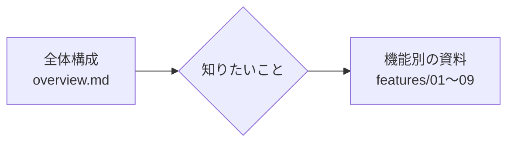

# 実装ドキュメント

ガントチャートの**実装がどう作られているか**を説明する資料の入口。

目的は 2 つ。

1. **プロジェクトの内容を把握する**（どこに何があり、なぜそうなっているか）
2. **実装について質問されたときに答えられるようにする**（コードのどこを見れば答えが分かるか、理由は何か）

要件や開発の経緯は `.plan/`（特に `.plan/handoff.md`）、セットアップと起動方法は [`../README.md`](../README.md)、開発ルールは [`../AGENTS.md`](../AGENTS.md) にある。この資料は「**コードの構造の説明**」に絞っている。

## 読む順番

1. まず **[全体構成](overview.md)** を読む（約 15 分）。層の分け方・データの流れ・状態の持ち場所・設計判断の理由がまとまっている。
2. そのあと、気になる機能の資料を読む。**各資料は単独で読める**ように書いてあり、冒頭に「主なファイル」と「関連する資料」を置いている。

## 全体の資料

| 資料                    | 内容                                                                                                                                                                                                        |
| ----------------------- | ----------------------------------------------------------------------------------------------------------------------------------------------------------------------------------------------------------- |
| [全体構成](overview.md) | このアプリは何か / 技術構成 / ディレクトリ / 層の分け方 / 画面が表示されるまで / 操作が保存されて反映されるまで / 状態の持ち場所の一覧 / データモデル / 設計判断とその理由 / テスト / 用語集 / よくある質問 |

## 機能別の資料

| #   | 資料                                                     | 扱う内容                                                                                                               | 主なファイル                                                                                                       |
| --- | -------------------------------------------------------- | ---------------------------------------------------------------------------------------------------------------------- | ------------------------------------------------------------------------------------------------------------------ |
| 1   | [データ層](features/01-data-layer.md)                    | 型・repository・localStorage への保存・検証・壊れたデータの扱い・スキーマの移行・Firestore への移行の道筋              | `gantt.type.ts` / `gantt.guards.ts` / `repositories/*` / `hooks/useMembers.ts` / `hooks/useProjects.ts`            |
| 2   | [日付と表示期間](features/02-date-and-timeline-range.md) | 日付の計算・日付と px の変換・表示期間と「今日」・無限スクロール                                                       | `utils/date.utils.ts` / `utils/layout.utils.ts` / `hooks/useTimelineRange.ts` / `hooks/useTimelineScroll.ts`       |
| 3   | [チャートの表示](features/03-chart-layout.md)            | 画面の構成・1 つのスクロール領域・行モデル（左右をそろえる仕組み）・左リスト・タイムライン・完了済みの表示・折りたたみ | `components/GanttChart/` / `ganttRows.utils.ts` / `components/MemberList*/` / `components/Timeline*/`              |
| 4   | [案件の編集](features/04-project-editing.md)             | サイドパネル・フォームの検証・保存・削除・完了・日付入力・確認ダイアログ                                               | `components/ProjectSidePanel/` / `components/DateField/` / `components/ConfirmDialog/` / `hooks/useSidePanel.ts`   |
| 5   | [担当者の管理](features/05-member-management.md)         | 管理ダイアログ・名前の編集・追加・削除・担当者名の検証                                                                 | `components/MemberManageDialog/` / `components/MemberManageRow/` / `hooks/useMemberManagement.ts`                  |
| 6   | [帯のドラッグ](features/06-bar-drag.md)                  | 帯の移動・伸縮・クリックとの区別・保存中の見た目・取り消し                                                             | `components/ProjectBar/` / `hooks/useBarPeriodChange.ts`                                                           |
| 7   | [並び替え](features/07-drag-reorder.md)                  | 案件・担当者のドラッグによる並び替え・完了済みを隠したときの扱い                                                       | `hooks/useDragReorder.ts` / `hooks/dragReorder.utils.ts` / `hooks/useProjectReorder.ts` / `components/DragHandle/` |
| 8   | [認証・PWA・開発環境](features/08-app-infrastructure.md) | Basic 認証・PWA・HTTPS での開発・環境変数・pnpm 縛り・品質ツール・ブランチ運用                                         | `src/proxy.ts` / `next.config.ts` / `src/app/*` / `public/sw.js` / `package.json`                                  |
| 9   | [スタイリング](features/09-styling.md)                   | デザイントークン・CSS Modules・ボタンの共通化・色とコントラスト                                                        | `src/styles/*` / `components/Button/`                                                                              |

## こんな質問が来たら（早見表）

| 質問                                                     | 答えのある資料                                                                                                                                                                    |
| -------------------------------------------------------- | --------------------------------------------------------------------------------------------------------------------------------------------------------------------------------- |
| データはどこに保存していますか？ 共有できますか？        | [データ層](features/01-data-layer.md) / [全体 §13](overview.md#13-よくある質問)                                                                                                   |
| 保存データが壊れたらどうなりますか？                     | [データ層「壊れたデータの扱い」](features/01-data-layer.md#6-壊れたデータの扱い)                                                                                                  |
| データの構造を変えたいときはどうしますか？               | [データ層「スキーマのバージョンと移行」](features/01-data-layer.md#7-スキーマのバージョンと移行)                                                                                  |
| Firestore に移すにはどうしますか？ 何に注意しますか？    | [データ層「Firestore への移行の道筋」](features/01-data-layer.md#11-firestore-への移行の道筋) / [`.plan/14-firestore-migration-todo.md`](../.plan/14-firestore-migration-todo.md) |
| 2 つのタブで同時に編集するとどうなりますか？             | [全体 §13](overview.md#13-よくある質問) / [`.plan/14-firestore-migration-todo.md`](../.plan/14-firestore-migration-todo.md)                                                       |
| 日付はなぜ文字列で持っているのですか？                   | [日付と表示期間](features/02-date-and-timeline-range.md#2-日付を文字列で持つ理由)                                                                                                 |
| 無限スクロールはどう実装していますか？                   | [日付と表示期間「無限スクロールの仕組み」](features/02-date-and-timeline-range.md#7-無限スクロールの仕組み)                                                                       |
| 夜 0 時をまたいで開きっぱなしにするとどうなりますか？    | [日付と表示期間 §6](features/02-date-and-timeline-range.md#6-表示期間と今日usetimelinerange)                                                                                      |
| 左リストとタイムラインの行がそろうのはなぜですか？       | [チャートの表示「行モデル」](features/03-chart-layout.md#5-行モデル左右をそろえる仕組み)                                                                                          |
| 新しい種類の行を足したいです                             | [チャートの表示「行モデル」](features/03-chart-layout.md#左右の描き方switch-の網羅チェック)                                                                                       |
| 完了済みの案件はどこで隠していますか？                   | [チャートの表示 §8](features/03-chart-layout.md#8-完了済みの表示非表示)                                                                                                           |
| サイドパネルの保存の流れは？ 失敗したら？                | [案件の編集 §4・§6](features/04-project-editing.md#4-パネルを開いてから保存するまで)                                                                                              |
| なぜ完了ボタンはフォームの内容と一緒に保存するのですか？ | [案件の編集 §6](features/04-project-editing.md#6-保存削除完了の処理)                                                                                                              |
| 担当者を削除すると案件はどうなりますか？                 | [担当者の管理 §8](features/05-member-management.md#8-削除)                                                                                                                        |
| 帯のドラッグとクリックはどう区別していますか？           | [帯のドラッグ §6](features/06-bar-drag.md#6-クリックとの区別)                                                                                                                     |
| 保存に失敗したら帯はどうなりますか？                     | [帯のドラッグ §8](features/06-bar-drag.md#8-保存中の見た目と失敗したときの戻し方)                                                                                                 |
| なぜ編集中の帯はドラッグできないのですか？               | [帯のドラッグ](features/06-bar-drag.md#11-編集中の帯はドラッグできない)                                                                                                           |
| 並び替えで、完了済みを隠していると何が起きますか？       | [並び替え §8](features/07-drag-reorder.md#8-案件の並び替え完了済みを隠しているとき)                                                                                               |
| 本番で 401 しか返りません                                | [認証・PWA・開発環境「Basic 認証」](features/08-app-infrastructure.md#2-basic-認証srcproxyts)                                                                                     |
| なぜ `npm install` は止まりますか？                      | [認証・PWA・開発環境「pnpm 以外を止める仕組み」](features/08-app-infrastructure.md#7-pnpm-以外を止める仕組み)                                                                     |
| PWA はどう実現していますか？ オフラインは？              | [認証・PWA・開発環境 §4](features/08-app-infrastructure.md#4-pwa)                                                                                                                 |
| ボタンのスタイルはどう使い分けますか？                   | [スタイリング「ボタン」](features/09-styling.md#6-ボタン)                                                                                                                         |
| 色を変えるときの注意は？                                 | [スタイリング §7](features/09-styling.md#7-色とコントラスト)                                                                                                                      |

## 資料の書き方（共通）

- **図**は Mermaid（GitHub 上でそのまま描画される）。シーケンス図は「誰が誰を呼ぶか」、フローチャートは「条件による分岐」を表す。
- **関数・ファイルの名前はコードの名前のまま**書いてある。検索（`Grep`）でそのまま見つけられる。
- 「**なぜそうしたか**」を、仕様の説明と同じくらい重視して書いている（質問されたときに理由を答えられるように）。
- 各資料の最後に**よくある質問**がある。

## 資料を更新するとき

コードを変えたら、**関係する資料も更新する**。

| 変えたもの                                  | 見直す資料                                                                                                                           |
| ------------------------------------------- | ------------------------------------------------------------------------------------------------------------------------------------ |
| `IMember` / `IProject` の構造・保存の仕組み | [データ層](features/01-data-layer.md)・[全体 §9](overview.md#9-データモデル)・スキーマのバージョン（`CURRENT_SCHEMA_VERSION`）の履歴 |
| 定数（列幅・既定の日数など）                | [日付と表示期間 §5](features/02-date-and-timeline-range.md#5-定数の一覧)                                                             |
| 行の種別・画面の部品                        | [チャートの表示](features/03-chart-layout.md)・[全体 §3](overview.md#3-ディレクトリ構成)                                             |
| ドラッグの挙動                              | [帯のドラッグ](features/06-bar-drag.md)・[並び替え](features/07-drag-reorder.md)                                                     |
| トークン・ボタンの mixin                    | [スタイリング](features/09-styling.md)                                                                                               |
| ディレクトリ構成・規約                      | [全体構成](overview.md)・`AGENTS.md`                                                                                                 |

> この資料は `develop` ブランチ時点（フェーズ 1〜12 完了後）のコードに基づいている。テストの件数（約 300 件）などの数字は、変わったら直す。
