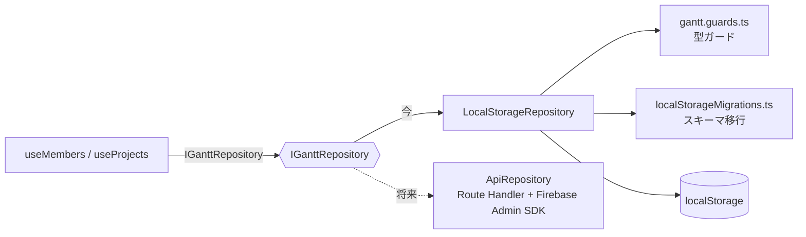
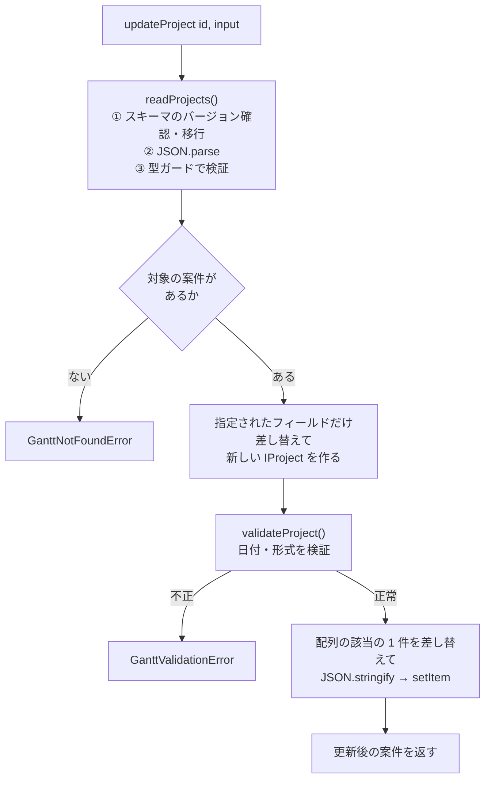
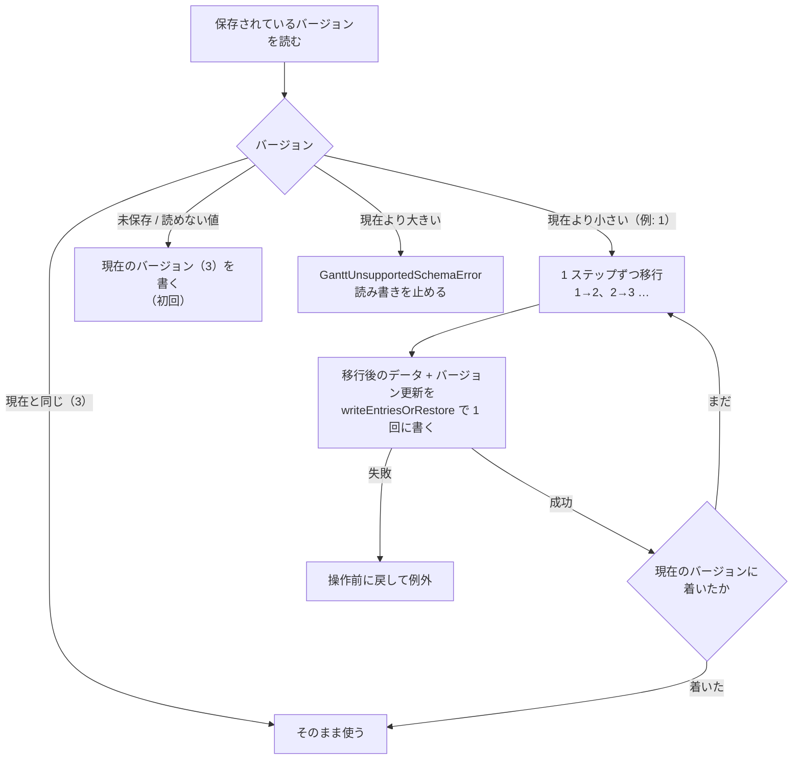

# データ層（型・repository・保存・移行）

担当者と案件を「どう表し、どう保存し、どう守るか」の資料。画面の外側（データ）の話で、React は出てこない（フック `useMembers` / `useProjects` との接点だけ最後に触れる）。

- 主なファイル: `src/features/gantt/gantt.type.ts` / `gantt.constants.ts` / `gantt.guards.ts` / `repositories/*` / `devSeed.ts`
- 関連する資料: [全体構成](../overview.md#9-データモデル)、[Firestore 移行時の宿題](../../.plan/14-firestore-migration-todo.md)

## 目次

1. [全体像](#1-全体像)
2. [型](#2-型)
3. [repository のインターフェース](#3-repository-のインターフェース)
4. [LocalStorageRepository の仕組み](#4-localstoragerepository-の仕組み)
5. [検証（型ガードと validate）](#5-検証型ガードと-validate)
6. [壊れたデータの扱い](#6-壊れたデータの扱い)
7. [スキーマのバージョンと移行](#7-スキーマのバージョンと移行)
8. [エラーの種類と画面での扱い](#8-エラーの種類と画面での扱い)
9. [`useMembers` / `useProjects` との接点](#9-usemembers--useprojects-との接点)
10. [開発用のサンプルデータ](#10-開発用のサンプルデータ)
11. [Firestore への移行の道筋](#11-firestore-への移行の道筋)
12. [よくある質問](#12-よくある質問)

---

## 1. 全体像

- **窓口は `IGanttRepository` だけ**。フックやコンポーネントは localStorage を直接触らない。
- **実装の切り替えは 1 か所**: `repositories/createGanttRepository.ts` の戻り値だけを変えればよい。
- **すべてのメソッドが `Promise` を返す**。localStorage は同期処理だが、将来の Firestore 版（API 経由）に差し替えても呼び出し側を変えずに済むようにするため。

---

## 2. 型

`gantt.type.ts` に集約している。

### データの型

| 型            | 役割                                                                                                                                    |
| ------------- | --------------------------------------------------------------------------------------------------------------------------------------- |
| `TDateString` | `"YYYY-MM-DD"` の文字列（中身は `string`。日時と区別するための別名）                                                                    |
| `TBarColor`   | 帯の色のキー（`"blue" \| "green" \| "orange" \| "purple" \| "red" \| "gray"`）                                                          |
| `IMember`     | 担当者: `id` / `name` / `sortOrder` / `createdAt` / `updatedAt`                                                                         |
| `IProject`    | 案件: `id` / `memberId` / `name` / `startDate` / `endDate` / `color` / `note` / `sortOrder` / `completedAt` / `createdAt` / `updatedAt` |

### 入力の型

| 型               | 内容                                                                                        | 補足                                                    |
| ---------------- | ------------------------------------------------------------------------------------------- | ------------------------------------------------------- |
| `TMemberInput`   | `Pick<IMember, "name">`                                                                     | `id`・`sortOrder`・日時は repository が付ける           |
| `TMemberUpdate`  | `Partial<TMemberInput>`                                                                     | 指定したフィールドだけ書き換える                        |
| `TProjectInput`  | `IProject` から `id` / `sortOrder` / `completedAt` / `createdAt` / `updatedAt` を除いたもの | 追加した案件は必ず未完了なので `completedAt` も含めない |
| `TProjectUpdate` | `Partial<TProjectInput> & { isCompleted?: boolean }`                                        | 完了の状態は日時ではなく `isCompleted` で指定する       |

**なぜ `sortOrder` が更新の入力に含まれないのか**: 並び順を変えるのは `reorderMembers` / `reorderProjects` だけにして、「ふつうの更新で並びが壊れる」ことを防ぐため。

**なぜ `completedAt` を入力で受けないのか**: 日時を作るのは `createdAt` / `updatedAt` と同じく repository の責務にするため。呼び出し側は `isCompleted: true / false` だけ渡す。

### サイドパネルの状態（データではない）

`TSidePanelState`（`"closed"` / `"create"`（`defaultMemberId` 付き）/ `"edit"`（`projectId` 付き））もこのファイルにある。これは保存するデータではなく画面の状態だが、複数のフック・コンポーネントが参照するのでここに置いている。

### 色の定義

`gantt.constants.ts` の `BAR_COLORS` が、色のキー → 表示名 + CSS 変数名の対応を持つ。`Record<TBarColor, ...>` なので、色のキーを増減して対応を書き忘れると型エラーになる。実際の色の値は `_tokens.scss` にある（[スタイリング](09-styling.md)）。

---

## 3. repository のインターフェース

`repositories/ganttRepository.type.ts` の `IGanttRepository`。

### 担当者

| メソッド                     | 動き                                                                                               |
| ---------------------------- | -------------------------------------------------------------------------------------------------- |
| `listMembers()`              | `sortOrder` の昇順で返す                                                                           |
| `createMember(input)`        | 追加。表示順は一番下                                                                               |
| `updateMember(id, input)`    | 名前を書き換える                                                                                   |
| `reorderMembers(orderedIds)` | 渡した id の並びのとおりに `sortOrder` を 0 から付け直す。**全担当者の id を過不足なく**含めること |
| `deleteMember(id)`           | 削除。**配下の案件もまとめて削除する**                                                             |

### 案件

| メソッド                                | 動き                                                                                                                     |
| --------------------------------------- | ------------------------------------------------------------------------------------------------------------------------ |
| `listProjects()`                        | 保存順で返す（担当者内の表示順は画面側が `sortOrder` を見て並べる）                                                      |
| `createProject(input)`                  | 追加。担当者の中の一番下に入る。担当者がいなければ `GanttNotFoundError`                                                  |
| `updateProject(id, input)`              | 指定したフィールドだけ書き換える。担当者を付け替えると付け替え先の一番下に入る。`isCompleted` で完了・未完了を切り替える |
| `reorderProjects(memberId, orderedIds)` | その担当者の案件の `sortOrder` を付け直す。**その担当者の案件の id を過不足なく**含めること                              |
| `deleteProject(id)`                     | 削除                                                                                                                     |

### 契約（どんなときにどのエラーを投げるか）

- 存在しない id → `GanttNotFoundError`
- 入力が不正（開始日が終了日より後など）→ `GanttValidationError`
- 保存データがアプリより新しい構造 → `GanttUnsupportedSchemaError`
- 保存データが壊れている → `GanttCorruptedDataError`

---

## 4. LocalStorageRepository の仕組み

`repositories/localStorageRepository.ts`。

### 保存の形

| キー                  | 値                                           |
| --------------------- | -------------------------------------------- |
| `gantt:members`       | 担当者の配列を `JSON.stringify` したもの     |
| `gantt:projects`      | 案件の配列を `JSON.stringify` したもの       |
| `gantt:schemaVersion` | 保存データの構造のバージョン（数値の文字列） |

キーは `gantt.constants.ts` の `STORAGE_KEYS` にある。

### 1 回の操作の流れ

どのメソッドも「**読む → 検証する → 加工する → 検証する → 書く**」の形になっている。例: `updateProject`。

### 読み込み（`readList`）

- 未保存（`null`）なら空配列。
- `JSON.parse` に失敗 → `GanttCorruptedDataError`（コンソールに元の値を警告として残す）。
- 型ガード（`isMemberList` / `isProjectList`）を通らない → `GanttCorruptedDataError`。**配列の中に不正な要素が 1 件でもあれば全体を拒否**する。
- 読み込みの前に必ず `getPreparedStorage()` を通る。これが **スキーマのバージョン確認・移行**を毎回行う（[§7](#7-スキーマのバージョンと移行)）。

### 書き込みと「操作前に戻す」仕組み

localStorage には複数のキーをまとめて書くトランザクションがない。そこで、複数キーを書く処理は `writeEntriesOrRestore` を使う。

1. 書く前に、対象キーの**今の値を控える**（未保存だったキーは `null` として控える）。
2. キーを順に `setItem` する。
3. 途中で失敗したら、**書き込みに成功したキーだけを控えた値に戻し**、元のエラーを投げ直す（戻すのにも失敗したときは `AggregateError`）。

これを使うのは次の 2 か所:

- **担当者の削除**（担当者と案件の 2 キーを書き換える）。途中で失敗しても、担当者だけ消えて案件が残る（または逆）状態を作らない。
- **スキーマの移行**（移行後の案件とバージョンの更新を 1 回で書く）。

Firestore 版では、同じ処理を batch 書き込みで 1 回にまとめる想定。

### ID・日時・並び順の決め方

| 項目                             | 決め方                                                                                                           |
| -------------------------------- | ---------------------------------------------------------------------------------------------------------------- |
| `id`                             | `crypto.randomUUID()`（`generateId`）                                                                            |
| `createdAt` / `updatedAt`        | `new Date().toISOString()`（`getCurrentDateTime`）                                                               |
| 追加時の `sortOrder`             | `getNextSortOrder`: 対象の一覧の最大値 + 1（空なら 0）。担当者は全員、案件は**追加先の担当者の案件だけ**で数える |
| 担当者の付け替え時の `sortOrder` | 付け替え先の一番下。**付け替え元の `sortOrder` は詰め直さない**（飛び番があっても並びは変わらないため）          |

### 完了の状態（`resolveCompletedAt`）

`updateProject` に渡す `isCompleted` と現在の `completedAt` から、更新後の `completedAt` を決める。

| `isCompleted` | 現在が未完了（`null`） | 現在が完了済み                                       |
| ------------- | ---------------------- | ---------------------------------------------------- |
| 省略          | `null`（変えない）     | 今の日時のまま                                       |
| `true`        | **今の日時**を入れる   | 今の日時のまま（**最初に完了にした日時を変えない**） |
| `false`       | `null`                 | `null`（未完了に戻す）                               |

### 入力の「拾い直し」

`updateMember` / `updateProject` / `createProject` は、渡された `input` をそのまま展開せず、**書き換えてよいフィールドだけを 1 つずつ拾って**新しいオブジェクトを作る。`input` に `id` など余計なキーが混ざっていても上書きされない。

### 並び替え（`reorderMembers` / `reorderProjects`）

渡された順に `sortOrder` を 0 から振り直す。

- 順番が変わらない行は `updatedAt` も変えない（無駄な更新を避ける）。
- **id の重複**・**対象外の id**・**件数の不足**は `GanttValidationError`（案件の場合、別の担当者の案件の id は「この担当者の案件ではない」として扱う）。
- 案件の並び替えでは、**配列の保存順は変えず**、並び替えた案件だけを差し替える。

---

## 5. 検証（型ガードと validate）

検証は 2 段階ある。

### ① 型ガード（`gantt.guards.ts`）— 外から読んだ値を信用しないため

localStorage は開発者ツールで書き換えられたり、古い構造のデータが残ったりする。`JSON.parse` した値は `unknown` として受け、型ガードで確かめてから使う。

| 関数                             | 確かめること                                                                                                                                      |
| -------------------------------- | ------------------------------------------------------------------------------------------------------------------------------------------------- |
| `isDateString`                   | `"YYYY-MM-DD"` の形で、**かつ実在する日付**か（`2026-02-30` や `2026-13-01` は不可）。UTC の `Date` に組み立て直して年・月・日が戻るかで判定      |
| `isBarColor`                     | 色プリセットのキーか（プリセットを減らした後に古いキーが残っていても弾く）                                                                        |
| `isMember`                       | `id` が空でない文字列 / `name` が文字列 / `sortOrder` が有限の数値 / 日時が読める                                                                 |
| `isProject`                      | 上に加えて、`memberId` が空でない / 日付が実在し**開始日 ≦ 終了日** / 色が有効 / `sortOrder` が **0 以上の整数** / `completedAt` が `null` か日時 |
| `isMemberList` / `isProjectList` | 配列で、**全要素**が上の型ガードを通る                                                                                                            |

**各ガードに「なぜその検証が必要か」のコメントが付いている**（例: 開始日が終了日より後だと帯の幅が負になって描画が壊れる）。

### ② validate（repository の書き込み前）— データを守る最後の砦

`validateMember` / `validateProject` が、保存する直前に確かめる。画面側（フォーム）でも同じ検証をするが、repository でも確かめる。`validateProject` は、よくある誤り（日付の形式・前後関係）を**個別のメッセージ**にしてから、残りを `isProject` でまとめて確かめる。

### 検証の役割分担

| 検証                    | どこで                                              | 何を                                                    |
| ----------------------- | --------------------------------------------------- | ------------------------------------------------------- |
| 案件名の必須・100 文字  | `projectForm.utils.ts`（画面）                      | **repository は名前の中身を見ない**ので、画面が唯一の砦 |
| 担当者名の必須・50 文字 | `memberName.utils.ts`（画面）                       | 同上                                                    |
| 日付の実在・前後関係    | 画面と repository の両方                            | データの整合性                                          |
| 担当者の存在            | 画面（選択肢）と repository（`assertMemberExists`） | 他のタブで削除された場合に備える                        |

---

## 6. 壊れたデータの扱い

**方針: 壊れたデータを「空」として扱わない。読み書きの両方を止める。**

もし「読めなかったら空配列」にすると、画面は普通の空状態になり、そこで担当者を 1 人追加した瞬間に、新しい 1 件だけの配列が元のキーを**上書き**してしまう。正常だった分のデータもまとめて失う。

そのため:

1. 壊れていると判断したら `GanttCorruptedDataError` を投げる。
2. **元のデータは localStorage に残したまま**にする（バージョンも進めない）。
3. 元の値はコンソールの警告に出す（手で復旧できるように）。
4. 画面は「データを読み込めませんでした」を出し、再読み込みボタンを置く。

壊れていると判断する条件:

| 条件                                  | 例                                         |
| ------------------------------------- | ------------------------------------------ |
| JSON として読めない                   | 手で書き換えて壊れた                       |
| 配列でない / 要素が型ガードを通らない | 1 件でも不正があれば全体を拒否             |
| 移行できない                          | 移行元のバージョンの形に合わない案件がある |

> 画面から「壊れたデータを退避して空で始める」ボタンは、オーナーの判断で**今は付けていない**（身内利用のため。復旧は開発者ツールで手で行う）。

---

## 7. スキーマのバージョンと移行

保存データの構造を変えたときに、古いデータを新しい構造へ書き換えるための仕組み。

### バージョンの履歴

`gantt.constants.ts` の `CURRENT_SCHEMA_VERSION`（現在 **3**）。

| バージョン | 内容                                                  |
| ---------- | ----------------------------------------------------- |
| 1          | 最初の構造                                            |
| 2          | 案件に担当者内の表示順 `sortOrder` を追加             |
| 3          | 案件に完了日時 `completedAt`（未完了は `null`）を追加 |

### 読み書きのたびに確認する

`getPreparedStorage()` が、**読み書きの前に毎回** `migrateSchemaIfNeeded` を呼ぶ。結果を覚えずに毎回確かめるのは、古いタブを開いたまま別のタブで新しいアプリがデータを移行したときに、古いタブからの読み書きを止めるため（バージョンを 1 つ読むだけなので負担は小さい）。

- **新しすぎるバージョン**は、新しいアプリで保存したデータを古いアプリ（ロールバック後など）で読む場面。読めば型ガードに合わず空として扱われ、次の書き込みで上書きしてしまうので、読み書きを止める。
- **1 ステップ終えるごとにバージョンも進める**ので、途中の段階で失敗しても、済んだ分をやり直さない。

### 移行処理の書き方（`localStorageMigrations.ts` の約束）

`SCHEMA_MIGRATIONS`（`localStorageRepository.ts`）に `{移行元のバージョン}: (storage) => IStorageEntry[]` の形で登録する。現在は `1: migrateSchemaV1ToV2`、`2: migrateSchemaV2ToV3`。

移行処理を書くときの約束（ファイルの先頭にも書いてある）:

1. **今の型や型ガードを使わない**。`isProject` は構造が変わるたびに書き換わるので、昔のバージョンのデータを確かめると全部「形が違う」になる。移行元の構造を、移行ファイルの中で確かめる（`isProjectV1` / `isProjectV2`）。
2. **repository のメソッドを呼ばない**。メソッドは読み書きの前に移行を確かめるので、移行の中から呼ぶと無限に再帰する。渡された `Storage` を直接読む。
3. **Storage に書き込まず、「書き込む内容」を返す**。書き込みは呼び出し側が、バージョンの更新と一緒に 1 回で行う（途中で失敗したら操作前に戻る）。
4. **移行の前に、案件の全件を「移行元の形」として検証する**。1 件でも外れていれば、案件もバージョンも変えずに `GanttCorruptedDataError`。これは次を防ぐため:
   - 不正なデータにも移行の結果を書き足してバージョンを進め、後の読み込みで初めて不正と分かる
   - バージョンの値だけが古く壊れていて、案件はすでに新しい形のとき、足すフィールドを既存の値の上から `null` で上書きしてしまう（だから、足すフィールドをすでに持つ案件も「移行元の形ではない」として止める）

### 各移行の中身

**1 → 2（`sortOrder` を振る）**: バージョン 1 の画面と同じ並び（担当者ごとに開始日順 → 終了日順。同じなら保存順）で、担当者ごとに 0 から番号を振る。移行の直後に見た目の並びが変わらない。担当者が見つからない案件（`memberId` が不正）にも番号を振る（画面には出ないがデータとしては残るため）。

**2 → 3（`completedAt` を足す）**: すべて未完了（`null`）にする。

### 構造を変えるときの手順

1. `IMember` / `IProject` の型を変える。
2. `CURRENT_SCHEMA_VERSION` を 1 つ上げ、履歴のコメントに追記する。
3. `localStorageMigrations.ts` に、旧バージョンの構造を前提にした移行関数を足す。
4. `SCHEMA_MIGRATIONS` に `{旧バージョン}: 移行関数` を登録する。
5. `gantt.guards.ts` の型ガードを新しい構造に合わせる。
6. `localStorageRepository.test.ts` に移行のテスト（正常・壊れたデータ・書き込み失敗）を足す。

---

## 8. エラーの種類と画面での扱い

`repositories/ganttRepository.errors.ts` に 4 種類ある。

| エラー                                                                | 投げる場面                                                       | 画面での扱い                                                                                                                      |
| --------------------------------------------------------------------- | ---------------------------------------------------------------- | --------------------------------------------------------------------------------------------------------------------------------- |
| `GanttNotFoundError`（`entity` と `id` を持つ）                       | 存在しない id の更新・削除・並び替え、存在しない担当者の指定     | 保存系は各画面のエラー表示（パネル内・ダイアログ内・お知らせ）にメッセージが出る                                                  |
| `GanttValidationError`                                                | 入力が不正（日付の形式・前後関係、並び替えの id の過不足・重複） | 同上。画面側の検証が先に止めるので、通常は出ない                                                                                  |
| `GanttUnsupportedSchemaError`（`storedVersion` / `supportedVersion`） | 保存データがアプリより新しい構造                                 | 読み込みの失敗として全画面のエラー                                                                                                |
| `GanttCorruptedDataError`（`key`）                                    | 保存データが壊れている・移行できない                             | 読み込みの失敗として全画面のエラー（「元のデータは消していません。…開発者ツールで localStorage の値を確認して復旧してください」） |

読み込みの失敗は、`useMembers` / `useProjects` が `Error` を state に載せ → `useGanttPage` の `loadError` → `useGanttChart` が `status: "error"` を返し → `GanttChart` が「データを読み込めませんでした。{メッセージ}」と**再読み込みボタン**（`retryLoad`。担当者と案件の両方を読み直す）を出す。

---

## 9. `useMembers` / `useProjects` との接点

repository の呼び出し側は、この 2 つのフック（`hooks/useMembers.ts` / `hooks/useProjects.ts`）。

- **`null` と `[]` を区別**: `null` は「まだ読み込めていない」、`[]` は「0 件」。
- **初回の読み込みは `useEffect`**: localStorage はサーバー側で読めないため。アンマウント後に結果が返っても state を更新しない（`isCancelled`）。
- **操作は「保存してから state を更新」**: たとえば `updateProject` は `repository.updateProject` の戻り値（更新後の案件）で、一覧の該当の 1 件を差し替える。**失敗したら state を変えず、例外をそのまま投げる**（呼び出し側が表示する）。
- **`reloadMembers` / `reloadProjects`**: 読み込み直し。エラーは例外にせず state に載せる（再読み込みボタンから呼ぶため）。
- **担当者の削除**: repository が配下の案件も消すので、`useMemberManagement` が `removeProjectsOfMember` で手元の案件の一覧からも取り除く（読み込み直さないのは、削除が済んだ後に再読み込みの失敗を挟まないため）。

---

## 10. 開発用のサンプルデータ

`devSeed.ts` の `seedSampleData(repository)`。担当者が 0 人の空の画面に、**開発ビルドのときだけ**「サンプルデータを入れる（開発用）」ボタンが出る（`useGanttPage` の `CAN_SEED_SAMPLE_DATA = process.env.NODE_ENV !== "production"`）。

- 担当者 3 人（田中・佐藤・鈴木）と案件 6 件を `repository` 経由で保存する（既存のデータは消さず追加するだけ）。
- 日付は**今日からの相対**なので、いつ実行しても同じ並びになる。
- 次のケースを含む: 月またぎ・初期の表示期間の前後にはみ出す案件・表示期間外の案件・1 日だけの案件・案件のない担当者。はみ出す・期間外の判定は、初期の表示期間の定数（`DEFAULT_RANGE_DAYS` など）を基準にしている。
- やり直すときは、ブラウザの localStorage の `gantt:*` を消す。

---

## 11. Firestore への移行の道筋

`createGanttRepository.ts` のコメントに手順がある。

1. `src/app/api/` に Route Handler を作り、**サーバー側だけで** Firebase Admin SDK を使って Firestore を読み書きする。Firebase の設定値やサービスアカウントに `NEXT_PUBLIC_` を付けず、クライアントに含めない。
2. `IGanttRepository` を実装した `ApiRepository`（`fetch` で Route Handler を呼ぶ）を `repositories/` に作る。レスポンスは `unknown` で受け、`gantt.guards.ts` の型ガードで検証する。
3. `createGanttRepository` の戻り値を `new ApiRepository()` に替える。呼び出し側のコードは変えなくてよい。

そのほか、Firestore の Security Rules は**クライアントからのアクセスをすべて拒否**にする方針。**移行時に必ず対応する事項（複数タブ・複数人の同時編集による上書きなど）**は [`.plan/14-firestore-migration-todo.md`](../../.plan/14-firestore-migration-todo.md) にまとめてある。

---

## 12. よくある質問

**Q. なぜ全部のメソッドが `Promise` を返すのですか？**
localStorage は同期ですが、Firestore（API 経由）は非同期です。差し替えたときに呼び出し側を書き換えずに済むようにするためです。

**Q. 「保存してから state を更新」だと、遅くなりませんか？**
localStorage は即座に終わるので体感の差はありません。Firestore に替えたときに遅くなる場合は、楽観的更新の導入を検討する余地があります（今は、失敗したときに画面と保存データがずれない安全さを優先しています）。

**Q. データが壊れたらどうなりますか？ 自動で直りますか？**
自動では直しません。読み書きを止めて元のデータを残し、「データを読み込めませんでした」を出します。開発者ツールで `gantt:members` / `gantt:projects` の値を確認して復旧します（コンソールに元の値が警告として出ています）。

**Q. `sortOrder` の欠番（飛び番）は問題ないですか？**
問題ありません。表示は `sortOrder` の**大小**だけで決まるので、担当者を付け替えて元の担当者に飛び番ができても並びは変わりません。並び替えをすると 0 から振り直されます。

**Q. `completedAt` の「完了日時」は何に使っていますか？**
「完了済みかどうか」の判定（`!== null`）と、サイドパネルの「完了済み（10/30）」の表示に使っています。タイムゾーンは端末のものを使って表示します（保存は UTC の ISO 8601）。

**Q. `crypto.randomUUID()` で困ることはありますか？**
HTTPS か `localhost` でしか使えません。`pnpm dev:http` に LAN の IP（スマホ実機など）で接続すると `undefined` になり、担当者・案件の追加で `TypeError` になります。実機で確認するときは `pnpm dev`（HTTPS）を使います（`generateId` にも `MEMO:` があります）。
