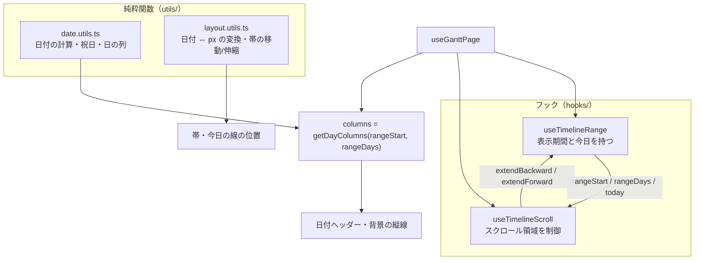
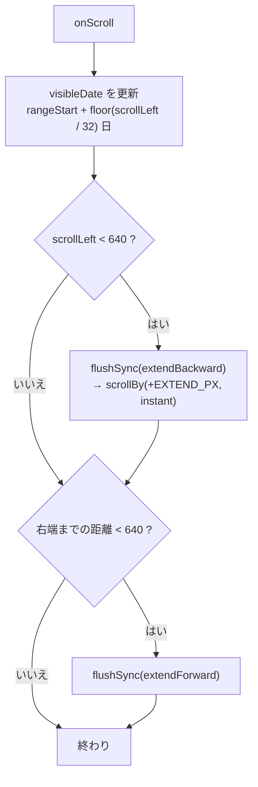

# 日付と表示期間（日付計算・座標・無限スクロール）

「日付をどう扱い、どの範囲をタイムラインに用意し、スクロールでどう広げるか」の資料。チャートの横軸の仕組み全体にあたる。

- 主なファイル:
  - 日付・座標の純粋関数: `utils/date.utils.ts` / `utils/layout.utils.ts`
  - 表示期間と今日: `hooks/useTimelineRange.ts`
  - スクロール制御: `hooks/useTimelineScroll.ts`
  - 定数: `gantt.constants.ts`
- 関連する資料: [チャートの表示](03-chart-layout.md)（この仕組みの上に日付ヘッダー・帯が載る）、[帯のドラッグ](06-bar-drag.md)（`pxToDays` などを使う）

## 目次

1. [全体像](#1-全体像)
2. [日付を文字列で持つ理由](#2-日付を文字列で持つ理由)
3. [日付ユーティリティ（`date.utils.ts`）](#3-日付ユーティリティdateutilsts)
4. [座標の計算（`layout.utils.ts`）](#4-座標の計算layoututilsts)
5. [定数の一覧](#5-定数の一覧)
6. [表示期間と「今日」（`useTimelineRange`）](#6-表示期間と今日usetimelinerange)
7. [無限スクロールの仕組み](#7-無限スクロールの仕組み)
8. [ボタン操作（今日・前へ・次へ）](#8-ボタン操作今日前へ次へ)
9. [数値で追う例](#9-数値で追う例)
10. [よくある質問](#10-よくある質問)

---

## 1. 全体像



- 「**どの日付を何日分用意するか**」を `useTimelineRange` が持ち、「**今どこを見ているか・端に近づいたら広げる**」を `useTimelineScroll` が持つ。2 つは `useGanttPage` で結ばれる。
- 日付の計算と、日付と px の変換は **純粋関数**に切り出してテストしている（`utils/date.utils.test.ts` / `utils/layout.utils.test.ts`）。

---

## 2. 日付を文字列で持つ理由

日付は **`"YYYY-MM-DD"` の文字列**（型名 `TDateString`）で受け渡し、`Date` は `date.utils.ts` の関数の内側でだけ扱う。

- **タイムゾーンのずれを避ける**: `Date` を UTC で作ると、日本時間の早朝に日付が前日になる。文字列ならずれない。
- **JSON / Firestore との相互変換が単純**: `Date` はそのまま JSON にできない。
- **文字列のまま大小比較できる**: `"YYYY-MM-DD"` は桁数が揃っているので、`startDate <= endDate` のように比較するだけで日付の前後が分かる（コードのあちこちでこの性質を使っている）。

`Date` を作るときは **ローカル時刻**で組み立てる（`parseDateString`）。日数の計算には「カレンダー上の日数差」（`differenceInCalendarDays`）を使い、夏時間など 24 時間でない日があっても 1 日ずれないようにしている。

---

## 3. 日付ユーティリティ（`date.utils.ts`）

| 関数                           | 役割                                                                                                                                                                                         |
| ------------------------------ | -------------------------------------------------------------------------------------------------------------------------------------------------------------------------------------------- |
| `toDateString(date)`           | `Date` → `"YYYY-MM-DD"`（ローカル時刻の年月日）                                                                                                                                              |
| `parseDateString(value)`       | `"YYYY-MM-DD"` → その日のローカル 0 時の `Date`。**厳密な形式以外は `RangeError`**（date-fns の `parse` は `2026-1-5` も受け付けるので、変換結果を文字列に戻して元と一致するか確かめている） |
| `getToday()`                   | 今日の `"YYYY-MM-DD"`                                                                                                                                                                        |
| `addDays(value, days)`         | 日付に日数を足す（マイナスで引く）                                                                                                                                                           |
| `diffInDays(from, to)`         | `to` が `from` の何日後か（前ならマイナス、同日なら 0）                                                                                                                                      |
| `getDateRange(start, days)`    | `start` から `days` 日分の日付の配列（`days` が 0 以下なら空配列）                                                                                                                           |
| `isWeekend` / `isSaturday`     | 土日か / 土曜か                                                                                                                                                                              |
| `getHolidayName` / `isHoliday` | 祝日名（振替休日・国民の休日を含む）/ 祝日か。`@holiday-jp/holiday_jp` を使う                                                                                                                |
| `formatYearMonth(value)`       | `"2026-10-29"` → `"2026年10月"`                                                                                                                                                              |
| `getDayColumns(start, days)`   | 日の列の情報（`IDayColumn`）の配列を作る                                                                                                                                                     |
| `getMonthSegments(columns)`    | 日の列を、同じ月が続く区間にまとめる（日付ヘッダーの月の行用）                                                                                                                               |

### `IDayColumn`（日の列 1 つぶん）

日付ヘッダーと背景の色分けに使う。

| フィールド     | 意味                                                                 |
| -------------- | -------------------------------------------------------------------- |
| `date`         | `"YYYY-MM-DD"`                                                       |
| `isWeekend`    | 土曜・日曜か                                                         |
| `isSaturday`   | 土曜か（土曜は青、日曜と祝日は赤で色分けするため、土日とは別に持つ） |
| `isMonthStart` | 月の 1 日か（月の区切り線を引く列）                                  |
| `holidayName`  | 祝日名（祝日でなければ `null`）                                      |

### `getMonthSegments` の動き

日の列を先頭から見て、`"YYYY-MM"` が同じ間は日数を数え、変わったら新しい区間を作る。

```
列: 10/29 10/30 10/31 11/1 11/2 …
→  [{ key:"2026-10", label:"2026年10月", days:3 }, { key:"2026-11", label:"2026年11月", days:30 }, …]
```

---

## 4. 座標の計算（`layout.utils.ts`）

「日付 ⇔ px」の変換と、帯の期間の操作。日付そのものの計算は `date.utils.ts` に任せる。

### 帯の位置と幅（`getBarLayout`）

案件の期間と表示期間から、帯の左端（px）・幅（px）・どちら側が切れているかを求める。

```
rangeStart = 10/1、rangeDays = 100、DAY_COLUMN_WIDTH = 32 の場合

案件 10/3 〜 10/5:
  startIndex = 2, endIndex = 4
  left = 2 × 32 = 64、width = (4 − 2 + 1) × 32 = 96
  isClippedStart = false、isClippedEnd = false

案件 9/28 〜 10/3（開始が表示期間より前）:
  startIndex = −3, endIndex = 2
  visibleStartIndex = max(−3, 0) = 0、visibleEndIndex = min(2, 99) = 2
  left = 0、width = 3 × 32 = 96
  isClippedStart = true   ← 左側が切れている（角を丸めない・左の伸縮つかみを出さない）

案件が表示期間にまったく入らない:
  visibleStartIndex > visibleEndIndex → null（帯を描かない）
```

戻り値 `IBarLayout`: `left` / `width` / `isClippedStart` / `isClippedEnd`。

### その他の関数

| 関数                                            | 役割                                                                                                                                 |
| ----------------------------------------------- | ------------------------------------------------------------------------------------------------------------------------------------ |
| `isRangeOverlapping(...)`                       | 案件の期間が表示期間と 1 日でも重なるか（端の日を含む）                                                                              |
| `getTodayOffset(rangeStart, rangeDays, today?)` | 今日の列の**左端**の位置（px）。表示期間の外なら `null`（線を描かない）                                                              |
| `pxToDays(deltaPx)`                             | ドラッグの移動量（px）を日数に変換する。列幅の半分以上動いたら 1 日（`Math.round`）。**ちょうど半分のときは 0 から遠い側**にそろえる |
| `moveProjectDates(period, days)`                | 期間の長さを保ったまま `days` 日動かした開始日・終了日                                                                               |
| `resizeProjectDates(period, edge, days)`        | 片端だけ動かす。**反対側の端は動かさず、開始日 ≦ 終了日（最短 1 日）を保つ**。追い越しそうなときは反対側の端で止める                 |

型: `TBarEdge`（`"start" \| "end"`）、`TProjectPeriod`（`Pick<IProject, "startDate" \| "endDate">`）。

> 今日の線は列の**中央**に引くので、`getTodayOffset` が返す左端に `DAY_COLUMN_WIDTH / 2` を足している（`useTodayLine`）。

---

## 5. 定数の一覧

`gantt.constants.ts`。タイムラインの挙動を変えるときはまずここ。

| 定数                        | 値  | 意味                                                       |
| --------------------------- | --- | ---------------------------------------------------------- |
| `DAY_COLUMN_WIDTH`          | 32  | 1 日分の列幅（px）                                         |
| `DEFAULT_RANGE_DAYS_BEFORE` | 60  | 初期状態で、今日より前に用意する日数                       |
| `DEFAULT_RANGE_DAYS`        | 180 | 初期状態で用意する合計の日数（今日より前の分を含む）       |
| `RANGE_EXTEND_DAYS`         | 90  | 端に近づいたとき、一度に広げる日数                         |
| `RANGE_EDGE_THRESHOLD_PX`   | 640 | スクロール位置が端からこの距離より近づいたら広げる         |
| `RANGE_SHIFT_DAYS`          | 14  | 「前へ」「次へ」1 回でスクロールする日数                   |
| `TODAY_SCROLL_MARGIN_DAYS`  | 7   | 初期表示と「今日」ボタンで、今日の列より左に見せておく日数 |
| `DRAG_THRESHOLD_PX`         | 4   | 帯のドラッグ・並び替えで、これ未満の移動はクリックとみなす |

---

## 6. 表示期間と「今日」（`useTimelineRange`）

タイムラインに用意する日付の範囲（`rangeStart` と `rangeDays`）と、今日の日付（`today`）を持つ。

### 返すもの

| 値                 | 意味                               |
| ------------------ | ---------------------------------- |
| `today`            | 今日。**日付が変わると更新される** |
| `rangeStart`       | 範囲の最初の日                     |
| `rangeDays`        | 範囲の日数                         |
| `extendBackward()` | 範囲を過去側に 90 日広げる         |
| `extendForward()`  | 範囲を未来側に 90 日広げる         |

日付が決まる前（サーバー側の描画中・ハイドレーション直後）は **`today` と `rangeStart` が `null`**。呼び出し側は `null` の間、期間に依存する描画を見送る（`useGanttChart` が `"loading"` を返す）。

### `rangeStart` は固定、`today` は追いかける

2 つを意図的に別管理している。

- **`rangeStart` は「最初に開いた日」を起点に固定**する（`rangeAnchorDate`。モジュール変数で、ブラウザで最初に読んだ今日を以降も同じ値で返す）。日付をまたいで動かすと、スクロール位置（`scrollLeft`）は補正されないので、**見ていた日付が突然ずれ**、ヘッダーの年月とも食い違ってしまう。
- **`today` は別に追いかける**（`subscribeToToday`）。日付が変わっても、今日の線・今日の強調・「今日」ボタンは正しい日を指す。

`today` の更新のきっかけ（`subscribeToToday`）:

1. 次の 0 時の少し後（1 秒の余裕）にタイマーで通知する。
2. PC のスリープなどでタイマーが遅れても追いつけるよう、**画面にフォーカスが戻ったとき**（`focus`）と**タブが表示されたとき**（`visibilitychange`）にも通知する。

通知を受けた `useSyncExternalStore` は `getToday()` を取り直し、**日付が変わっていたときだけ**再描画する。

### 範囲の計算

```
rangeStart = rangeAnchor の（60 + extraDaysBefore）日前
baseRangeDays = 180 + extraDaysBefore
daysForToday  = max(0, (rangeStart から today までの日数) + 1 + 90 − baseRangeDays)
rangeDays = baseRangeDays + extraDaysAfter + daysForToday
```

- `extraDaysBefore` / `extraDaysAfter`: 端に近づいて広げた分（90 日ずつ増える）。**縮めることはない**。
- `daysForToday`: **開いたまま日付が進んで今日が初期の範囲を超えた場合**に備え、今日の先に 90 日ぶんの余白が残るよう未来側を足す。今日の線・強調が描画され、「今日」ボタンが右端に丸められずに届くようにするため。**`extraDaysAfter` には依存させない**（依存させると、端での拡張が打ち消されて広がらなくなる）。

---

## 7. 無限スクロールの仕組み

`useTimelineScroll` が、スクロール領域（`<div className={styles.scroller}>`）を制御する。**右へ行っても左へ行っても、端に近づくと日付を足していく**ので、利用者には無限にスクロールできるように見える。

### 使い方（`GanttChart` との接点）

- スクロール領域の `ref` に **`attachScroller`**、`onScroll` に **`handleScroll`** を渡す。
- スクロール領域の要素は `ref` ではなく **state**（`scrollerElement`）で持つ。要素が付いたときに再描画され、関数が最新の要素を参照できるようにするため。

### 最初に表示する位置（`attachScroller`）

スクロール領域の要素が現れた時点で、**今日が見える位置**に `scrollLeft` を設定する。

```
scrollLeft = max(0, (今日の列番号 − 7) × 32)
```

初回は範囲が「今日の 60 日前」から始まるので、`(60 − 7) × 32 = 1696px` になる。空の画面から担当者を追加し直した場合など、**範囲が広がった後に要素が作り直される**ことがあるので、その場合は広がった範囲と今日から位置を求め直す（固定値だと過去の日付が表示されてしまう）。`attachScroller` は参照を保つため deps を持てず、最新の範囲・今日は `latestRangeRef` から読む。

### スクロールのたびに行うこと（`handleScroll`）



1. **`visibleDate`（画面の左端の日付）を更新**: 左リストは `sticky` で動かないので、`scrollLeft` ぶんがそのまま左端の日付の位置になる。ヘッダーの年月表示に使う。
2. **左端に近づいた**（`scrollLeft < 640`）: 範囲を過去側に 90 日広げる。広げると**全体が右にずれる**（左に日付が増えるため）ので、広げた分（`EXTEND_PX = 90 × 32 = 2880px`）だけ `scrollBy` で右にずらし、**見ている位置を保つ**。
3. **右端に近づいた**（右端までの距離 `< 640`）: 範囲を未来側に 90 日広げる。右に増えるだけなので位置の補正は要らない。

### `flushSync` を使う理由

どちらの拡張も `flushSync` で**描画を済ませてから次のイベントを受ける**。描画前に `scroll` イベントが続けて届くと、端に近いまま何度も拡張してしまう（90 日が何回も足される）ため。`flushSync` はイベントハンドラの中なので使える。

### アニメーションの途中で拡張させない（`scrollToPosition`）

`scrollLeft` を書き換えると、スクロール中のアニメーション（`behavior: "smooth"`）が打ち切られる。目的地が左端に近いと、アニメーションの途中で拡張と位置の補正が起きてしまう。そこで、

1. 目的地が `RANGE_EDGE_THRESHOLD_PX` より左なら、**アニメーションを始める前に**範囲を広げ、位置を補正し、目的地を広げた分だけずらす（`while` で繰り返す）。
2. そのうえで `scrollTo` を始める。

これでアニメーションの途中で拡張が起きない。

---

## 8. ボタン操作（今日・前へ・次へ）

| 操作     | 関数             | 動き                                                                   |
| -------- | ---------------- | ---------------------------------------------------------------------- |
| 「今日」 | `scrollToToday`  | `(今日の列番号 − 7) × 32` へ **`instant`**（アニメーションなし）で移動 |
| 「◀」    | `scrollBackward` | `scrollByDays(−14)`（なめらか）                                        |
| 「▶」    | `scrollForward`  | `scrollByDays(14)`（なめらか）                                         |

「今日」を瞬時に動かすのは、過去へ遠く離れていたときに長いアニメーションにならないようにするため。いずれも内部で `scrollToPosition` を通る。

---

## 9. 数値で追う例

初期状態（開いた日を 2026-11-10 とする）:

| 項目                 | 値                                                                         |
| -------------------- | -------------------------------------------------------------------------- |
| `rangeStart`         | 2026-11-10 の 60 日前 = 2026-09-11                                         |
| `rangeDays`          | 180（`daysForToday` は `0`。今日は 60 日目で、先に 90 日以上の余白がある） |
| タイムライン全体の幅 | 180 × 32 = 5760px                                                          |
| 初期の `scrollLeft`  | (60 − 7) × 32 = 1696px                                                     |
| 画面の左端の日付     | 2026-09-11 + floor(1696 / 32) = +53 日 = 2026-11-03（今日の 7 日前）       |

左端に近づいたとき（`scrollLeft < 640`）:

| 項目              | 前         | 後                                        |
| ----------------- | ---------- | ----------------------------------------- |
| `extraDaysBefore` | 0          | 90                                        |
| `rangeStart`      | 2026-09-11 | 2026-06-13                                |
| `rangeDays`       | 180        | 270                                       |
| `scrollLeft`      | 600        | 600 + 2880 = 3480（同じ日付が見え続ける） |

---

## 10. よくある質問

**Q. 日付が変わる夜 0 時をまたいで開きっぱなしにするとどうなりますか？**
`today` が更新され、今日の線・日付ヘッダーの強調・「今日」ボタンの行き先が新しい日になります。一方、`rangeStart` は動かさないので、見ている位置はずれません。今日が初期の範囲を超えた場合は、未来側が自動的に足されます。

**Q. 過去・未来のどこまで見られますか？**
制限はありません。端に近づくたびに 90 日ずつ広がります。ただし**縮めない**ので、遠くまでスクロールするほどタイムラインの DOM（日の列）が増えます。

**Q. なぜ `flushSync` を使っているのですか？ 普通の `setState` ではだめですか？**
描画前に `scroll` イベントが続けて届くと、端に近いまま何度も拡張してしまうためです。`flushSync` で描画を済ませてから次を受けています。

**Q. 日付ヘッダーの月の行はどう作っていますか？**
`getMonthSegments` が、日の列を同じ月ごとの区間にまとめ、区間の日数 × 32px が月のセルの幅になります（`useTimelineDateHeader`）。

**Q. 祝日はどこから来ていますか？**
`@holiday-jp/holiday_jp` のデータです。`getHolidayName` が日付で引いています。ライブラリのデータにない日付は祝日として扱われません（ライブラリのバージョンアップで新しい年の祝日が増えます）。

**Q. 時計がずれたら？**
`getToday()` は端末の現在時刻を使うので、端末の時計に従います。
