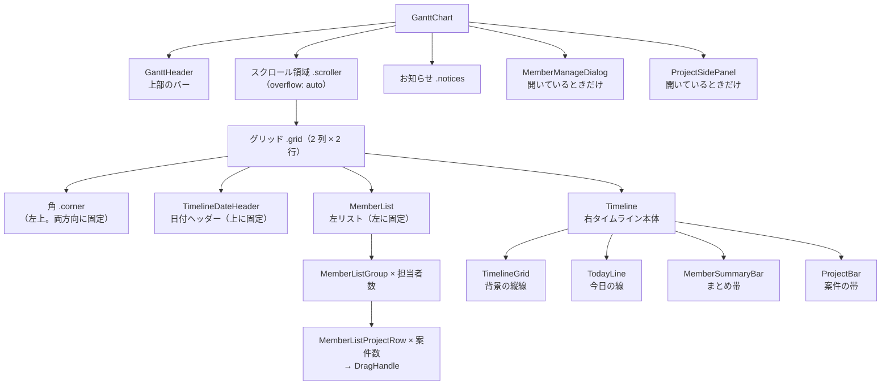
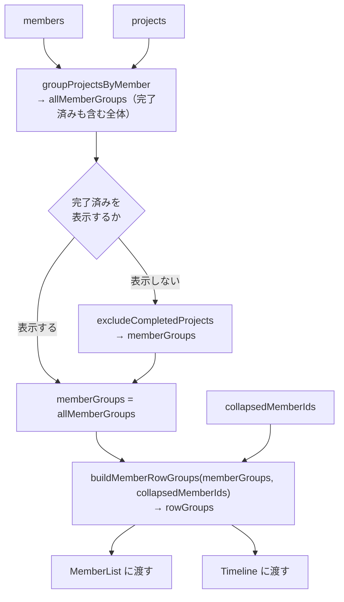

# チャートの表示（画面構造・行モデル・左リストとタイムライン）

「画面がどんな部品でできていて、左リストと右タイムラインがなぜ縦にそろうのか」の資料。

- 主なファイル:
  - 画面の最上位: `components/GanttChart/`（`GanttChart.tsx` / `useGanttChart.ts` / `GanttChart.module.scss`）
  - 行モデル: `ganttRows.utils.ts`
  - 左リスト: `components/MemberList/` / `MemberListGroup/` / `MemberListProjectRow/`
  - 右タイムライン: `components/Timeline/` / `TimelineDateHeader/` / `TimelineGrid/` / `TodayLine/` / `ProjectBar/` / `MemberSummaryBar/`
  - 上部のバー: `components/GanttHeader/`
  - 絞り込み・集計: `utils/member.utils.ts`
- 関連する資料: [日付と表示期間](02-date-and-timeline-range.md)（横軸）、[帯のドラッグ](06-bar-drag.md)、[並び替え](07-drag-reorder.md)

## 目次

1. [画面の構成](#1-画面の構成)
2. [1 つのスクロール領域に入れる理由](#2-1-つのスクロール領域に入れる理由)
3. [`GanttChart` の 3 つの状態](#3-ganttchart-の-3-つの状態)
4. [データから行になるまで](#4-データから行になるまで)
5. [行モデル（左右をそろえる仕組み）](#5-行モデル左右をそろえる仕組み)
6. [左リスト](#6-左リスト)
7. [右タイムライン](#7-右タイムライン)
8. [完了済みの表示・非表示](#8-完了済みの表示非表示)
9. [折りたたみ](#9-折りたたみ)
10. [空の何もないところをクリックしたとき](#10-空の何もないところをクリックしたとき)
11. [お知らせ（保存の失敗）](#11-お知らせ保存の失敗)
12. [再描画を抑える工夫（`React.memo`）](#12-再描画を抑える工夫reactmemo)
13. [よくある質問](#13-よくある質問)

---

## 1. 画面の構成

`app/page.tsx` が `<GanttChart />` を置き、その中に次の部品が入る。



- `GanttHeader` はスクロール領域の**外**（上に常に出ている）。
- 日付ヘッダー・左リスト・角は、スクロール領域の**中**にあるが、`position: sticky` で固定されている。
- サイドパネルと管理ダイアログは、チャートの上に重なって出る（[案件の編集](04-project-editing.md)、[担当者の管理](05-member-management.md)）。

---

## 2. 1 つのスクロール領域に入れる理由

左のリストと右のタイムラインは、**1 つのスクロール領域の中に左右に並べている**。

```
.scroller（overflow: auto）                ← 縦横のスクロールをここ 1 か所で受ける
└─ .grid（display: grid / width: max-content / min-height: 100%）
   │   grid-template-columns: var(--member-list-width) {rangeDays × 32}px
   │   grid-template-rows:    auto 1fr
   ├─ .corner            （1 行 1 列）position: sticky; top: 0; left: 0
   ├─ TimelineDateHeader （1 行 2 列）position: sticky; top: 0
   ├─ MemberList         （2 行 1 列）position: sticky; left: 0
   └─ Timeline           （2 行 2 列）
```

- 縦にも横にも**同じ要素がスクロールする**ので、左リストの行と右の帯が**自然にそろい**、JavaScript でスクロール位置を同期する必要がない。
- 日付ヘッダーは `sticky; top: 0`（縦スクロールしても上に残る）、左リストは `sticky; left: 0`（横スクロールしても左に残る）、角は両方向に固定。
- `.grid` を `width: max-content` にしているのは、スクロール領域の幅のままだと、`sticky` の左リストが領域の幅までしか追従しないため。
- `min-height: 100%` と `grid-template-rows: auto 1fr` で、担当者や案件が少なくても、**リストの区切り線やタイムラインの背景が画面の下端まで続く**。
- 列幅はスクロール期間（日数）で変わる動的な値なので、`grid-template-columns` だけ**インラインスタイル**で渡す（`useGanttChart` の `gridStyle`）。左リストの幅は画面の幅で変わるので、CSS 変数 `--member-list-width`（`_tokens.scss` / `globals.scss`）で受ける。

`z-index` の重なり順（`_tokens.scss`）:

| 要素           | z-index                                             |
| -------------- | --------------------------------------------------- |
| 帯             | `$z-index-bar`（1）                                 |
| ドラッグ中の帯 | `$z-index-bar-dragging`（2）                        |
| 左リスト       | `$z-index-sticky`（10）                             |
| 日付ヘッダー   | `$z-index-sticky + 1`                               |
| 角             | `$z-index-sticky + 2`（一番上。両方向の固定のため） |
| サイドパネル   | `$z-index-panel`（100）                             |
| お知らせ       | `$z-index-notice`（110。パネルより上）              |

---

## 3. `GanttChart` の 3 つの状態

`useGanttChart` が返す `status` で、画面を切り替える（`GanttChart.tsx` が早期 return で分岐）。

| `status`    | 条件                                                             | 出すもの                                                         |
| ----------- | ---------------------------------------------------------------- | ---------------------------------------------------------------- |
| `"error"`   | `useGanttPage` の `loadError` がある                             | 「データを読み込めませんでした。{メッセージ}」+ 再読み込みボタン |
| `"loading"` | 担当者・案件・`rangeStart`・`today`・`columns` のどれかが `null` | 「読み込み中…」                                                  |
| `"ready"`   | すべてそろっている                                               | チャート（担当者が 0 人なら空の画面）                            |

`"ready"` のときだけ、チャートの値がそろっている（戻り値の型でも絞り込まれる）。**エラー判定が最初**なので、読み込みに失敗すれば他の値が `null` でもエラー画面になる。

担当者が 0 人（`isEmpty`）のときは、チャートの代わりに空の画面（「まず担当者を追加してください」+ 「担当者を管理」ボタン。開発ビルドでは「サンプルデータを入れる（開発用）」も）を出す。ヘッダーは出たまま。

---

## 4. データから行になるまで



| 段階                   | 関数                                               | 内容                                                                                                                          |
| ---------------------- | -------------------------------------------------- | ----------------------------------------------------------------------------------------------------------------------------- |
| ① 担当者ごとにまとめる | `groupProjectsByMember`（`utils/member.utils.ts`） | 担当者の並びは渡した順のまま。案件は **`sortOrder` の昇順**（同じなら開始日順 → `id` 順）。担当者が見つからない案件は含めない |
| ② 完了済みを絞る       | `excludeCompletedProjects`                         | 完了済みの案件を取り除く。**担当者は残す**（案件が 0 件でも担当者行は出す）。並びは変えない                                   |
| ③ 行にする             | `buildMemberRowGroups`（`ganttRows.utils.ts`）     | 担当者ごとの行のまとまり（`rowGroups`）を作る                                                                                 |

`useGanttPage` が ①②（`allMemberGroups` / `memberGroups`）、`useGanttChart` が ③（`rowGroups`）を計算する。**②は 1 か所だけ**で行うので、左右の行がずれない。

> **`memberGroups` と `allMemberGroups` の違い**: 画面のチャートには `memberGroups`（完了済みを隠していれば除いたもの）を使い、**担当者管理ダイアログと、並び替えの全体の並びの復元には `allMemberGroups`（完了済みも含む全体）**を使う。隠れている完了済みの案件も、担当者を削除したら消えるので、削除の確認の件数は全体で数える必要があるため。

---

## 5. 行モデル（左右をそろえる仕組み）

`ganttRows.utils.ts`。**担当者 1 人ぶんの「行の種別・順序・開閉・高さ」を、1 か所だけで決める**ためのファイル。

### 背景: なぜ必要か

左リストとタイムラインは、同じ担当者・案件の行を別々のコンポーネントで描く。もし両方が「折りたたみ中は担当者行だけ」「開いていれば案件行と『案件を追加』行」といった判定を**別々に**持つと、片側だけ直したときに左右の行がずれる（案件名と帯の行が対応しなくなる）。そこで、**同じモデルを親で 1 度だけ作って左右に渡す**。

### 行の種別

```ts
type TGanttRowKind = "member" | "project" | "addProject"
```

| 種別                             | 左リストで出すもの           | タイムラインで出すもの   | 高さ                         |
| -------------------------------- | ---------------------------- | ------------------------ | ---------------------------- |
| `member`（担当者行）             | 開閉ボタン・担当者名・案件数 | まとめ帯                 | 40px（`MEMBER_ROW_HEIGHT`）  |
| `project`（案件行）              | つかみ・色の丸・案件名       | 案件の帯                 | 36px（`PROJECT_ROW_HEIGHT`） |
| `addProject`（「案件を追加」行） | 「＋ 案件を追加」ボタン      | 高さをそろえるだけの空行 | 36px                         |

行は `kind` で判別するユニオン型 `TGanttRow`（`IMemberRow` / `IProjectRow` / `IAddProjectRow`）。

### 提供する関数

| 関数                                                     | 役割                                                                     |
| -------------------------------------------------------- | ------------------------------------------------------------------------ |
| `buildMemberRowGroups(memberGroups, collapsedMemberIds)` | 担当者ごとの行のまとまり `IMemberRowGroup[]` を作る                      |
| `getRowHeight(kind)`                                     | 行の高さ（px）。**左右とも必ずこの関数を使う**                           |
| `applyProjectOrder(rows, orderedProjectIds)`             | 案件行だけを指定の順に差し替える（左リストのドラッグ中・保存中の並び用） |

`IMemberRowGroup` の中身:

| フィールド    | 意味                                                                               |
| ------------- | ---------------------------------------------------------------------------------- |
| `memberId`    | 担当者の ID                                                                        |
| `memberGroup` | 担当者とその配下の案件（担当者行の件数・まとめ帯に使う。**折りたたみ中でも使う**） |
| `isExpanded`  | 開いているか（`!collapsedMemberIds.has(memberId)`）                                |
| `rows`        | 描く行の配列                                                                       |

### `rows` の中身

```
開いている担当者:  [member, project…（表示順）, addProject]
折りたたみ中:       [member]
案件が 0 件で開いている: [member, addProject]
```

行の `key` は、担当者行が `member:{memberId}`、案件行が案件の `id`、「案件を追加」行が `add:{memberId}`。

### 左右の描き方（`switch` の網羅チェック）

左リスト（`MemberListGroup`）もタイムライン（`Timeline`）も、`rows.map` の中で `row.kind` の `switch` で描き分ける。`switch` は網羅チェックなので、**行の種別を増やして `switch` を直し忘れると型エラーになる**。

行の種別を増やすときの手順:

1. `TGanttRowKind` と `TGanttRow`（新しい行の型）に足す。
2. `getRowHeight` に高さを足す。
3. `buildMemberRowGroups` で、その行を作る。
4. `MemberListGroup` と `Timeline` の `switch` に、描き方を足す（左右の両方。足し忘れると型エラー）。

### `applyProjectOrder`（ドラッグ中の並び）

左リストで案件をドラッグして並び替えている間と、保存中は、**左リストの案件行の並びだけ**を差し替える（右のタイムラインは保存後まで元の並びのまま）。`orderedProjectIds` の順に案件行を並べ直し、担当者行と「案件を追加」行の位置は変えない。指定にない案件行は元の順で後ろに残す（手元の一覧と食い違ったときの防御）。詳しくは [並び替え](07-drag-reorder.md)。

---

## 6. 左リスト

```
MemberList（.list: sticky; left: 0）
├─ MemberListGroup（担当者 1 人ぶん）  × 担当者数
│    rows.map で switch:
│      member     → 開閉ボタン / 担当者名 / 「3件」のバッジ
│      project    → MemberListProjectRow（つかみ + 色の丸 + 案件名）
│      addProject → 「＋ 案件を追加」ボタン
└─ footer: 「担当者を管理」ボタン
```

### `MemberList`

`rowGroups` を受け取り、`MemberListGroup` を担当者ごとに置き、最下部に「担当者を管理」ボタンを置くだけ。`memo` 済み。

### `MemberListGroup`（担当者 1 人ぶん）

- 専用フック `useMemberListGroup` が、表示用の値と**案件の並び替え**（`useDragReorder`）を受け持つ。
- 行は `applyProjectOrder(rows, displayIds)` で、`displayIds`（ドラッグ中の並び）の順にしてから描く。案件行には `getRowState(id)`（ドラッグの状態）を付ける。
- 案件数のバッジは `"{projects.length}件"`。開閉アイコンは `▼` / `▶`、`aria-label` は「{名前}を折りたたむ / 開く」。
- `React.memo` で包んである。

### `MemberListProjectRow`（案件 1 行）

- 左端に `DragHandle`（つかみ）、右に色の丸と案件名のボタン（クリックでサイドパネルを開く）。
- **完了済みの案件**（表示しているときだけ出てくる）は、`✓` を出して案件名を薄くする。スクリーンリーダー用に「完了済み」の文字（`srOnly`）も出す。
- 行の要素は ref のコールバック（`rowRef`）で並び替えフックに登録する。`useCallback` で参照を保つ（変わると描画のたびに登録し直しになるため）。
- ドラッグ中は `transform: translateY(...)` で行が浮いてポインターに追従し、落とす先に線（`dropBefore` / `dropAfter`）が出る。

---

## 7. 右タイムライン

### `Timeline`（本体）

`position: relative` の箱に、次を重ねる（`Timeline.tsx`）。

```
.body（position: relative / 幅 = rangeDays × 32px）
├─ TimelineGrid        ← 背景の縦線（絶対配置で全面）
├─ TodayLine           ← 今日の線（絶対配置）
└─ rowGroups.map → 担当者ごとの <div>
     └─ rows.map で switch:
          member     → MemberSummaryBar（まとめ帯）
          project    → ProjectBar（案件の帯）
          addProject → 空の行（高さをそろえるだけ）
```

- 行の見た目と高さは、専用フック `useTimeline` の `getRowProps(kind)` が返す（className と `height: getRowHeight(kind)`）。左リストと**同じ `getRowHeight`**。
- 担当者行と案件行の行の下線は、左リストの行と同じ位置に引く。

### `TimelineDateHeader`（日付ヘッダー）

月の行（24px）と日の行（28px）の 2 段。`columns` から作る。

- **月の行**: `getMonthSegments` の区間ごとに、日数 × 32px の幅のセル。最初の月は途中から始まることがあるので、**最初の列が 1 日のときだけ**区切り線を引く。
- **日の行**: 1 日 1 セル。土曜は青、日曜と祝日は赤の文字。月初は区切り線。**今日は丸いバッジ**（`$color-primary-solid` の塗りに白文字）。祝日名は `title`（ツールチップ）に出す。
- `memo` 済み。`position: sticky; top: 0`。

### `TimelineGrid`（背景）

日ごとの縦の列。**祝日 > 土曜 > 日曜**の順で色を決める（祝日の土日は祝日の色）。月初の列は左に区切り線（`box-shadow: inset 2px 0 0`。`border` だと幅が変わって帯の位置がずれるため、内側の影で描く）。操作は受け付けない（`pointer-events: none`、`aria-hidden`）。

### `TodayLine`（今日の線）

今日の列の**中央**に 2px の縦線。`getTodayOffset` で今日の列の左端を求め、`DAY_COLUMN_WIDTH / 2` を足す。**今日が表示期間の外なら何も描かない**（`null`）。

### `ProjectBar`（案件の帯）

位置・幅・色を `getBarLayout` で求め、ドラッグ・クリックを受け付ける。詳しくは [帯のドラッグ](06-bar-drag.md)。ここでは見た目の要点だけ:

- **位置・幅・色は動的な値**なのでインラインスタイルで渡す。**色は `background` ではなく `backgroundColor`** で渡す（`background` だと、背景のグラデーション（立体感）が消える）。
- 表示期間からはみ出している側は**角を丸めない**（`clippedStart` / `clippedEnd`）。
- サイドパネルで編集中の帯は**枠で強調**する（`editing`）。
- 完了済み（表示中）の帯は**薄く**する（`completed`）。ただし編集中・ドラッグ中は元の濃さに戻す。
- 案件名が帯に入りきらないときは省略記号。`title`（ツールチップ）に「案件名（開始日 〜 終了日）」を出す。`aria-label` には期間と完了済みを添える。

### `MemberSummaryBar`（まとめ帯）

担当者行に出す、配下の案件をまとめた**細い帯**（高さ 6px、半透明）。案件ごとに 1 本ずつ重ねて描くので、**重なった日は濃く見える**。折りたたみ中でも予定の入っている日が分かる。完了済みの案件は、さらに薄くする。表示期間に入らない案件は帯を作らない。

---

## 8. 完了済みの表示・非表示

- 状態は `useCompletedVisibility`（初期値は「表示しない」。保存しない）。
- `GanttHeader` の右端のボタン（`aria-pressed`）で切り替える。文言は「完了済みを表示（{件数}）」。狭い画面（480px 以下）では「完了済み（{件数}）」の短い文言に切り替わる（CSS のメディアクエリ）。
- 件数は `allMemberGroups` の**担当者が見つかる案件**だけで数える（担当者のいない孤立した案件まで数えると、表示に切り替えても件数ぶんの案件が出てこないため）。
- 隠すときは `excludeCompletedProjects` で **1 か所だけ**取り除く。左リスト・タイムライン・まとめ帯はどれも同じ `rowGroups` を使うので、そろったまま。

---

## 9. 折りたたみ

- 状態は `useCollapsedMembers`（折りたたみ中の担当者 ID の `Set`。保存しない）。
- 担当者行の開閉ボタンで `toggleMember(memberId)`。
- 折りたたむと、その担当者の `rows` が `[member]` だけになり、**左右とも**案件行と「案件を追加」行が消える（まとめ帯は残る）。

---

## 10. 空の何もないところをクリックしたとき

サイドパネルが開いているときに、スクロール領域の**何もないところ**（帯のない行・日付ヘッダー・左リストの空き）をクリックすると、パネルを閉じる（`useGanttChart` の `handleScrollAreaClick`）。

- クリックされた要素が `button, a, input, select, textarea` の中なら閉じない（`KEEP_SIDE_PANEL_SELECTOR`）。帯・左リストのボタン類は、すべて `button` なので対象外。**チャートの上で独自の操作を持つ要素を足すときは、このセレクターに追加する**。
- 入力途中でも確認せずに閉じる（Esc・✕ と同じ扱い）。
- ヘッダーはスクロール領域の外なので対象にならない。
- 保存・削除の実行中は、`useSidePanel` が閉じる操作を受け付けない。

---

## 11. お知らせ（保存の失敗）

帯のドラッグ・案件の並び替えの保存に失敗すると、**画面の左下**に赤いお知らせが出る（`.notices`）。

- 右側はサイドパネルが開くと隠れるので左下。`z-index` もパネルより上。
- 2 つ出ても重ならないよう縦に積む。「閉じる」ボタンで消える。次の保存を始めたときにも消える。
- お知らせのない部分は `pointer-events: none` で、下の画面の操作を妨げない。

---

## 12. 再描画を抑える工夫（`React.memo`）

左リスト・タイムライン・日付ヘッダー・担当者 1 人ぶんなどは `memo` で包んである（スクロールのたびに `useGanttPage` が走り直しても、重い部分を再描画しないため）。そのため、**渡す値の参照を保つ**必要がある。

- 関数は `useCallback` で参照を保つ（`onSelectProject` など）。
- `rowGroups` / `memberGroups` / `columns` は `useMemo` で、元の値が変わったときだけ作り直す。
- `rowGroups` を作る `useMemo` は、**早期 return より前**（フックの呼び出し順を保つため）に置かれ、`memberGroups` が `null`（読み込み前）のときは `null` を返す。

---

## 13. よくある質問

**Q. 左リストの行と右の帯がずれたらどこを見ますか？**
まず `getRowHeight`（`ganttRows.utils.ts`）。高さは左右ともこの関数から取っています。次に、左右の `switch` が同じ `rows` を描いているか（`rowGroups` を `GanttChart` が 1 度作って両方に渡しています）。

**Q. 新しい種類の行（たとえば「案件の合計」行）を足したいです。**
[行の種別を増やすときの手順](#左右の描き方switch-の網羅チェック) のとおり、`ganttRows.utils.ts` に足し、左右の `switch` を直します。直し忘れは型エラーになります。

**Q. 完了済みの案件を隠すと、担当者の「3件」の数字は変わりますか？**
変わります。担当者行の件数は、表示している案件（`memberGroup.projects`）の数です。ヘッダーのボタンの件数（完了済みの数）とは別です。

**Q. 担当者行のまとめ帯は何のためにありますか？**
折りたたんだときや、案件が多くて見渡しにくいときに、その担当者がどの日に忙しいかを一目で見るためです。案件ごとに半透明で重ねるので、重なった日が濃く見えます。

**Q. 横にはスクロールできるのに、左のリストが動かないのはなぜですか？**
左リストが `position: sticky; left: 0` だからです。同じスクロール領域の中にあるので、縦スクロールには自然についてきます。

**Q. 読み込み中の「読み込み中…」はいつまで出ますか？**
担当者・案件・今日の日付・表示期間のすべてが決まるまでです。通常は一瞬です。保存データが壊れていれば、代わりにエラー画面になります。
