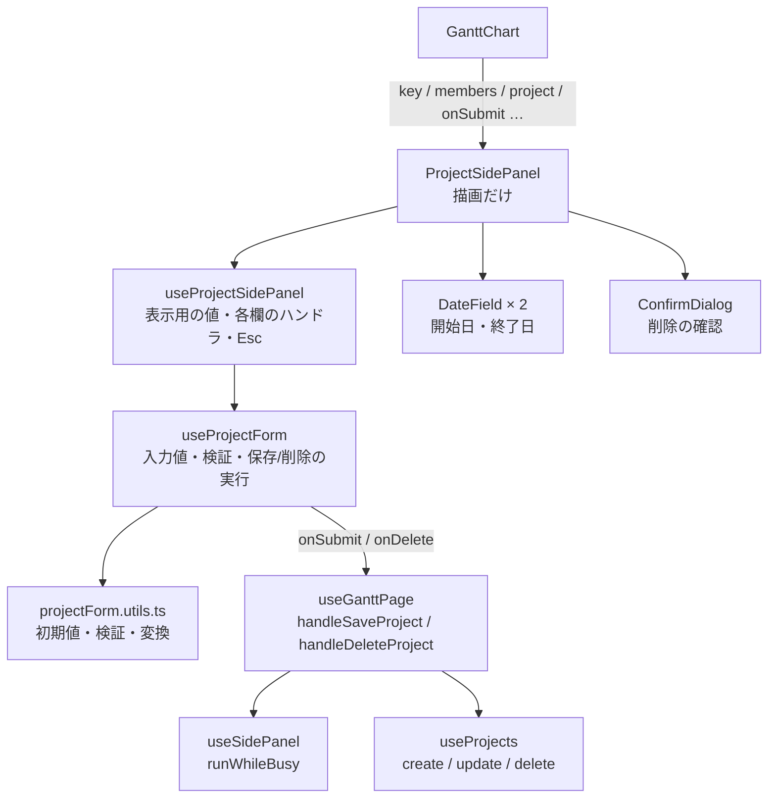
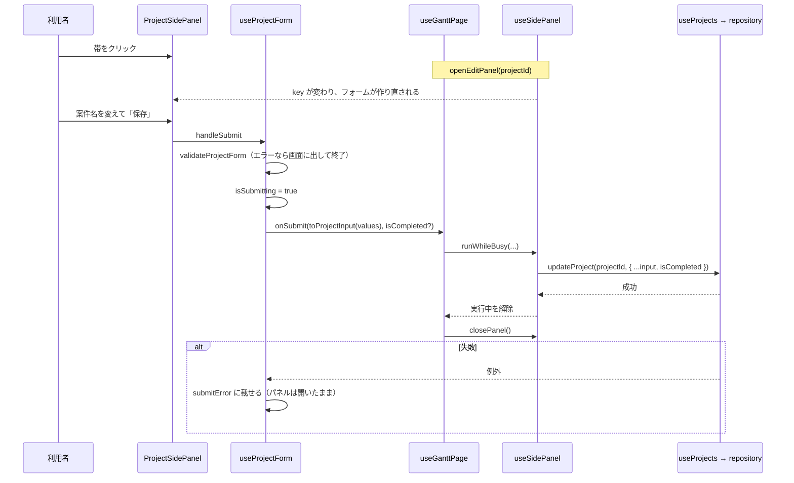

# 案件の追加・編集・削除・完了（サイドパネル）

「帯をクリックしたり『案件を追加』を押したときに右から出てくるパネルが、どう動いているか」の資料。フォーム、検証、保存、削除、完了、日付入力、確認ダイアログまでを扱う。

- 主なファイル:
  - パネル: `components/ProjectSidePanel/`（`ProjectSidePanel.tsx` / `useProjectSidePanel.ts` / `useProjectForm.ts` / `projectForm.utils.ts` / `projectForm.type.ts`）
  - 日付入力: `components/DateField/`
  - 確認ダイアログ: `components/ConfirmDialog/`
  - パネルの開閉の状態: `hooks/useSidePanel.ts`
  - 保存・削除の結線: `hooks/useGanttPage.ts`（`handleSaveProject` / `handleDeleteProject`）
- 関連する資料: [データ層](01-data-layer.md)（保存の実体）、[チャートの表示](03-chart-layout.md)（パネルを開く入口）

## 目次

1. [できること](#1-できること)
2. [状態の持ち方（パネルの開閉）](#2-状態の持ち方パネルの開閉)
3. [層の構成](#3-層の構成)
4. [パネルを開いてから保存するまで](#4-パネルを開いてから保存するまで)
5. [フォームの値と検証](#5-フォームの値と検証)
6. [保存・削除・完了の処理](#6-保存削除完了の処理)
7. [Esc とクリックでの閉じ方](#7-esc-とクリックでの閉じ方)
8. [日付入力（`DateField`）](#8-日付入力datefield)
9. [確認ダイアログ（`ConfirmDialog`）](#9-確認ダイアログconfirmdialog)
10. [見た目の要点](#10-見た目の要点)
11. [よくある質問](#11-よくある質問)

---

## 1. できること

| 操作                      | 入口                                                   | パネルの状態                     |
| ------------------------- | ------------------------------------------------------ | -------------------------------- |
| 案件を追加                | 左リストの「＋ 案件を追加」（担当者ごと）              | `create`（その担当者が初期選択） |
| 案件を編集                | 帯のクリック、または左リストの案件名のクリック         | `edit`                           |
| 案件を削除                | 編集のとき、パネル下部の「削除」→ 確認ダイアログ       |                                  |
| 完了にする / 未完了に戻す | 編集のとき、フォーム最上部の「状態」の欄のボタン       |                                  |
| 閉じる                    | ✕・キャンセル・Esc・チャートの何もないところのクリック |                                  |

---

## 2. 状態の持ち方（パネルの開閉）

`hooks/useSidePanel.ts` が、パネルの開閉と「何を開いているか」を **1 つの state** で持つ。型は `TSidePanelState`（`gantt.type.ts`）。

```ts
type TSidePanelState =
  | { mode: "closed" }
  | { mode: "create"; defaultMemberId: string | null } // 追加。担当者の初期選択
  | { mode: "edit"; projectId: string } // 編集
```

### 編集中の案件の「中身」は持たない

`edit` のときに持つのは **`projectId` だけ**。編集中の案件そのものは、`useGanttPage` が `projectId` から案件の一覧を引いて求める（`editingProject`）。保存や他の操作でデータが変わっても、パネルの表示とずれないようにするため。他のタブで削除されるなどして見つからなければ `null` になり、**パネルは出さない**。

### 保存・削除の実行中は開閉を受け付けない（`runWhileBusy`）

`useSidePanel` の `runWhileBusy(action)` の中は、**開く・閉じる・別の案件への切り替えをすべて受け付けない**（`isBusyRef` で判定。描画に使わないので ref）。

- 実行中に閉じると、失敗したときのエラーと入力内容が見えなくなる。
- 実行中に別のパネルを開くと、先の保存が成功したときに**新しいパネルが閉じられてしまう**。

成功したあとにパネルを閉じるときは、`runWhileBusy` が**終わってから** `closePanel` を呼ぶ（実行中は `closePanel` も受け付けないため）。

---

## 3. 層の構成



| ファイル                 | 受け持ち                                                                                                                                |
| ------------------------ | --------------------------------------------------------------------------------------------------------------------------------------- |
| `ProjectSidePanel.tsx`   | 描画だけ（`<aside>` の中にフォーム・ボタン・確認ダイアログ）                                                                            |
| `useProjectSidePanel.ts` | フォームに、パネルの表示用の値（見出し・状態の表示・色の選択肢・フィールドの id）と各入力欄のハンドラを足す。**Esc で閉じる処理**もここ |
| `useProjectForm.ts`      | 入力値・検証結果・送信（保存 / 削除）・削除確認の開閉                                                                                   |
| `projectForm.utils.ts`   | 初期値の作成・検証・`TProjectInput` への変換・完了日の表示                                                                              |
| `projectForm.type.ts`    | `IProjectFormValues`（入力値）/ `TProjectFormErrors`（項目ごとのエラー）                                                                |

---

## 4. パネルを開いてから保存するまで



### `key` でフォームを作り直す

`useProjectForm` の入力値の初期値は、**初回の描画で 1 度だけ**決める（`useState` の初期化関数）。別の案件・別の担当者で開き直すときは、`GanttChart` が `ProjectSidePanel` の `key` を変えて**作り直す**（effect で同期しない方針）。`key` は次のとおり（`useGanttChart`）:

- 追加: `create:{defaultMemberId}`
- 編集: `edit:{案件の id}`

> 編集中の案件の帯はドラッグできない（[帯のドラッグ](06-bar-drag.md#11-編集中の帯はドラッグできない)）ので、パネルの外で期間が変わって `key` を作り直す必要が出ることはない。

---

## 5. フォームの値と検証

### 入力値（`IProjectFormValues`）

| フィールド  | 型          | 備考                             |
| ----------- | ----------- | -------------------------------- |
| `memberId`  | `string`    | 担当者の ID（未選択は空文字）    |
| `name`      | `string`    | 案件名                           |
| `startDate` | `string`    | `"YYYY-MM-DD"`（未入力は空文字） |
| `endDate`   | `string`    | 同上                             |
| `color`     | `TBarColor` | 帯の色                           |
| `note`      | `string`    | メモ                             |

`input` の値は文字列で扱うので、日付も空文字を取りうる。保存するときに `toProjectInput` で `TProjectInput` に変換する。

### 初期値（`createInitialFormValues`）

| 場面 | 初期値                                                                                                                                                   |
| ---- | -------------------------------------------------------------------------------------------------------------------------------------------------------- |
| 編集 | その案件の内容                                                                                                                                           |
| 追加 | 担当者: `defaultMemberId`（存在しなければ**先頭の担当者**）/ 案件名: 空 / 開始日・終了日: **今日（1 日だけ）** / 色: 青（`DEFAULT_BAR_COLOR`）/ メモ: 空 |

### 検証（`validateProjectForm`）

項目ごとにエラーを返す（なければ空のオブジェクト）。

| 項目   | 条件                                    | メッセージ                              |
| ------ | --------------------------------------- | --------------------------------------- |
| 案件名 | 前後の空白を除いて空                    | 案件名を入力してください                |
| 案件名 | 100 文字超（`PROJECT_NAME_MAX_LENGTH`） | 案件名は 100 文字以内で入力してください |
| 担当者 | 担当者の選択肢にない                    | 担当者を選択してください                |
| 開始日 | 実在する `"YYYY-MM-DD"` でない          | 開始日を入力してください                |
| 終了日 | 実在する `"YYYY-MM-DD"` でない          | 終了日を入力してください                |
| 終了日 | 開始日より前                            | 終了日は開始日以降の日付にしてください  |

- **repository は名前の中身を見ない**ので、案件名の必須・文字数チェックはここが**唯一の砦**。
- 担当者の存在も確かめるのは、他のタブで担当者が削除されている場合に備えるため。
- 文字数は UTF-16 のコード単位（`length`）で数える（絵文字は 2 文字ぶん。身内利用なので許容）。

### エラーの出し方と消し方

- 保存ボタンを押したときに、**全項目をまとめて**検証し、エラーを項目の下に出す。1 つでもあれば保存しない。
- 項目を書き換えると（`setField`）、**その項目のエラーだけ消える**（直したことが分かるよう）。

### 保存する値（`toProjectInput`）

案件名は `trim()` する。他はそのまま。

---

## 6. 保存・削除・完了の処理

### 共通の実行処理（`runSubmit`）

保存・削除に共通。

- **二重送信を防ぐ**: `isSubmitting` が `true` の間は何もしない。
- 実行前に `submitError` を消し、失敗したら `submitError` に載せる。パネル内に「保存できませんでした。{メッセージ}」と出て、**パネルは開いたまま**。
- 終わったら `isSubmitting` を戻す（`finally`）。

### 保存（`submitForm`）

保存ボタン（`handleSubmit`）と完了ボタン（`handleToggleCompleted`）に共通。

1. `validateProjectForm` で全項目を検証し、エラーがあれば表示して終了（**完了の状態も変えない**）。
2. `onSubmit(toProjectInput(values), isCompleted?)` を `runSubmit` 経由で呼ぶ。

`useGanttPage.handleSaveProject` の中身:

| パネルの状態 | 呼ぶもの                                              |
| ------------ | ----------------------------------------------------- |
| `create`     | `createProject(input)`                                |
| `edit`       | `updateProject(projectId, { ...input, isCompleted })` |
| `closed`     | 何もしない                                            |

どちらも `runWhileBusy` の中で行い、**成功してから** `closePanel()`。失敗は例外のまま投げ、フォームが受け取って表示する。

### 完了にする / 未完了に戻す（`handleToggleCompleted`）

- **編集のときだけ**使える（追加のときは何もしない。追加した案件は必ず未完了なので）。
- **フォームの内容と一緒に保存する**。編集途中の内容が失われないように、完了の切り替えだけを別に保存せず、`submitForm(project.completedAt === null)` として 1 回で保存する。
- 検証に失敗したら、完了の状態も変えない。
- 成功するとパネルが閉じ、完了にした案件は（既定では）チャートから消える。
- 「状態」の欄の表示: 未完了は「未完了」、完了済みは「完了済み（10/30）」（`formatCompletedLabel`。完了日時は UTC で保存しているので、**端末のタイムゾーンの日付**で表示する）。ボタンの文言は「完了にする」/「未完了に戻す」。

### 削除（`handleConfirmDelete`）

1. 「削除」ボタンで確認ダイアログを開く（`openDeleteConfirm`）。
2. 確認ダイアログの「削除する」で `runSubmit(onDelete)` を実行し、**成否にかかわらず確認ダイアログを閉じる**。失敗したらエラーはパネル内に出る。
3. `useGanttPage.handleDeleteProject` は、`runWhileBusy(() => deleteProject(projectId))` の後に `closePanel()`。

確認メッセージ: 「『{案件名}』を削除します。この操作は元に戻せません。」

---

## 7. Esc とクリックでの閉じ方

| 操作                               | 動き                                     | 実装                                                                                  |
| ---------------------------------- | ---------------------------------------- | ------------------------------------------------------------------------------------- |
| Esc                                | パネルを閉じる（入力途中でも確認しない） | `useProjectSidePanel` が `document` の `keydown` に登録                               |
| ✕・キャンセル                      | 閉じる                                   | `onClose`                                                                             |
| チャートの何もないところをクリック | 閉じる                                   | [`handleScrollAreaClick`](03-chart-layout.md#10-空の何もないところをクリックしたとき) |

Esc の例外（閉じない場面）:

- **削除の確認ダイアログが開いている間**: ダイアログ側の Esc（確認だけを閉じる）を優先する。
- **保存・削除の実行中**（`isSubmitting`）: 結果を見失わないため。
- **カレンダーを開いている間の Esc**: カレンダーだけを閉じる（[§8](#8-日付入力datefield)）。
- **帯のドラッグ中の Esc**: ドラッグの取り消しだけ（[帯のドラッグ](06-bar-drag.md)）。

---

## 8. 日付入力（`DateField`）

`components/DateField/`。ボタンを押すと、すぐ下にページのデザインに合わせたカレンダー（`react-day-picker`）が出る。

### 値の受け渡し

- 値は **`"YYYY-MM-DD"` の文字列**で受け渡す。`Date` への変換は `useDateField` の中だけ。
- 読めない値（空文字など）のときは「日付を選択」と表示し、未選択として扱う（`isDateString` を通った値だけ `Date` にする）。
- 表示は `yyyy/MM/dd（E）`（例: `2026/10/30（金）`）。日本語ロケール（`ja`）。

### 開閉

| 操作                       | 動き                                                                |
| -------------------------- | ------------------------------------------------------------------- |
| ボタンを押す               | 開く / 閉じる（トグル）                                             |
| 日付を選ぶ                 | 値を反映して閉じる                                                  |
| 外側をクリック             | 閉じる（フォーカスはクリックした先に任せる）                        |
| Esc                        | **カレンダーだけ**を閉じる。**パネルまで閉じない**                  |
| Tab でカレンダーの外へ出る | 閉じる（移り先が `null`（ウィンドウ切り替えなど）のときは閉じない） |

閉じたあとは（外側クリック・Tab を除き）ボタンにフォーカスを戻す。

### Esc がパネルまで届かない仕組み

パネルの Esc は `document` の `keydown` で受けている。React のイベントも `document` に登録される（Next.js は React のルートを `document` に置く）ため、`stopPropagation` ではパネルのリスナーを止められない。そこで `handleKeyDown` で **`event.nativeEvent.stopImmediatePropagation()`** を呼び、後続のリスナーを止める。React のリスナーのほうが先に登録されているので、パネルより先に実行される。

### 色分け

カレンダーの日付は、タイムラインと同じく**土曜は青、日曜と祝日は赤**。`modifiers`（`saturday` / `sunday` / `holiday`）で判定し、選択中の日は白文字を保つ。祝日が土曜と重なるときは祝日（赤）を優先する。右端の欄（終了日）は `align="right"` で右寄せにして、パネルの外にはみ出さないようにする。

---

## 9. 確認ダイアログ（`ConfirmDialog`）

`components/ConfirmDialog/`。削除など、破壊的な操作の確認に使う。パネルの案件の削除と、[担当者の削除](05-member-management.md)の両方で使っている。

- **`<dialog>` 要素を `showModal` で開く**。背面は操作できなくなり、フォーカスは最初のボタン（キャンセル）に当たる。
- **開閉は `isOpen` の props が正**。`useConfirmDialog` が `isOpen` に合わせて `showModal()` / `close()` する。
- **Esc は `<dialog>` に任せない**: `cancel` イベントを `preventDefault` して、`onCancel` 経由で**親の state を更新**する（state と見た目をずらさない）。実行中（`isBusy`）は Esc でも閉じない。
- `<dialog>` は閉じていても DOM に残るので、複数の確認ダイアログが同時にマウントされても ID が重複しないよう、見出しの ID は `useId` で作る。
- 「削除する」ボタンは危険色（`$color-danger-solid`。白文字との比 4.5:1 以上）。

---

## 10. 見た目の要点

`ProjectSidePanel.module.scss`。

- **位置**: `position: fixed; top: $header-height; right: 0; bottom: 0`。**画面上部のバーの下**から出す（バーの右端の「完了済みを表示」を、パネルを開いたままでも押せるように）。幅は `min(360px, 100vw)`。狭い画面（480px 以下）では全幅。タイムラインの上に**重なる**（タイムラインの幅は変えない）。
- **スライドイン**のアニメーション（0.24 秒）。`prefers-reduced-motion` のときは無効。
- **構成**: ヘッダー（見出し + ✕）/ フォーム（`.body` だけがスクロールし、下部の `.actions` は下に固定）。下部のボタンは「削除（左）／キャンセル・保存（右）」の 1 段。
- **編集のときだけ**フォーム最上部に「状態」の欄（状態の表示 + 完了ボタン）と、下部の「削除」が出る。
- **帯の色**はラジオボタンを隠し、色の丸（スウォッチ）で選ぶ。選んだ色は白い輪で示す。キーボード操作は残してある。
- **編集中の帯**は、チャート側で枠で強調される（`isEditing`）。

---

## 11. よくある質問

**Q. パネルを開いたままデータが変わるとどうなりますか？**
編集中の案件は `projectId` から引いているので、保存後に最新の内容が反映されます。ただし**フォームの入力値は初回に決めた値のまま**で、外から更新されません（別の案件を開くときは `key` で作り直します）。他のタブで案件が削除された場合は、パネルが出なくなります。

**Q. 保存に失敗するとどうなりますか？**
パネルは開いたまま、下部に「保存できませんでした。{理由}」が出ます。入力内容はそのままなので、直して再度保存できます。

**Q. なぜ完了ボタンはフォームの内容と一緒に保存するのですか？**
編集途中の内容が失われないようにするためです。完了だけを別に保存すると、パネルを閉じたときに未保存の編集が消えてしまいます。

**Q. 追加のときの開始日・終了日が今日の 1 日だけなのはなぜですか？**
最小の初期値として、まず帯が 1 つ出るようにするためです。必要に応じて日付を変えてもらいます。

**Q. `ConfirmDialog` が閉じているのに DOM に残っているのはなぜですか？**
`<dialog>` は `showModal` / `close` で開閉する要素で、親の `isOpen` に合わせて呼び分けているためです。閉じているときは表示されません。

**Q. 別の担当者に付け替えるとどうなりますか？**
`updateProject` が `memberId` の変更を検知し、**付け替え先の一番下**に入れます（付け替え元の `sortOrder` は詰め直しません）。
