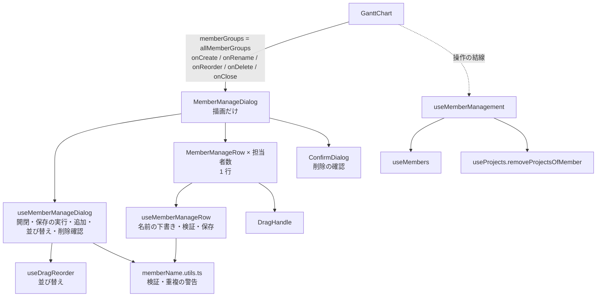
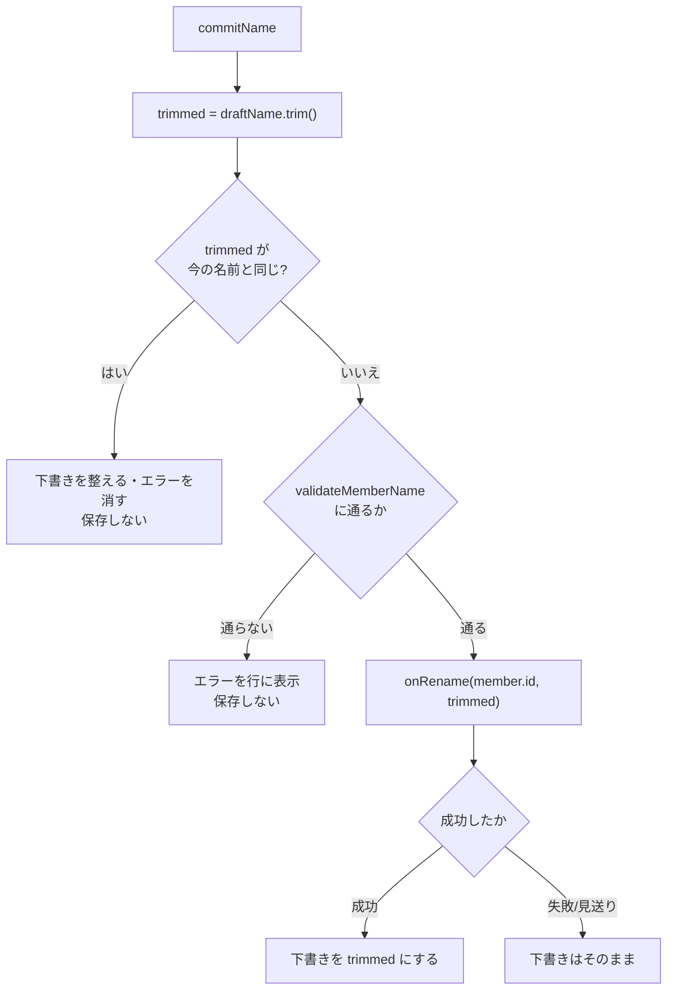
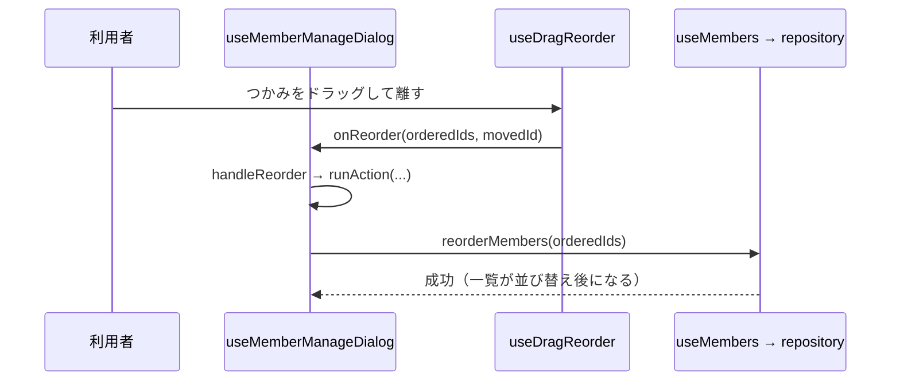

# 担当者の管理（追加・名前変更・並び替え・削除）

「左リスト下の『担当者を管理』ボタンで開くダイアログが、どう動いているか」の資料。

- 主なファイル:
  - ダイアログ: `components/MemberManageDialog/`（`MemberManageDialog.tsx` / `useMemberManageDialog.ts` / `memberName.utils.ts`）
  - 1 行: `components/MemberManageRow/`（`MemberManageRow.tsx` / `useMemberManageRow.ts`）
  - 開閉と操作の結線: `hooks/useMemberManagement.ts`
  - データの保持: `hooks/useMembers.ts`（[データ層](01-data-layer.md#9-usemembers--useprojects-との接点)）
  - 並び替え: `hooks/useDragReorder.ts`（[並び替え](07-drag-reorder.md)）
  - 確認ダイアログ: `components/ConfirmDialog/`（[案件の編集](04-project-editing.md#9-確認ダイアログconfirmdialog)）
- 関連する資料: [チャートの表示](03-chart-layout.md)（`allMemberGroups` を渡す側）

## 目次

1. [できること](#1-できること)
2. [層の構成](#2-層の構成)
3. [開閉の仕組み](#3-開閉の仕組み)
4. [保存系の操作の共通処理（`runAction`）](#4-保存系の操作の共通処理runaction)
5. [名前の編集（行）](#5-名前の編集行)
6. [追加](#6-追加)
7. [並び替え](#7-並び替え)
8. [削除](#8-削除)
9. [担当者名の検証](#9-担当者名の検証)
10. [Esc の扱い](#10-esc-の扱い)
11. [よくある質問](#11-よくある質問)

---

## 1. できること

| 操作         | 方法                                                             |
| ------------ | ---------------------------------------------------------------- |
| 担当者を追加 | 下部の入力欄に名前を入れて「追加」（Enter でも可）               |
| 名前を変える | 行の入力欄で直接編集し、Enter か、入力欄から離れる（blur）と保存 |
| 並び替える   | 行の左端の「⋮⋮」をドラッグ                                       |
| 削除する     | 行の「削除」→ 確認ダイアログ。**配下の案件もまとめて消える**     |
| 閉じる       | ✕・Esc                                                           |

画面の入口は 2 つ: 左リスト最下部の「担当者を管理」ボタン、担当者が 0 人のときの空の画面の「担当者を管理」ボタン。どちらも `manageMembers`（= ダイアログを開く）を呼ぶ。

---

## 2. 層の構成



- ダイアログには **`allMemberGroups`（完了済みの案件も含めた全体）** を渡す。完了済みを隠していても、担当者を削除すれば完了済みの案件も消えるので、削除の確認の件数と並び替えの全 id は全体で扱う必要がある。
- ダイアログ自体は保存の方法を知らない。`onCreate` などの**コールバック**で受け取り、失敗したら例外を投げてもらう契約。

### `useMemberManagement`（結線）

`hooks/useMemberManagement.ts`。`useMembers`（担当者）と `useProjects`（案件）をつなぐ役目。

| 返すもの                                      | 動き                                                                                                              |
| --------------------------------------------- | ----------------------------------------------------------------------------------------------------------------- |
| `isDialogOpen` / `openDialog` / `closeDialog` | ダイアログの開閉。`openDialog` は**サイドパネルを閉じてから**開く                                                 |
| `createMember(name)`                          | `useMembers.createMember` を呼ぶ                                                                                  |
| `renameMember(id, name)`                      | 同 `renameMember`                                                                                                 |
| `reorderMembers(orderedIds)`                  | 同 `reorderMembers`                                                                                               |
| `deleteMember(id)`                            | `useMembers.deleteMember` の後に `removeProjectsOfMember(id)`（手元の案件の一覧から、その担当者の案件を取り除く） |

> **管理ダイアログを開くときにサイドパネルを閉じる**理由: パネルに残った担当者の選択や、削除した担当者の案件を編集中のままになる状態を作らないため（入力途中の内容は破棄される）。パネルの Esc（`document` の `keydown`）が、ダイアログの Esc と二重に効くのを避ける意味もある。

---

## 3. 開閉の仕組み

**「マウントされている間が開いている」**。`GanttChart` が、`memberDialog.isOpen` のときだけ `<MemberManageDialog />` を置く（`isOpen` の props はない）。

```tsx
{memberDialog.isOpen && <MemberManageDialog ... />}
```

`useMemberManageDialog` の `useEffect`:

- マウント時に `dialog.showModal()` を呼ぶ。
- アンマウント時（クリーンアップ）に `dialog.close()` を呼び、元のフォーカスに戻す。

そのため、**開き直すたびに入力中の値・エラー・削除確認の状態は作り直される**（外すと入力途中の値も破棄される）。

`<dialog>` を `showModal` で開くので、背面は操作できなくなる（モーダル）。

---

## 4. 保存系の操作の共通処理（`runAction`）

追加・名前変更・並び替え・削除は、すべて `runAction` を通る。

```ts
runAction(action): Promise<boolean>
```

- **二重実行を弾く**: 実行中か（`isBusyRef`）で判定し、実行中なら何もせず `false`。**`state` の `isBusy` ではなく ref を使う**のは、`state` は再描画されるまで古い値のままで、Enter と blur が続けて走るような短い間の二重実行を防げないため。
- 実行前に `actionError` を消し、`isBusy` を `true` にする（ボタン・入力欄・つかみをすべて止める）。
- 成功したら `true`、失敗（または実行中で見送り）なら `false`。失敗は `actionError` に載せ、ダイアログ内に「保存できませんでした。{理由}」と**次の操作を始めるまで**出し続ける。
- `finally` で `isBusy` を戻す。

`runAction` は**例外を投げない**ので、`useDragReorder` の「`onReorder` は例外を投げない」契約も満たす。

---

## 5. 名前の編集（行）

`MemberManageRow` / `useMemberManageRow`。

### 下書きと確定

- 入力中の値は **`draftName`**（下書き）として行が持つ。初期値は担当者の名前（初回の描画で決めるので、呼び出し側で**担当者の `id` を `key` にする**）。
- **確定は 2 つのきっかけ**で走る: Enter（フォーム送信）と、入力欄から離れたとき（blur）。どちらも `commitName`。

`commitName` の流れ:



### Enter と blur が続けて走る問題

Enter の確定で入力欄が無効化（`isBusy`）され、フォーカスが外れて blur も走りうる。**二重に保存しない**のは `onRename` 側の役目で、`runAction` が実行中は 2 回目を見送って `false` を返す。見送られた側は `false` が返るだけで、下書きは 1 回目の成功で更新される。

### 重複の警告

同じ名前の担当者がいると、行に「同じ名前の担当者がいます」を出す。**登録は止めない**（同姓の人がいる場合を考えて、警告だけ）。入力のたびに計算できるので state にせず、描画のたびに `hasSameNameMember(draftName, members, member.id)` で求める（自分自身は数えない）。

### 行の見た目

- 並び替えのドラッグ中は、行が `transform: translateY(...)` でポインターに追従する。落とす先に線が出る。
- `isBusy`（保存中）は入力欄・つかみ・削除ボタンが無効。

---

## 6. 追加

下部のフォーム（`handleSubmitNew`）。

1. `validateMemberName(newName)` で検証。**通らなければ保存せず**、入力欄の下にエラーを出す。
2. 通ったら `runAction(() => onCreate(newName.trim()))`。
3. **成功したら入力欄を空にする**。失敗したら入力はそのまま残す。

入力すると、エラーは消える（`handleChangeNewName`）。重複は行と同じく警告だけ。

担当者は**一番下**に追加される（`getNextSortOrder`）。

---

## 7. 並び替え

行の左端の「⋮⋮」（`DragHandle`）をドラッグして並べ替える。ドラッグの仕組みは共通の `useDragReorder`（[並び替え](07-drag-reorder.md)）。



- `ids` は全担当者の id（`memberGroups` から `useMemo` で作る。`useDragReorder` の `effect` が描画のたびに作り直されないよう、担当者が変わったときだけ作る）。
- 行は `displayIds` の順に描く。**保存中は並べ替え後の順**、それ以外は元の順（ドラッグ中は並びを変えず、つかんだ行が浮いて追従する）。
- 保存中（`isBusy`）はドラッグを始められない（`isDisabled: isBusy`）。
- 全担当者の id を過不足なく渡す契約（`reorderMembers`）。別のタブで担当者が増減していると、repository がエラーを返す（ダイアログ内に表示される）。

---

## 8. 削除

1. 行の「削除」→ `requestDelete(memberId)` で `deletingMemberId` を設定 → 確認ダイアログが開く。
2. 確認メッセージ（`deleteConfirmMessage`）:
   - 案件がある: 「『{名前}』を削除します。**案件 {N} 件も一緒に削除されます**。この操作は元に戻せません。」
   - 案件がない: 「『{名前}』を削除します。この操作は元に戻せません。」
3. 「削除する」→ `confirmDelete`: `runAction(() => onDelete(deletingMemberId))`。**成否にかかわらず確認は閉じ**、失敗は `actionError` に出る。

### 削除の中身

- `useMemberManagement.deleteMember` が `useMembers.deleteMember`（→ repository が担当者と配下の案件を **2 つのキーまとめて**削除。途中で失敗したら両方を操作前に戻す）を呼ぶ。
- その後 `removeProjectsOfMember(id)` で、手元の案件の一覧から取り除く。**案件は読み込み直さない**（削除は済んでいるので、ここで再読み込みの失敗を起こさないため）。

件数は `allMemberGroups` の `projects.length`（完了済みを含む）。

---

## 9. 担当者名の検証

`MemberManageDialog/memberName.utils.ts`（テストは同じ場所の `memberName.utils.test.ts`）。

| 関数                                                 | 内容                                                                                                                                                            |
| ---------------------------------------------------- | --------------------------------------------------------------------------------------------------------------------------------------------------------------- |
| `validateMemberName(name)`                           | 前後の空白を除いて空 → 「担当者名を入力してください」/ 50 文字超（`MEMBER_NAME_MAX_LENGTH`）→ 「担当者名は 50 文字以内で入力してください」/ 問題なければ `null` |
| `hasSameNameMember(name, members, excludeMemberId?)` | 同じ名前の担当者がいるか（前後の空白を除いて比較。名前変更中の本人は数えない）。警告の表示にだけ使う                                                            |

- **repository は名前の中身を見ない**ので、必須・文字数のチェックは画面側（これ）が**唯一の砦**。
- 保存する値は `trim()` したものにすること（呼び出し側の責務）。
- 文字数は UTF-16 のコード単位。
- このファイルは **Dialog と Row だけ**が使うのでこの場所に置いている。`MemberManageRow` からは、バレル（`index.ts`）ではなくこのファイルを**直接** import する（バレル経由だと Dialog → Row → Dialog の循環になるため）。

---

## 10. Esc の扱い

| 場面                                 | 動き                                           |
| ------------------------------------ | ---------------------------------------------- |
| 通常                                 | ダイアログを閉じる                             |
| 保存中（`isBusy`）                   | 閉じない                                       |
| 削除の確認ダイアログが開いているとき | 確認だけを閉じる。管理ダイアログは残る         |
| 並び替えのドラッグ中                 | ドラッグだけを取り消す（ダイアログは閉じない） |

実装（`handleCancel`）: `<dialog>` の `cancel` イベントを `preventDefault` し、親の state（`onClose`）に反映する。中に置いた削除の確認ダイアログの `cancel` も React 上では親（管理ダイアログ）の `onCancel` へ**伝わってしまう**ため、**発生元が管理ダイアログ自身（`event.target === event.currentTarget`）のときだけ**処理する。

---

## 11. よくある質問

**Q. 担当者を削除すると、完了済みで隠れている案件も消えますか？**
消えます。削除は担当者に属する案件をすべて消します。そのため、確認メッセージの件数は、完了済みを含めた全体（`allMemberGroups`）で数えています。

**Q. 担当者名の重複は登録できますか？**
できます。同姓の人がいる場合を考えて、警告（「同じ名前の担当者がいます」）を出すだけで止めません。

**Q. 名前を編集したまま「削除」ボタンを押すと、名前は保存されますか？**
入力欄から離れる（blur）ので、名前の確定（保存）が走ります。保存中は他のボタンが無効になり、`runAction` が実行中の 2 つ目の操作を見送るので、同時に 2 つの操作が走ることはありません。なお、「編集直後に押した他のボタンの 1 回目のクリックが効かない」可能性は PR のレビューで指摘されましたが、実際のブラウザでは再現しませんでした（`.plan/handoff.md` の 4 章）。

**Q. ダイアログを閉じるとき、入力途中の値はどうなりますか？**
破棄されます（開いている間だけマウントしているため）。

**Q. 担当者が 0 人になったらどうなりますか？**
チャートの代わりに空の画面（「まず担当者を追加してください」+「担当者を管理」ボタン）が出ます。そこからダイアログを開いて追加できます。ダイアログ内でも、一覧が空のときは「担当者がいません」と出ます。

**Q. なぜダイアログに `isOpen` の props がないのですか？**
開いている間だけコンポーネントを置く方式にして、閉じたときに入力中の値やエラーを確実に破棄するためです。`ConfirmDialog` は逆に `isOpen` の props が正で、`<dialog>` を常に DOM に残します（開閉の方式が違う点に注意）。
