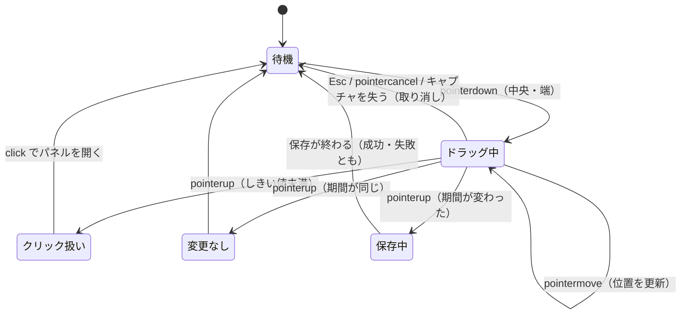
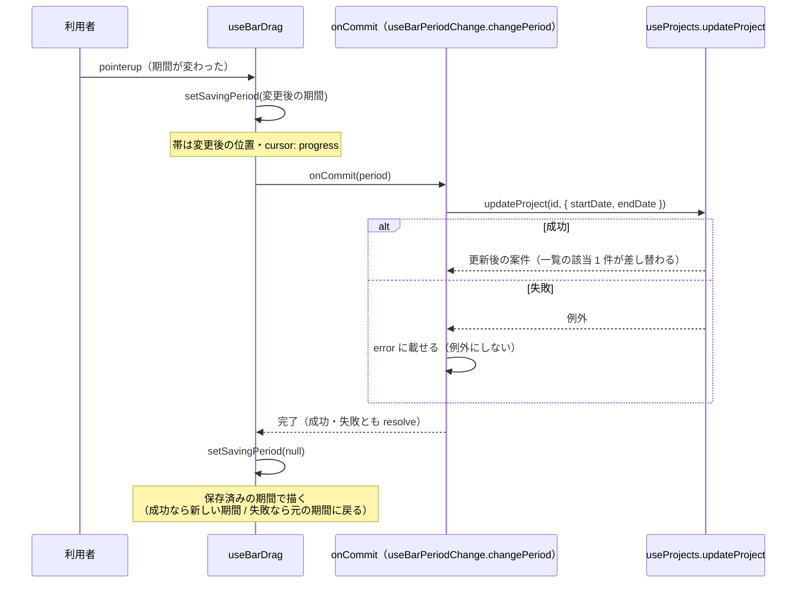

# 帯のドラッグ（期間の移動・伸縮）

「タイムライン上の帯を動かして、案件の期間を変える」仕組みの資料。クリック（サイドパネルを開く）との区別、保存中の見た目、取り消し、失敗時の戻し方までを扱う。

- 主なファイル:
  - 帯: `components/ProjectBar/`
    - `ProjectBar.tsx`（描画）/ `useProjectBar.ts`（見た目の値とドラッグの結線）
    - `useBarDrag.ts`（**ポインター操作と状態**）
    - `barDrag.utils.ts`（**状態遷移の純粋関数**）/ `barDrag.utils.test.ts`
    - `ProjectBar.module.scss`
  - 期間の計算: `utils/layout.utils.ts`（`pxToDays` / `moveProjectDates` / `resizeProjectDates`）
  - 保存とエラー: `hooks/useBarPeriodChange.ts`
- 関連する資料: [日付と表示期間](02-date-and-timeline-range.md#4-座標の計算layoututilsts)、[チャートの表示](03-chart-layout.md)、[並び替え](07-drag-reorder.md)（同じ設計の兄弟）

## 目次

1. [できること](#1-できること)
2. [全体の流れ](#2-全体の流れ)
3. [ファイルの役割分担](#3-ファイルの役割分担)
4. [ドラッグの状態（`IBarDragState`）](#4-ドラッグの状態ibardragstate)
5. [イベントの流れ（`useBarDrag`）](#5-イベントの流れusebardrag)
6. [クリックとの区別](#6-クリックとの区別)
7. [離したときの 3 つの結果](#7-離したときの-3-つの結果)
8. [保存中の見た目と、失敗したときの戻し方](#8-保存中の見た目と失敗したときの戻し方)
9. [取り消し（Esc・pointercancel）](#9-取り消しescpointercancel)
10. [伸縮のつかみ](#10-伸縮のつかみ)
11. [編集中の帯はドラッグできない](#11-編集中の帯はドラッグできない)
12. [ドラッグ中の見た目](#12-ドラッグ中の見た目)
13. [テスト](#13-テスト)
14. [よくある質問](#14-よくある質問)

---

## 1. できること

| つかむ場所       | 動き | 期間への効果                                           |
| ---------------- | ---- | ------------------------------------------------------ |
| 帯の中央         | 移動 | 期間の長さを保ったまま、開始日・終了日を同じ日数ずらす |
| 左端（開始日側） | 伸縮 | 開始日だけ動かす（終了日は動かさない）                 |
| 右端（終了日側） | 伸縮 | 終了日だけ動かす（開始日は動かさない）                 |

- **1 日単位**で動く（列幅の半分以上動いたら 1 日）。
- 動かしている間は、帯の上に**変更後の期間**（例: `10/3 〜 10/12`）が出る。
- 離すと保存され、**保存が終わるまで帯は変更後の位置**に描かれる。
- 失敗すると**元の位置に戻り**、左下にお知らせが出る。
- Esc で**取り消し**（元の位置に戻る。保存しない）。
- 小さくしか動かさなかったら**クリック**として扱い、サイドパネルを開く。

---

## 2. 全体の流れ



---

## 3. ファイルの役割分担

| ファイル                      | 受け持ち                                                                             | 持たないもの                           |
| ----------------------------- | ------------------------------------------------------------------------------------ | -------------------------------------- |
| `barDrag.utils.ts`            | **状態遷移の計算**（純粋関数）。ポインターイベントを知らない                         | DOM・React                             |
| `useBarDrag.ts`               | **ポインター操作**（キャプチャ・`window` への登録・click の抑止）と状態の保持        | 期間の計算（`barDrag.utils` に任せる） |
| `useProjectBar.ts`            | 帯の位置・幅・色・className・ツールチップ・伸縮つかみの出し分け。`useBarDrag` を呼ぶ |                                        |
| `ProjectBar.tsx`              | 描画だけ                                                                             |                                        |
| `hooks/useBarPeriodChange.ts` | 保存（`updateProject`）と失敗時のエラー                                              | ドラッグ                               |

> **状態を純粋関数に切り出す**のは、jsdom を入れず node 環境でテストするため。ポインターイベントの順番を変えた流れを `dragThrough` で再現してテストしている。フック自体の配線（キャプチャ・`window` の登録・click の抑止）は、ブラウザでの手動確認で見ている。

---

## 4. ドラッグの状態（`IBarDragState`）

ポインターを押してから離す（または取り消す）までの間だけ存在する。**帯 1 本ごとのフック**（`useBarDrag`）が持つ（ドラッグ中に `Timeline` 全体を再描画しないため）。

| フィールド     | 意味                                                                                                    |
| -------------- | ------------------------------------------------------------------------------------------------------- |
| `mode`         | `"move"`（中央）/ `"resize-start"` / `"resize-end"`                                                     |
| `pointerId`    | ドラッグに使っているポインターの ID（2 本目の指の動きを無視するため）                                   |
| `startClientX` | ドラッグ開始時の X 座標（`clientX`）                                                                    |
| `deltaDays`    | 現在の移動日数（`pxToDays` で 1 日単位に丸めた値）                                                      |
| `isDragging`   | 移動量がしきい値（`DRAG_THRESHOLD_PX` = 4px）を**一度でも**超えたか。**超えたら戻しても `true` のまま** |

### `barDrag.utils.ts` の関数

| 関数                                            | 役割                                                                                                                                                                                                           |
| ----------------------------------------------- | -------------------------------------------------------------------------------------------------------------------------------------------------------------------------------------------------------------- |
| `startBarDrag(mode, pointerId, clientX)`        | 押したときの状態を作る（`deltaDays: 0`、`isDragging: false`）                                                                                                                                                  |
| `updateBarDrag(state, pointerId, clientX)`      | 動いたときの状態を返す。`state` が `null`・別のポインターなら**そのまま返す**。移動量 `deltaPx = clientX − startClientX` から `deltaDays = pxToDays(deltaPx)` を求め、しきい値を超えたら `isDragging` を立てる |
| `getDraggedPeriod(period, state)`               | ドラッグ中の**仮の期間**。しきい値を超えるまで（または `deltaDays === 0`）は元の期間のまま。`move` なら `moveProjectDates`、伸縮なら `resizeProjectDates`                                                      |
| `getBarDragResult(period, state)`               | 離したときの結果（[§7](#7-離したときの-3-つの結果)）                                                                                                                                                           |
| `isSamePeriod(a, b)`                            | 開始日・終了日が同じか                                                                                                                                                                                         |
| `formatBarPeriodLabel(period)`                  | ドラッグ中に帯の上に出す表示（`"10/3 〜 10/12"`）                                                                                                                                                              |
| `formatBarAriaLabel(name, period, isCompleted)` | 帯の `aria-label`（`"案件A 10月3日〜10月12日"`、完了済みは末尾に「完了済み」）                                                                                                                                 |

---

## 5. イベントの流れ（`useBarDrag`）

```
1. 帯の中央・端の onPointerDown
     ├ 主ボタン（button === 0）以外 → 何もしない
     ├ 保存中・すでに別のポインターでドラッグ中 → 何もしない
     ├ 無効（編集中の帯）→ 何もしない（※クリックは受け付ける）
     └ setPointerCapture して、状態を作る（startBarDrag）

2. ドラッグ中だけ window に登録（同じ useEffect の中で解除）
     pointermove / pointerup / pointercancel / keydown（Esc。capture 段階）

3. pointermove → updateBarDrag で状態を更新 → 仮の期間で帯を描き直す
4. pointerup   → 結果を決める（§7）
5. pointercancel / Esc / キャプチャを失った → 取り消し（§9）
```

### なぜ `window` で受けるのか

帯の要素ではなく **`window`** にイベントを登録するのは、**帯が表示期間の外へ出て描かれなくなっても、離した操作を受け取る**ため。ポインターのキャプチャ（`setPointerCapture`）もしているので、帯の外にポインターが出ても、イベントが届き続ける。

### 状態を `state` と `ref` の両方で持つ

`applyDragState` が、`state`（描画用）と `ref`（イベントハンドラーから最新値を読む用）を**同時に更新**する。`pointermove` が描画より速く続けて来ても、古い値で計算しないため。

### 伸縮のつかみの `stopPropagation`

伸縮のつかみは帯（`button`）の**中**にある。つかみの `pointerdown` で `event.stopPropagation()` して、帯全体の「移動」の `pointerdown` まで伝わらないようにしている（`handleResizeStartPointerDown` / `handleResizeEndPointerDown`）。

---

## 6. クリックとの区別

同じ帯が「クリックでパネルを開く」と「ドラッグで期間を変える」の両方を持つので、区別が要る。

### しきい値

移動量が `DRAG_THRESHOLD_PX`（4px）**未満**で離したら、**クリック扱い**（`isDragging` が `false` のまま）。クリックならそのまま後続の `click` イベントがパネルを開く。

### ドラッグ・取り消しの後の `click` を 1 回だけ無視する

ドラッグして離すと、ブラウザは `click` も発火する。これでパネルが開いてしまわないよう、**直後の `click` を 1 回だけ無視する印**（`shouldSuppressClickRef`）を使う。

- ドラッグ・取り消しのときに印を立てる。
- `click` ハンドラーの先頭で `consumeClickSuppression(isPointerClick)` を**必ず**呼び、`true` ならパネルを開かない。
- **印は `click` のたびに消す**。次の `pointerdown` でも戻す（取り消しの後に `click` が来なかった場合に、印が残って次のクリックまで消えてしまわないように）。
- **キーボード（Enter / Space）の `click` は抑止しない**。ポインター由来かの判定は `MouseEvent.detail > 0`（キーボード由来は `detail === 0`）。取り消しの後に `click` が来ず印が残っていても、キーボードではパネルを開けるようにするため。

> `useProjectBar.handleClick`: `if (consumeClickSuppression(event.detail > 0)) return` → `onSelect(projectId)`。

---

## 7. 離したときの 3 つの結果

`getBarDragResult(period, state)`（`period` はドラッグ前の期間）。

| 結果                         | 条件                                                     | その後                                                |
| ---------------------------- | -------------------------------------------------------- | ----------------------------------------------------- |
| `{ type: "click" }`          | `isDragging` が `false`（しきい値未満）                  | 後続の `click` でパネルを開く。保存しない             |
| `{ type: "unchanged" }`      | ドラッグしたが、期間が元と同じ（元の位置に戻して離した） | 保存しない。直後の `click` は抑止（パネルを開かない） |
| `{ type: "commit", period }` | 期間が変わった                                           | `onCommit(period)` で**1 回だけ**保存する             |

---

## 8. 保存中の見た目と失敗したときの戻し方



- **描く期間の決め方**（`displayPeriod`）: 保存中はその期間 → ドラッグ中は仮の期間 → それ以外は保存済みの期間。
- **保存が終わる（成功・失敗とも）と、仮の期間を捨てて保存済みの位置に戻す**。成功していれば保存済みの期間そのものが新しい値になっているので、見た目は動かない。失敗なら元の位置に戻る。
- 保存中は**もう一度つかめない**（`savingPeriod !== null` のとき `beginDrag` が何もしない）。カーソルは `progress`。
- **`onCommit` は例外を投げない契約**（失敗の表示は呼び出し側）。万一 reject されても、`useBarDrag` が `.catch` してコンソールに出すだけにして、unhandled rejection にしない。
- 失敗の表示は `useBarPeriodChange` の `error` → `GanttChart` の左下のお知らせ（「期間を保存できませんでした。{理由}」+ 閉じるボタン）。

`useBarPeriodChange.changePeriod` は `updateProject(projectId, period)` を呼ぶ**部分更新**（開始日・終了日だけを渡す）。`useProjects.updateProject` が保存成功後に一覧の該当の 1 件を差し替える。参照は `updateProject` が変わらない限り同じ（`Timeline` の `React.memo` を保つため）。

---

## 9. 取り消し（Esc・pointercancel）

次のとき、**取り消して元の位置に戻す**（保存しない）。

| きっかけ                                   | 実装                                                                                                    |
| ------------------------------------------ | ------------------------------------------------------------------------------------------------------- |
| Esc                                        | `window` の `keydown`（**capture 段階**）で受け、`preventDefault` + `stopPropagation` して `cancelDrag` |
| `pointercancel`                            | ブラウザがドラッグを中断したとき                                                                        |
| キャプチャを失った（`lostpointercapture`） | 要素が消えた・ブラウザが外した                                                                          |

- Esc を **capture 段階で受けて `stopPropagation`** するのは、サイドパネルの Esc（`document` の `keydown`）まで届いて、**開いているパネルが閉じてしまうのを防ぐ**ため。
- 取り消しの後は、**直後の `click` を無視**する（パネルを開かない）。
- 取り消しでキャプチャを外す（`releasePointerCapture`）と `lostpointercapture` が来るが、その時点で状態は `null` なので何もしない。

---

## 10. 伸縮のつかみ

帯の左右の端に重ねる細い領域（`.handle`。幅はマウスで 6px、タッチなど指で操作する端末（`@media (pointer: coarse)`）で 10px。1 日だけの帯（32px）でも、中央が 20px / 12px 残る）。触れたときだけ薄く浮かび上がる。

出し分け（`useProjectBar`）:

- **ドラッグ前の位置**で決める（`originalLayout`）。ドラッグ中につかみが出たり消えたりしないように。
- **表示期間の外にはみ出している側の端は出さない**（見えていないので伸縮させない）。`isClippedStart` なら左のつかみなし、`isClippedEnd` なら右のつかみなし。
- **編集中の帯は両方とも出さない**。
- つかみは `aria-hidden`（スクリーンリーダーには伝えない）。

---

## 11. 編集中の帯はドラッグできない

**サイドパネルで編集中の案件の帯は、ドラッグできない**（クリックだけ受け付ける）。`useProjectBar` が `useBarDrag` の `isDisabled` に `isEditing` を渡している。

- 理由: パネルのフォームの日付と、ドラッグで変えた期間が食い違い、古い日付のまま保存して戻してしまうのを防ぐため。
- そのため `GanttChart` の `sidePanelKey` は案件の ID だけのまま（期間で作り直さなくてよい）。
- 見た目: カーソルは `grab` ではなく `pointer`、つかみも出ない。パネルを閉じれば同じ帯もドラッグできる。**他の帯は、パネルを開いたままドラッグできる**。

---

## 12. ドラッグ中の見た目

`ProjectBar.module.scss`。

| 状態                                 | 見た目                                                                                                                           |
| ------------------------------------ | -------------------------------------------------------------------------------------------------------------------------------- |
| 通常                                 | カーソル `grab`。背景はグラデーション（立体感）。`touch-action: pan-y`（横のドラッグは帯の操作、縦のスワイプは画面のスクロール） |
| ホバー                               | 白を 6% 重ねる（`$bar-highlight`）                                                                                               |
| ドラッグ中（`.dragging`）            | 他の帯より上（`z-index: 2`）、カーソル `grabbing`、ホバーと同じ白を重ねる                                                        |
| 変更後の期間の表示（`.periodLabel`） | 帯の上に小さなラベル（`10/3 〜 10/12`）。位置（`left`）は帯の左端にそろえる                                                      |
| 保存中（`.saving`）                  | カーソル `progress`                                                                                                              |
| 編集中（`.editing`）                 | 二重の枠で強調。カーソルは `pointer`                                                                                             |
| 完了済み（`.completed`）             | 薄い（`opacity: 0.4`）。**編集中・ドラッグ中は元の濃さに戻す**（どの帯を操作しているか分かるように）                             |
| 表示期間からはみ出す側               | 角を丸めない（`.clippedStart` / `.clippedEnd`）                                                                                  |

> 色は `background` ではなく **`backgroundColor`** で渡す（`useProjectBar` の `style`）。`background` だと、`.bar` の `background-image`（グラデーション）が消える。

---

## 13. テスト

`barDrag.utils.test.ts`（25 ケース）が、状態遷移を純粋関数として確認している。

- `startBarDrag` / `updateBarDrag`: 初期状態、別のポインターの無視、しきい値の境界、一度超えたら戻しても `isDragging` が `true`、日数の丸め
- `getDraggedPeriod`: 移動・左右の伸縮、開始日が終了日を越えないこと
- `getBarDragResult`: `click` / `unchanged` / `commit`
- `formatBarPeriodLabel` / `formatBarAriaLabel`

フック（`useBarDrag`）の配線は、ブラウザでの手動確認で見ている（ドラッグで移動・伸縮、離すと保存、Esc で取り消し、保存失敗時の戻し、編集中はドラッグ不可、など）。

---

## 14. よくある質問

**Q. ドラッグの途中で別の帯に触れたらどうなりますか？**
`pointerId` が違うポインターの動きは無視されます（`updateBarDrag` が状態をそのまま返す）。同じポインターなら、`setPointerCapture` のおかげで、別の帯の上を通っても、ドラッグ中の帯にイベントが届き続けます。

**Q. 帯を表示期間の外まで引っぱって離したらどうなりますか？**
`window` で受けているので、離した操作は受け取れます。期間は 1 日単位で計算されるので、表示期間の外の日付にも動かせます（帯が見えなくなるだけです）。

**Q. なぜ保存中の帯を変更後の位置に描くのですか？**
保存が終わるまで元の位置に戻ると、一瞬ちらつくためです。保存中は変更後の位置に描き続け、終わったら保存済みの値で描き直します。

**Q. 左端が表示期間の外にはみ出している帯の、開始日は伸縮できますか？**
できません。見えていない端なので、つかみを出していません。中央をつかんで移動することはできます。

**Q. ドラッグした直後にパネルが開いてしまいます。**
`click` を抑止する仕組み（`consumeClickSuppression`）の呼び忘れが原因として考えられます。`click` のハンドラーの**先頭**で必ず呼び、`true` ならパネルを開かないようにしてください。

**Q. タッチ操作でも動きますか？**
ポインターイベント（`pointerdown` など）で書いているのでタッチでも動く想定で、つかみも指向けに広くしています。ただし**実機では確認していません**（スマホはあまり想定していないため）。
