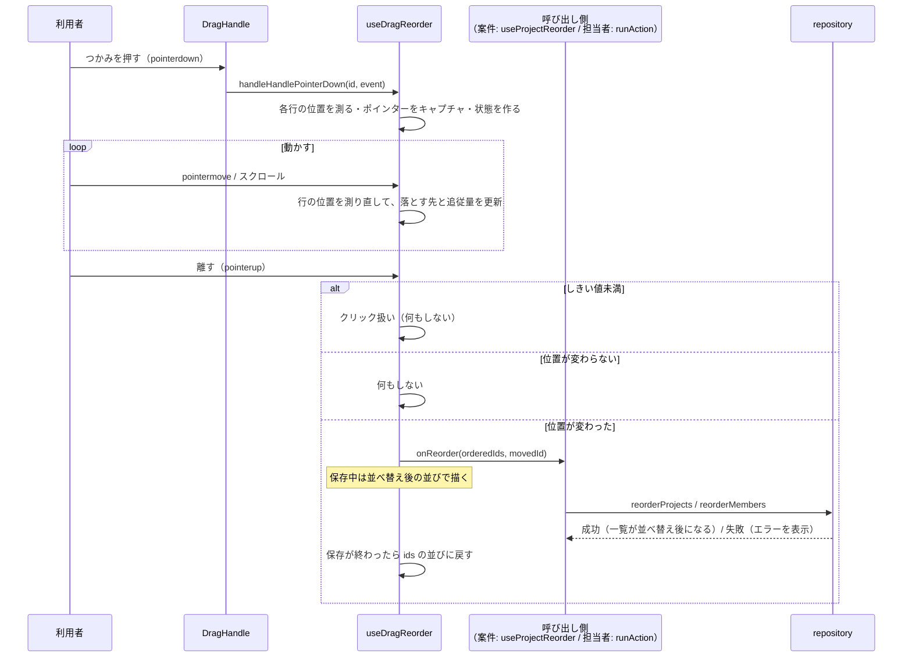
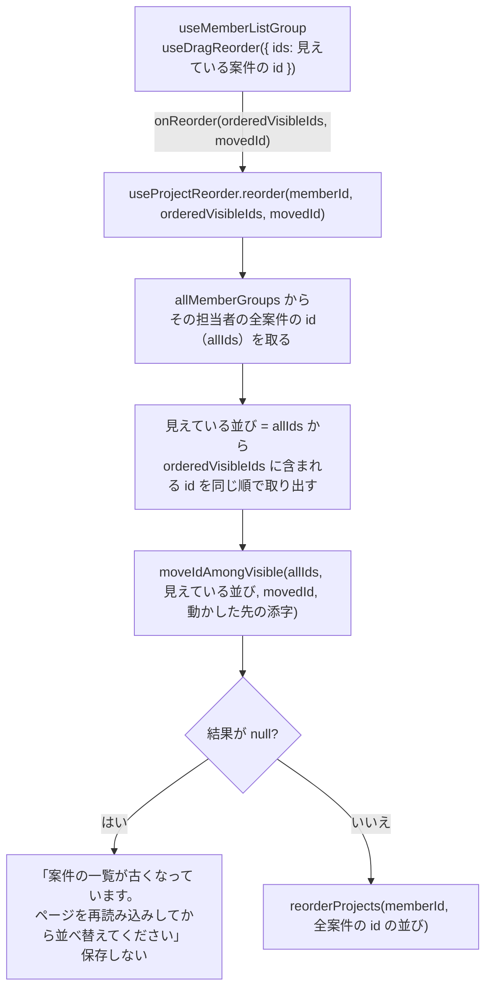

# ドラッグによる並び替え（案件・担当者）

「左リストの案件、担当者管理ダイアログの担当者を、つかみ（⋮⋮）をドラッグして並べ替える」仕組みの資料。**共通のフック `useDragReorder` を、案件と担当者の 2 か所で使い回している**のが特徴。

- 主なファイル:
  - 共通のフック: `hooks/useDragReorder.ts`
  - 状態遷移の純粋関数: `hooks/dragReorder.utils.ts` / `dragReorder.utils.test.ts`
  - id の並びの入れ替え: `utils/reorder.utils.ts`（`moveIdToIndex` / `moveIdAmongVisible`）
  - つかみ: `components/DragHandle/`
  - 案件での使用: `components/MemberListGroup/useMemberListGroup.ts` → `hooks/useProjectReorder.ts`
  - 担当者での使用: `components/MemberManageDialog/useMemberManageDialog.ts`
  - 保存: `repositories/localStorageRepository.ts`（`reorderProjects` / `reorderMembers`）
- 関連する資料: [帯のドラッグ](06-bar-drag.md)（同じ設計）、[チャートの表示](03-chart-layout.md#5-行モデル左右をそろえる仕組み)（`applyProjectOrder`）、[担当者の管理](05-member-management.md#7-並び替え)

## 目次

1. [できること](#1-できること)
2. [全体の流れ](#2-全体の流れ)
3. [共通のフック `useDragReorder`](#3-共通のフック-usedragreorder)
4. [状態遷移の純粋関数（`dragReorder.utils.ts`）](#4-状態遷移の純粋関数dragreorderutilsts)
5. [落とす先の決め方](#5-落とす先の決め方)
6. [行の見た目（浮かせる・線を出す）](#6-行の見た目浮かせる線を出す)
7. [イベントとスクロール](#7-イベントとスクロール)
8. [案件の並び替え（完了済みを隠しているとき）](#8-案件の並び替え完了済みを隠しているとき)
9. [担当者の並び替え](#9-担当者の並び替え)
10. [保存（repository）](#10-保存repository)
11. [`DragHandle`](#11-draghandle)
12. [設計上の判断](#12-設計上の判断)
13. [よくある質問](#13-よくある質問)

---

## 1. できること

| 場所                                     | 並べるもの           | 範囲                                                                 |
| ---------------------------------------- | -------------------- | -------------------------------------------------------------------- |
| 左リストの各案件行の左端の「⋮⋮」         | 同じ担当者の中の案件 | **その担当者の案件の中だけ**（範囲の外へ引いても先頭・末尾で止まる） |
| 担当者管理ダイアログの各行の左端の「⋮⋮」 | 全担当者             | 全担当者の中                                                         |

- **ドラッグ中は並びを変えない**。つかんだ行が浮いてポインターに追従し、落とす先に**横線**が出る。
- 離したとき、位置が変わっていれば保存する。保存中は並べ替え後の並びで描き、終わったら保存済みの並びに戻す（成功なら同じ並び、失敗なら元の並び）。
- Esc で取り消せる。**キーボードでの並び替えはない**（オーナーの判断で不要。つかみは `tabIndex={-1}`）。

---

## 2. 全体の流れ



---

## 3. 共通のフック `useDragReorder`

並べる対象（案件か担当者か）を**知らない**。**id の並びの中の 1 つを動かす**ことだけを受け持つ。

```ts
useDragReorder({
  ids: string[],            // 並んでいる id（表示順）
  onReorder: (orderedIds, movedId) => Promise<void>,
  isDisabled: boolean,      // true の間はドラッグを始めない（保存中など）
})
```

### 引数の契約

| 引数         | 契約                                                                                                                                                                                                                 |
| ------------ | -------------------------------------------------------------------------------------------------------------------------------------------------------------------------------------------------------------------- |
| `ids`        | **このフックはこの並びだけを扱う**。ここに渡していない id（表示していない行など）を含めた全体の並びに戻すのは、**呼び出し側の責務**。`useMemo` などで**参照を保って**渡す（`effect` が作り直されないように）         |
| `onReorder`  | 離して位置が変わったときに **1 回だけ**呼ぶ。`movedId`（動かした id）も渡す。**例外を投げない契約**（失敗の表示は呼び出し側）。完了（成功・失敗とも）するまでは並べ替え後の並びで描き、完了したら `ids` の並びに戻す |
| `isDisabled` | `true` の間はドラッグを始めない                                                                                                                                                                                      |

### 返すもの

| 値                                   | 使い方                                                                                 |
| ------------------------------------ | -------------------------------------------------------------------------------------- |
| `displayIds`                         | 描く並び。**保存中は並べ替え後の並び、それ以外は `ids`**（ドラッグ中も並びは変えない） |
| `isDragging` / `isSaving`            | ドラッグしている間 / 保存中                                                            |
| `getRowState(id)`                    | 行 1 つぶんの見た目の状態（`isDragging` / `offsetY` / `dropIndicator`）                |
| `registerRow(id, element)`           | 行の要素を登録する（`ref` のコールバックから呼ぶ）                                     |
| `handleHandlePointerDown(id, event)` | つかみの `onPointerDown` に渡す                                                        |
| `handleLostPointerCapture`           | つかみの `onLostPointerCapture` に渡す                                                 |

### 使い方（呼び出し側がやること）

1. 各行の要素を `registerRow(id, element)` で登録する（行の `ref` のコールバックから。`useCallback` で参照を保つ）。**行の位置を測るのに使う**。
2. つかみに `handleHandlePointerDown(id, event)` と `handleLostPointerCapture` をつなぐ。
3. 行は `displayIds` の順に描き、`getRowState(id)` で浮かせる量・挿入位置の線を決める。

### 状態の持ち方

- ドラッグ中の状態（`IDragReorderState`）は `state`（描画用）と `ref`（イベントハンドラーから最新値を読む用）の**両方**を `applyDragState` で同時に更新する（帯のドラッグと同じ）。
- 保存中の並び（`savingIds`）は `state`。
- 行の要素の登録（`rowElementsRef`）と、キャプチャしている要素、最後のポインターの Y 座標は `ref`（描画には使わない）。

---

## 4. 状態遷移の純粋関数（`dragReorder.utils.ts`）

座標はすべて**今の画面の座標（`clientY`）**。行の位置は、フックが測り直して渡す。

### `IDragReorderState`

| フィールド     | 意味                                                                             |
| -------------- | -------------------------------------------------------------------------------- |
| `activeId`     | つかんでいる行の id                                                              |
| `pointerId`    | ポインターの ID（2 本目の指の動きを無視するため）                                |
| `startClientY` | 開始時の Y 座標（しきい値の判定に使う）                                          |
| `grabOffsetY`  | つかんだ位置の、つかんだ行の上端からの距離（行をポインターに追従させるのに使う） |
| `rowRects`     | **最後に測った**各行の位置（`top` / `bottom`）。並びは id の並びと同じ           |
| `fromIndex`    | つかんだときの位置（添字）                                                       |
| `toIndex`      | 今のポインターから求めた、落とす先の位置（0 〜 件数 − 1）                        |
| `offsetY`      | つかんだ行をポインターに追従させる縦の移動量（px）                               |
| `isDragging`   | 移動量がしきい値（4px）を一度でも超えたか                                        |

### 関数

| 関数                                                      | 役割                                                                                                                                                                                            |
| --------------------------------------------------------- | ----------------------------------------------------------------------------------------------------------------------------------------------------------------------------------------------- |
| `startDragReorder(...)`                                   | つかんだときの状態を作る                                                                                                                                                                        |
| `getDropIndex(rowRects, fromIndex, pointerY)`             | 落とす先の位置を求める（[§5](#5-落とす先の決め方)）                                                                                                                                             |
| `clampDragOffset(rowRects, fromIndex, offsetY)`           | 追従量を、並べ替えられる範囲に収める                                                                                                                                                            |
| `updateDragReorder(state, pointerId, clientY, rowRects?)` | 動いた・スクロールしたときの状態を返す。`state` が `null`・別のポインターならそのまま返す。しきい値を超えるまでは落とす先を元の位置のままにする（つかみをクリックしただけで並びを変えないため） |
| `getDragReorderResult(ids, state)`                        | 離したときの結果。`click` / `unchanged` / `commit`（`orderedIds` 付き）                                                                                                                         |
| `getDropIndicator(state, index)`                          | `index` 番目の行に出す線（`"before"` / `"after"` / `null`）                                                                                                                                     |

---

## 5. 落とす先の決め方

**つかんだ行を除いた各行のうち、中央がポインターより上にある行の数**が、そのまま落とす先の位置（`toIndex`）になる（`getDropIndex`）。

```
行: A(0)  B(1)  C(2)  D(3)       Bをつかんだ（fromIndex = 1）
中央の Y:  40    80    120   160

ポインターが Y = 100 → Bを除いた A(40), C(120), D(160) のうち 100 より上にあるのは A だけ
  → toIndex = 1（B は元の位置）

ポインターが Y = 130 → A(40), C(120) が 130 より上 → toIndex = 2（B は C の下へ）
```

- 一番上の行より上・一番下の行より下に出ても、`0 〜 件数 − 1` に収まる（**先頭・末尾で止まる**）。
- **高さの違う行**があっても、測った位置から決めるので正しく動く（行の高さを仮定しない）。
- **追従量**（`offsetY`）も、並べ替えられる範囲（先頭の行の上端〜末尾の行の下端）の**外へは出さない**（`clampDragOffset`）。管理ダイアログの外に出て見えなくなったり、別の担当者の行に重なったりしないようにする。

---

## 6. 行の見た目（浮かせる・線を出す）

`getRowState(id)` が、行ごとに次を返す。

| 値              | 意味                                                                    |
| --------------- | ----------------------------------------------------------------------- |
| `isDragging`    | つかまれていて、しきい値を超えて動かしている行か                        |
| `offsetY`       | つかんだ行の縦の移動量（つかまれていない行は 0）                        |
| `dropIndicator` | 落とす先の行に出す線。`"before"`（行の上）/ `"after"`（行の下）/ `null` |

**線の向きの決め方**（`getDropIndicator`）: 落とす先が**元の位置より下**なら、落とす先の行の**下**（`after`）に、**上**なら落とす先の行の**上**（`before`）に出す。ドラッグ前・元の位置のままのときは出さない。

行側（`useMemberListProjectRow` / `useMemberManageRow`）は、`isDragging` なら `transform: translateY(${offsetY}px)` で行を動かし、`dropIndicator` に応じたクラス（`dropBefore` / `dropAfter`）を付ける。

---

## 7. イベントとスクロール

### つかみの `pointerdown`（`handleHandlePointerDown`）

始めない条件: 主ボタン（`button === 0`）以外 / `isDisabled` / 保存中 / すでに別のポインターでドラッグ中。

始めるとき:

1. **各行の位置を測る**（`measureRowRects(ids)`）。**測れない行がある（描画の途中など）ときは始めない**。
2. ポインターをキャプチャする（`setPointerCapture`）。
3. 状態を作る（`startDragReorder`）。

> **`preventDefault` はしない**。すると入力欄からフォーカスが外れず（`blur` が来ず）、管理ダイアログで**編集中の名前が保存されないまま残る**ため。タッチのスクロールはつかみの `touch-action: none` で、テキストの選択はつかみの `user-select: none` で防いでいる。

### ドラッグ中だけ `window` に登録するイベント

`pointermove` / `pointerup` / `pointercancel` / `scroll`（capture 段階）/ `keydown`（Esc。capture 段階）。登録と解除は同じ `useEffect` の中。`window` で受ける理由は、ポインターが行の外へ出ても離した操作を受け取るため（帯のドラッグと同じ）。

### 行の位置を「測り直す」

**`pointermove` とスクロールのたびに、行の位置を測り直す**（`updateWithPointer`）。つかんだときだけ測ると、ドラッグ中に行の高さが変わった（たとえば担当者名の検証エラーが出て行が高くなった）ときに、**落とす先が 1 つずれる**ため。

測り方（`measureRowRect`）は `getBoundingClientRect` ではなく **`offsetTop` / `offsetHeight`**:

- `getBoundingClientRect` だと、ドラッグ中の行に付けた `transform`（動かした分）の影響を受けてしまう。`offsetTop` なら**動かす前の位置**が測れる。
- `offsetTop` は `offsetParent` からの距離なので、`offsetParent` の画面上の位置を足し、そのスクロール量を引いて、画面の座標にそろえる。
- 画面に出ていない（`offsetParent` がない）ときは `null`。

### スクロールへの追従

ポインターを止めたままスクロールしても、つかんだ行はポインターの下に残り、落とす先もスクロールした分だけ変わる（`scroll` を **capture 段階**で受ける。スクロールはバブリングしないため、どの要素のスクロールも受けられるように）。ただし、**端に近づいたときの自動スクロールはない**。

### Esc

ドラッグの**取り消しだけ**に使う。サイドパネルの Esc（`document`）や、管理ダイアログ（`<dialog>`）が Esc で閉じるのを防ぐため、`window` の capture 段階で受けて `preventDefault` + `stopPropagation`。

### 結果の確定

離したとき（`handlePointerUp`）:

1. 最後の位置まで反映してから結果を決める。
2. `endDrag()`（キャプチャを外し、状態を消す）。
3. `getDragReorderResult(ids, state)` が `commit` なら、`setSavingIds(orderedIds)` → `onReorder(orderedIds, activeId)`。終わったら `finally` で `savingIds` を消す。
4. `onReorder` が（契約に反して）reject しても、unhandled rejection にしない（コンソールに出すだけ）。

---

## 8. 案件の並び替え（完了済みを隠しているとき）



### なぜ全体の並びに戻す必要があるのか

repository の `reorderProjects` は**その担当者の案件の id を過不足なく**受け取る契約。しかし完了済みを隠していると、画面には**一部の案件しか見えていない**（`useDragReorder` が扱うのは見えている案件だけ）。見えている並びのまま渡すと id が足りず、repository の検証エラーになる。

そこで `useProjectReorder` が、**隠れている完了済みの案件の前後関係を保って全体の並びに戻してから**保存する。

### `moveIdAmongVisible` の規則

`utils/reorder.utils.ts`。一部の id だけが見えている並びの中で `id` を動かし、見えていない id も含めた全体の並びを返す。

- 動かした先の**直後に見えている id** があれば、その**直前**に入れる。
- 見えている id の**末尾**へ動かしたときは、**直前に見えている id の直後**に入れる。
- 見えている id が自分だけのときは、動かす先がないので並びを変えない。
- `visibleIds` は `allIds` と同じ順で、その一部であること。`id` が含まれないときは `null`。

```
全体: A, (B), C, D     ← B は隠れている（完了済み）
D を、見えている並び（A, C, D）の先頭へ動かす
→ 直後に見えている id は A → A の直前に D を入れる
→ D, A, B, C           ← B は A と C の間（元の前後関係）を保つ
```

`dragReorder` で「どれを動かしたか」を決めるのに `movedId` が要る理由: 隣どうしを入れ替えた場合、並びの比較だけでは**どちらを動かしたか**を決められず、隠れた案件の置き場所が変わってしまうため。

### 見つからないとき

担当者・動かした案件が手元の一覧に見つからない（別のタブで削除された直後など）ときは**保存しない**。見えている並びのまま渡すと、repository の分かりにくい検証エラーになるため、**原因の分かる文言**（「案件の一覧が古くなっています。…」）を出す。

### 左のリストの描画

`useMemberListGroup` は、`applyProjectOrder(rows, displayIds)` で**案件行だけ**を `displayIds` の順にして描く。右のタイムラインは、離して保存するまで（`rowGroups` が変わるまで）並びを変えない。

---

## 9. 担当者の並び替え

`useMemberManageDialog` が `useDragReorder` を使う。

- `ids`: 全担当者の id（`useMemo`）。完了済みの絞り込みは関係ない（担当者は全員見える）。
- `onReorder`: `handleReorder` → `runAction(() => onReorder(orderedIds))`。`runAction` は例外を投げない（失敗は `actionError` にダイアログ内で出す）ので、契約を満たす。
- `isDisabled: isBusy`（保存中はつかめない）。
- 行は `displayIds` の順。

---

## 10. 保存（repository）

どちらも「渡された順に `sortOrder` を **0 から**付け直す」。

| メソッド                                | 渡すもの                    | 検証                                                                                                                                             |
| --------------------------------------- | --------------------------- | ------------------------------------------------------------------------------------------------------------------------------------------------ |
| `reorderMembers(orderedIds)`            | **全担当者**の id           | 重複 → `GanttValidationError` / 存在しない id → `GanttNotFoundError` / 件数が合わない（全員を含まない）→ `GanttValidationError`                  |
| `reorderProjects(memberId, orderedIds)` | **その担当者の全案件**の id | 担当者がいない → `GanttNotFoundError` / 重複・別の担当者の案件・存在しない id → `GanttValidationError` / 件数が合わない → `GanttValidationError` |

- **順番が変わらない行は `updatedAt` も変えない**。
- 案件は**配列の保存順を変えず**、並び替えた案件だけを差し替える。
- 画面側では、戻り値（並び替え後の一覧）で state を置き換える（`useMembers.reorderMembers`）か、該当の案件だけ差し替える（`useProjects.reorderProjects`）。

詳しくは [データ層](01-data-layer.md#並び替えreordermembers--reorderprojects)。

---

## 11. `DragHandle`

`components/DragHandle/`。縦の点 6 つ（`⋮⋮`）のボタン。**ドラッグの処理は持たず**、`useDragReorder` のハンドラーを受け取ってつなぐだけ。

| props                                    | 意味                                                                         |
| ---------------------------------------- | ---------------------------------------------------------------------------- |
| `label`                                  | 読み上げ用のラベル（「{名前} の並び順を変更」）                              |
| `isDragging`                             | この行をドラッグしている間 `true`（カーソルを `grabbing`）                   |
| `isDisabled`                             | `true` の間はつかめない見た目（管理ダイアログの保存中など。`aria-disabled`） |
| `onPointerDown` / `onLostPointerCapture` | フックのハンドラー                                                           |

- `tabIndex={-1}`: Tab で止まらない（キーボードでは並び替えられないため）。
- 無効は `disabled` 属性ではなく `aria-disabled` で表す。ドラッグを始めない判定そのものは、フック側（`useDragReorder` の `isDisabled`）が行う。
- 幅 20px × 高さ 28px（行の高さ 36px に収まり、指でもつかめる大きさ）。`touch-action: none`、`user-select: none`。

---

## 12. 設計上の判断

| 判断                                              | 理由                                                                                                            |
| ------------------------------------------------- | --------------------------------------------------------------------------------------------------------------- |
| ドラッグ中は並びを変えず、`translateY` で浮かせる | 並びを変えると行の位置が変わって測り直しが複雑になる。保存するまで DOM の並びが変わらないので、キャンセルも簡単 |
| 行の位置を毎回測り直す                            | ドラッグ中に行の高さが変わっても、スクロールしても、落とす先がずれない                                          |
| `offsetTop` / `offsetHeight` で測る               | ドラッグ中の行の `transform` の影響を受けずに、動かす前の位置を測れる                                           |
| 共通フックは「id の並び」だけを扱う               | 案件・担当者の両方に使い回すため。全体の並びへの復元は呼び出し側                                                |
| 状態遷移を純粋関数に切り出す                      | node 環境でテストするため（`dragReorder.utils.test.ts` は 22 ケース）                                           |
| `window` でイベントを受ける                       | 行の外にポインターが出ても離した操作を受け取るため                                                              |
| キーボードでの並び替えなし                        | オーナーの判断（issue #25 をクローズ）。必要になったら上下移動ボタンなどを足す                                  |

---

## 13. よくある質問

**Q. 並び替えたのに、右のタイムラインの並びがすぐ変わらないのはなぜですか？**
ドラッグ中は左リストの並びも変えず、離して保存するまで右のタイムラインも変わりません（保存後に `rowGroups` が変わって並び直ります）。左リストだけは、保存中に並べ替え後の並びで描きます。

**Q. 完了済みを隠しているとき、並べ替えると隠れている案件の位置はどうなりますか？**
元の前後関係を保ちます（[§8](#8-案件の並び替え完了済みを隠しているとき) の例）。見えている案件との相対的な位置が保たれるように、動かした案件の直後に見えている案件の直前に入れます。

**Q. 別の担当者の下には引っぱれますか？**
できません。並べ替えられるのは同じ担当者の中だけです。範囲の外へ引いても、先頭・末尾で止まります（担当者の付け替えは、サイドパネルの「担当者」の選択で行います）。

**Q. 管理ダイアログで名前を編集中につかんでドラッグするとどうなりますか？**
`pointerdown` で `preventDefault` していないので、入力欄の `blur` が起き、名前の保存が走ります。その後、並び替えも続けて行われます（名前の保存と並び替えの両方が 1 回の操作で反映されます）。

**Q. 行がとても多くて、画面の外まで引きたいときは？**
端に近づいたときの自動スクロールはありません。スクロールしながら（ホイールなどで）ドラッグを続ければ、落とす先もスクロールした分だけ変わります。

**Q. 並び替えの保存に失敗したら？**
元の並びに戻り、案件の場合は左下に「並び順を保存できませんでした。{理由}」のお知らせが出ます。担当者の場合はダイアログ内にエラーが出ます。
