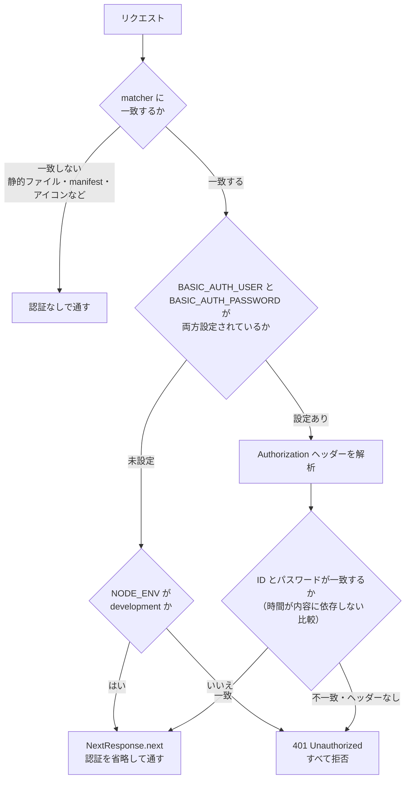

# 認証・PWA・開発環境

「アプリを動かす土台」の資料。Basic 認証、PWA（インストール）、HTTPS での開発、pnpm 縛り、設定ファイル、テスト・検証コマンド、ブランチ運用までを扱う。画面の機能そのものではなく、**動かす・守る・開発する**側の話。

- 主なファイル:
  - 認証: `src/proxy.ts` / `src/proxy.test.ts`
  - Next.js の設定: `next.config.ts`
  - PWA: `src/app/manifest.ts` / `public/sw.js` / `src/app/ServiceWorkerRegister.tsx` / `public/icons/` / `scripts/generate-icons.mjs`
  - アプリの入口: `src/app/layout.tsx` / `src/app/page.tsx`
  - パッケージ管理: `package.json` / `scripts/check-package-manager.mjs`
  - 品質: `eslint.config.mjs` / `.prettierrc.json` / `tsconfig.json` / `vitest.config.mts`
  - 規約: `AGENTS.md` / `CLAUDE.md` / `README.md`
- 関連する資料: [全体構成](../overview.md)

## 目次

1. [アプリの入口](#1-アプリの入口)
2. [Basic 認証（`src/proxy.ts`）](#2-basic-認証srcproxyts)
3. [Next.js の設定（`next.config.ts`）](#3-nextjs-の設定nextconfigts)
4. [PWA](#4-pwa)
5. [HTTPS での開発](#5-https-での開発)
6. [環境変数](#6-環境変数)
7. [pnpm 以外を止める仕組み](#7-pnpm-以外を止める仕組み)
8. [コマンドと品質ツール](#8-コマンドと品質ツール)
9. [ブランチと PR の運用](#9-ブランチと-pr-の運用)
10. [よくある質問](#10-よくある質問)

---

## 1. アプリの入口

```
src/app/
├── layout.tsx                 # <html lang="ja">。グローバル CSS の読み込みと ServiceWorkerRegister
├── page.tsx                   # <GanttChart /> を置くだけ
├── manifest.ts                # PWA のマニフェスト
├── ServiceWorkerRegister.tsx  # Service Worker の登録（"use client"）
└── favicon.ico
```

- **`layout.tsx`**: タイトルは「ガントチャート」。`globals.scss` をここで読み込む。**Google Fonts は使わずシステムフォント**を使う（オフライン・身内利用を前提に。フォントは `globals.scss` / `_tokens.scss` の `$font-family-base`）。
- **`page.tsx`**: サーバーコンポーネントだが、`<GanttChart />`（`"use client"`）を置くだけ。**データの読み込みはクライアント側**（localStorage はサーバーで読めないため。[全体構成](../overview.md#5-画面が表示されるまで)）。
- ルーティングはこの 1 ページだけ（`/`）。

---

## 2. Basic 認証（`src/proxy.ts`）

**全リクエストに Basic 認証をかける**（ユーザー認証はこれだけ）。Next.js 16 では `middleware.ts` ではなく **`proxy.ts`**（関数名は `proxy`）。

### 動きの全体



### 環境変数が未設定のとき

| 環境                                 | 動き                  | 理由                                       |
| ------------------------------------ | --------------------- | ------------------------------------------ |
| 開発（`NODE_ENV === "development"`） | 認証を省略して通す    | ローカルでの作業を楽にするため             |
| それ以外（本番など）                 | **すべて 401 で拒否** | **設定し忘れて公開してしまうのを防ぐため** |

### 関数

| 関数                                  | 役割                                                                                                                                                                                                                                                               |
| ------------------------------------- | ------------------------------------------------------------------------------------------------------------------------------------------------------------------------------------------------------------------------------------------------------------------ |
| `parseBasicAuthHeader(header)`        | `Authorization` ヘッダーから ID とパスワードを取り出す。ヘッダーなし・形式違い・base64 不正・コロンなしは `null`。**パスワードにコロンが含まれていてもよいよう、最初のコロンで分割**する。UTF-8 として読み直す（`atob` はバイト列を 1 文字ずつの文字列にするため） |
| `isSafeEqual(a, b)`                   | 2 つの文字列を、**一致するまでの時間が内容に依存しない**形で比較する（タイミング攻撃対策）。長さが違っても、長い方の長さ分だけ必ず比較してから結果を返す                                                                                                           |
| `isAuthorized(credentials, expected)` | 資格情報が期待する ID・パスワードに一致するか。ID とパスワードの比較結果を**別々に評価せず、両方比較してから結合**する（片方が不一致でも比較時間が変わらないように）                                                                                               |
| `proxy(request)`                      | 上の流れ                                                                                                                                                                                                                                                           |

### `matcher`（認証の対象外）

```
/((?!_next/static|_next/image|favicon.ico|manifest.webmanifest|icons/|apple-icon.png).*)
```

静的ファイル・favicon に加えて、**PWA のインストール判定に使われるファイル（manifest とアイコン）も認証の対象外**にしている。ブラウザは manifest とアイコンを**資格情報なしで**取得する（`<link rel="manifest">` に `crossorigin="use-credentials"` がないため）。これらに Basic 認証をかけると 401 になり、**インストール可能と判定されない**。`sw.js` は登録時に資格情報が送られるため、認証をかけたまま。

### 他のモジュールに依存しない

`proxy.ts` は、認証に必要な関数をすべてこのファイルの中で完結させている（Next.js のドキュメントが、proxy は他のモジュールに依存しない方がよいとしているため）。

### テスト（`proxy.test.ts`、21 ケース）

ヘッダーの解析（形式違い・コロン入りのパスワード・UTF-8）、比較関数、認証の判定、環境変数あり・なし（開発 / 本番）の挙動を確認している。

---

## 3. Next.js の設定（`next.config.ts`）

| 設定                       | 内容                                                                                                                                                       |
| -------------------------- | ---------------------------------------------------------------------------------------------------------------------------------------------------------- |
| `cacheComponents: true`    | 現在時刻などを静的な部分に焼き込まない（そのため `useTimelineRange` は、サーバー側では日付を決めず `null` を返す）                                         |
| `partialPrefetching: true` |                                                                                                                                                            |
| `sassOptions.loadPaths`    | `src/styles` を指定。**各 `*.module.scss` から `@use "tokens"` で読める**ようにする                                                                        |
| `headers()`（全ページ）    | `X-Content-Type-Options: nosniff` / `X-Frame-Options: DENY`（`<iframe>` への埋め込みを拒否）/ `Referrer-Policy: strict-origin-when-cross-origin`           |
| `headers()`（`/sw.js`）    | `Content-Type: application/javascript; charset=utf-8` と `Cache-Control: no-cache, no-store, must-revalidate`（**Service Worker は常に最新を取得させる**） |

> Next.js 16 は、記憶にある API と異なる点がある（`middleware.ts` が `proxy.ts` に変わった、`cacheComponents` が有効、など）。実装前に `node_modules/next/dist/docs/` の該当ドキュメントを読むのが `AGENTS.md` の決まり。

---

## 4. PWA

「ホーム画面・アプリとしてインストールして、独立したウィンドウで開ける」ようにしてある。**オフライン対応はしていない**（インストール可能にするための最小限）。

### マニフェスト（`manifest.ts`）

| 項目                               | 値                                                                                                   |
| ---------------------------------- | ---------------------------------------------------------------------------------------------------- |
| `name` / `short_name`              | ガントチャート                                                                                       |
| `display`                          | `standalone`（ブラウザの枠なしのアプリのウィンドウ）                                                 |
| `start_url`                        | `/`                                                                                                  |
| `theme_color` / `background_color` | `#11141b` / `#0b0d12`（`_tokens.scss` の `$color-surface` / `$color-bg` と揃えている。ダークテーマ） |
| `icons`                            | `icon-192.png` / `icon-512.png` / `icon-maskable-512.png`（`public/icons/`）                         |

### Service Worker（`public/sw.js`）

**最小限**。`install` で `skipWaiting()`、`activate` で `clients.claim()` するだけで、`fetch` ハンドラは持たない。そのためリクエストはキャッシュされず、そのままネットワークに流れる。インストール可能と判定されるためだけに置いている。

`TODO:` オフライン対応が必要になったら、Serwist などでキャッシュ戦略を導入する。

### 登録（`ServiceWorkerRegister.tsx`）

- `layout.tsx` に 1 回だけ置く。画面には何も描画しない。
- **本番ビルドのときだけ登録する**（`process.env.NODE_ENV !== "production"` なら何もしない）。開発中に古い Service Worker が残って挙動が分かりにくくなるのを避けるため。
- `register("/sw.js", { scope: "/", updateViaCache: "none" })`。

### アイコン（`scripts/generate-icons.mjs`）

`node scripts/generate-icons.mjs` で、帯が並んだガントチャート風の PNG を生成する（外部ライブラリなしで、矩形を塗って PNG に書き出す）。maskable アイコンの安全領域（中央 80%）に収まるよう、内側 60% の範囲だけを使う。

> アイコンの背景色は `#2f6fed`（ダークテーマ化の前の主色）のままで、**ダークテーマ化の後に作り直していない**（`.plan/handoff.md` の残課題。必要なら `generate-icons.mjs` の色を変えて作り直す）。

### PWA が動く条件

- PWA のインストールと Service Worker の登録は**本番ビルドでだけ**動く（`pnpm build` → `pnpm start`。`localhost` なら HTTP でも可）。
- 認証をかけている場合、manifest・アイコンは認証の対象外（上記 `matcher`）。

---

## 5. HTTPS での開発

```bash
pnpm dev        # next dev --experimental-https   → https://localhost:3000
pnpm dev:http   # next dev                         → http://localhost:3000
```

- `pnpm dev` は Next.js の実験的機能で HTTPS 起動する。**初回に Next.js が mkcert を自動でダウンロード**し、開発機にローカルの認証局（CA）を登録して、証明書を `certificates/` に作る（コミットされない）。**mkcert を自分で入れる必要はない**（ネットワークが必要）。
- `pnpm dev:http` は証明書なしで手早く起動したいとき用。

### なぜ HTTPS が要るのか

**`crypto.randomUUID()` は安全なコンテキスト（HTTPS か `localhost`）でしか使えない**。担当者・案件の ID 生成（`LocalStorageRepository.generateId`）で使っているので、`pnpm dev:http` に **LAN の IP**（スマホ実機など）で接続すると `undefined` になり、追加で `TypeError` になる。`localhost` なら HTTP でも問題ない。

### 認証なしで HTTP 起動する

`.env.local` に認証情報があると 401 になるので、環境変数を空にして起動する。

```bash
BASIC_AUTH_USER= BASIC_AUTH_PASSWORD= pnpm dev:http
```

スマホ実機で HTTPS を使う手順（LAN アドレスを含む証明書の作り直し・CA の信頼）は [`README.md`](../../README.md) にある（実機での動作確認はしていない）。

---

## 6. 環境変数

| 変数                  | 用途                   | 備考 |
| --------------------- | ---------------------- | ---- |
| `BASIC_AUTH_USER`     | Basic 認証の ID        |      |
| `BASIC_AUTH_PASSWORD` | Basic 認証のパスワード |      |

- 実際の値は **`.env.local`** に書く（コミットされない）。ひな形は **`.env.example`**。
- **`NEXT_PUBLIC_` を付けない**（付けるとブラウザに公開される）。将来 Firebase を使うときの設定値・サービスアカウント情報も、`NEXT_PUBLIC_` を付けずサーバー側だけで使う方針。
- 開発で未設定 → 認証なし。**本番で未設定 → すべて 401**。

---

## 7. pnpm 以外を止める仕組み

このプロジェクトは **pnpm のみ**を使う。`npm install` / `yarn` は止まる（**止まることを確認済み**）。

| 仕組み                      | 内容                                                                                                                                                                                                  |
| --------------------------- | ----------------------------------------------------------------------------------------------------------------------------------------------------------------------------------------------------- |
| `devEngines.packageManager` | `package.json` に `{ name: "pnpm", version: "11.5.2", onFail: "error" }`。npm は `EBADDEVENGINES` を出して**インストールの前に**止まる                                                                |
| `preinstall`                | `node scripts/check-package-manager.mjs`。実行元（環境変数 `npm_config_user_agent`）が `pnpm/` で始まらなければ、「このプロジェクトでは pnpm を使ってください（pnpm install）。」と出して終了コード 1 |
| `engines`                   | `node >= 24`、`pnpm >= 11`                                                                                                                                                                            |

- `only-allow` を使わず自前のスクリプトにしているのは、**ネットワークに依存させない**ため。
- `package-lock.json` / `yarn.lock` を作らない（もし作られていたら削除し、原因を報告する、が `AGENTS.md` の決まり）。
- 一時的なコマンドの実行は `pnpm dlx`（`npx` は使わない）。

---

## 8. コマンドと品質ツール

### コマンド

| コマンド                            | 内容                                                         |
| ----------------------------------- | ------------------------------------------------------------ |
| `pnpm dev` / `pnpm dev:http`        | 開発サーバー（HTTPS / HTTP）                                 |
| `pnpm build` / `pnpm start`         | 本番ビルド / 起動                                            |
| `pnpm lint`                         | ESLint                                                       |
| `pnpm typecheck`                    | `next typegen && tsc --noEmit`（型を生成してから型チェック） |
| `pnpm test` / `pnpm test:watch`     | Vitest（約 300 件）/ ウォッチ                                |
| `pnpm format` / `pnpm format:check` | Prettier で整形 / 整形チェック                               |

### 品質ツールの設定

| ツール                         | 主な設定                                                                                                                                                                                                    |
| ------------------------------ | ----------------------------------------------------------------------------------------------------------------------------------------------------------------------------------------------------------- |
| TypeScript（`tsconfig.json`）  | `strict: true`、**`noUncheckedIndexedAccess: true`**（配列・オブジェクトの添字アクセスの結果が `T \| undefined` になる。コード中の `?? 0` や `rects[i]?.top` はこのため）、パスエイリアス `@/*` → `./src/*` |
| ESLint（`eslint.config.mjs`）  | `eslint-config-next`（core-web-vitals + typescript）、`@typescript-eslint/no-explicit-any: "error"`（`any` 禁止）、Prettier と衝突しないよう `eslint-config-prettier` を最後に置く                          |
| Prettier（`.prettierrc.json`） | セミコロンなし・ダブルクォート・末尾カンマあり                                                                                                                                                              |
| Vitest（`vitest.config.mts`）  | 環境は `node`（jsdom なし）。エイリアス `@` → `src`                                                                                                                                                         |

> 命名: interface は `IXxx`、type は `TXxx`、定数は `UPPER_SNAKE_CASE`、フックは `useXxx`、型ガードは `isXxx`。ファイル接尾辞は `*.type.ts` / `*.constants.ts` / `*.utils.ts` / `*.guards.ts`。詳しくは `AGENTS.md`。

### 検証の目安（コード変更のあと）

`pnpm lint` → `pnpm typecheck` → `pnpm test`。ビルド設定・エントリー・グローバル CSS に影響する変更は `pnpm build` も。

> `pnpm build` は `.next` を書き換える。開発サーバーが同じフォルダーで動いているときは、止めてから行うか、別の作業ディレクトリで行うのが安全（同じ `.next` を共有して衝突する可能性があるため）。

---

## 9. ブランチと PR の運用

| 項目            | 決まり                                                                                                                                                                                                                                                           |
| --------------- | ---------------------------------------------------------------------------------------------------------------------------------------------------------------------------------------------------------------------------------------------------------------- |
| ブランチ        | `main`（長期。直接コミットしない）/ `develop`（開発のベース。作業用ブランチはここから切り、PR のマージ先もここ）/ 作業用ブランチ（英小文字・数字・`-`・`/` のケバブケース。prefix はコミットの prefix と揃える。例 `feat/gantt-drag`）                           |
| コミット        | 意味のある小さな単位。日本語で `<prefix>: <要約>`。prefix は `feat` / `fix` / `docs` / `style` / `refactor`                                                                                                                                                      |
| PR              | `develop` 宛て。説明欄は「変更内容」と「確認リスト」（実施した検証は `[x]`、未実施・依頼したい確認は `[ ]`。対応する issue は `Closes #番号`）。マージ先が `develop`（既定ブランチではない）なので、`Closes` では issue が自動では閉じず、**手動でクローズ**する |
| `main` への反映 | ユーザーの指示があるときだけ `develop` から反映                                                                                                                                                                                                                  |
| 作業前          | ローカルの `develop` がリモートより遅れていないか確認し、`git pull --ff-only` で最新にしてから作業用ブランチを切る                                                                                                                                               |

### 開発の経緯

- `.plan/` に要件・実装プラン（フェーズ 1〜12）・**引き継ぎ資料（`handoff.md`）**がある。進捗・調査済みの事実・各フェーズの確認結果はここ。
- Codex によるレビューの指摘は GitHub の issue（#24〜#35）になり、`develop` に対応済み。残りは #24（複数タブの上書き。Firestore 移行時に対応。[`.plan/14-firestore-migration-todo.md`](../../.plan/14-firestore-migration-todo.md)）。
- 規約は `AGENTS.md`（全 AI エージェント共通）と `CLAUDE.md`（Claude Code 固有）。

---

## 10. よくある質問

**Q. 本番にデプロイしたら 401 しか返りません。**
`BASIC_AUTH_USER` / `BASIC_AUTH_PASSWORD` が設定されていない可能性が高いです。本番で未設定のときは、設定し忘れて公開しないよう、**すべてのアクセスを拒否**する作りです。環境変数を設定してください。

**Q. なぜ manifest とアイコンだけ認証の対象外なのですか？**
ブラウザが資格情報なしで取得するためです。認証をかけると 401 になり、PWA としてインストール可能と判定されません。これらは機密ではありません。

**Q. 開発中に Service Worker が悪さをしませんか？**
本番ビルドのときだけ登録するので、開発中は登録されません。

**Q. オフラインで使えますか？**
いいえ。Service Worker は `fetch` を扱わず、キャッシュもしません（インストール可能にするためだけの最小限）。データは localStorage にあるので、一度開いたページがキャッシュされていれば別ですが、オフライン対応は未実装です。

**Q. `pnpm dev` が証明書のエラーで起動しません。**
初回は Next.js が mkcert をダウンロードして CA を登録します（ネットワークが必要で、パスワードを聞かれることがあります）。難しいときは `pnpm dev:http`（`localhost` なら HTTP でも `crypto.randomUUID()` は使えます）を使ってください。

**Q. `npm install` を打ってしまいました。**
`EBADDEVENGINES` で止まるので、何も入りません。`package-lock.json` ができていないことを確認し、`pnpm install` を使ってください。

**Q. `middleware.ts` はないのですか？**
Next.js 16 で `proxy.ts`（関数名 `proxy`）に変わりました。このプロジェクトでは認証を `src/proxy.ts` に置いています。
