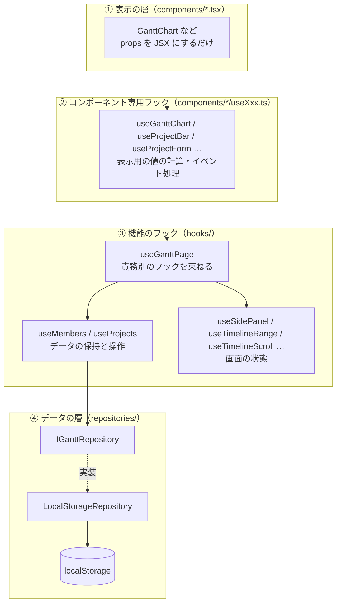
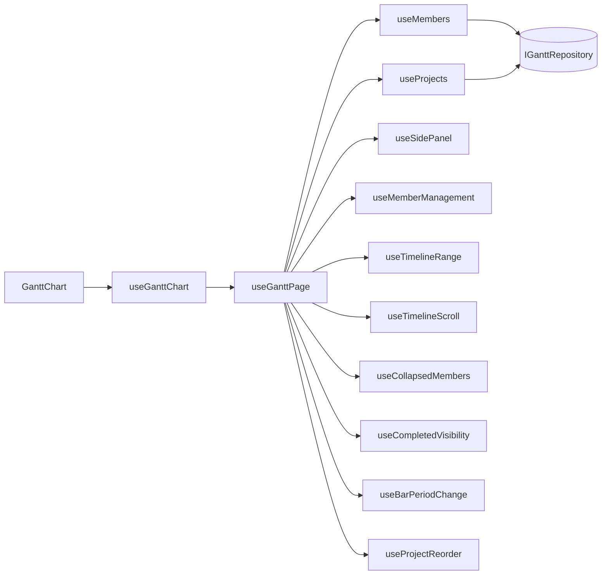
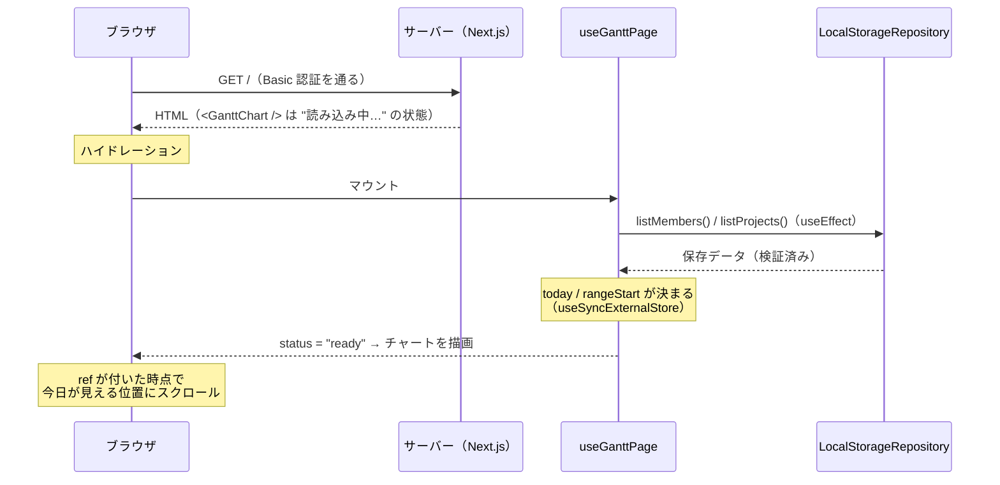
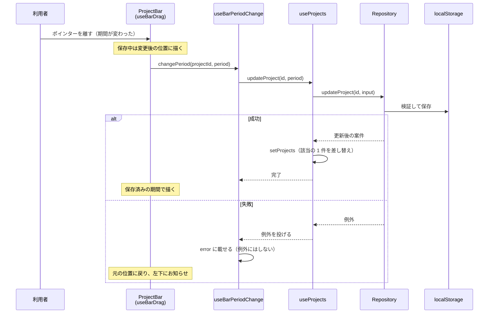
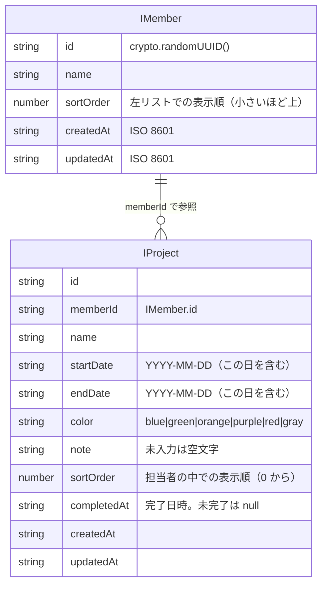

# 全体構成

このプロジェクト全体の「地図」にあたる資料。まずこれを読み、気になる機能の詳細は [機能別の資料](README.md#機能別の資料) に進む。

- 対象: `develop` ブランチ時点のコード（フェーズ 1〜12 完了後）
- 書かれていること: 何を作っているか / 技術構成 / ディレクトリ / 層の分け方 / データの流れ / 状態の持ち場所 / 設計判断の理由 / 用語集 / よくある質問
- 書かれていないこと: 各機能の中身（機能別の資料にある）、開発の経緯（`.plan/handoff.md` にある）

## 目次

1. [このアプリは何か](#1-このアプリは何か)
2. [技術構成](#2-技術構成)
3. [ディレクトリ構成](#3-ディレクトリ構成)
4. [層の分け方（アーキテクチャ）](#4-層の分け方アーキテクチャ)
5. [画面が表示されるまで](#5-画面が表示されるまで)
6. [操作が保存されて画面に反映されるまで](#6-操作が保存されて画面に反映されるまで)
7. [状態の持ち場所の一覧](#7-状態の持ち場所の一覧)
8. [コンポーネントの作り方の約束](#8-コンポーネントの作り方の約束)
9. [データモデル](#9-データモデル)
10. [設計判断とその理由](#10-設計判断とその理由)
11. [テストと検証](#11-テストと検証)
12. [用語集](#12-用語集)
13. [よくある質問](#13-よくある質問)

---

## 1. このアプリは何か

担当者ごとに「いつ・どの案件を作業しているか」を一目で確認・編集できる、シンプルなガントチャート。身内での利用を想定している。

```
┌──────────────────────────────────────────────────────────────────────┐
│ ガントチャート  [◀][今日][▶]  2026年11月            [完了済みを表示(0)] │ ← GanttHeader
├────────────────┬─────────────────────────────────────────────────────┤
│                │ 11月            │ 12月                              │ ← TimelineDateHeader
│  （角）         │ 3 4 5 6 7 8 9 10 11 12 …                            │
├────────────────┼─────────────────────────────────────────────────────┤
│ ▼ 田中   3件    │  ▂▂▂▂▂▂▂▂▂▂▂▂（まとめ帯）                          │ ← 担当者行
│ ⋮⋮ ● Web 改修   │      ┌────────────────┐                            │ ← 案件行
│ ⋮⋮ ● バナー     │               ┌─┐                                  │   （帯 = ProjectBar）
│   ＋ 案件を追加  │                                                    │ ← 「案件を追加」行
│ ▼ 佐藤   3件    │  …                                                 │
│ [担当者を管理]   │                                  今日の線 │         │
└────────────────┴─────────────────────────────────────────────────────┘
        左リスト（MemberList）          右タイムライン（Timeline）
```

できること（コードの入口）:

| 機能                                   | 概要                                       | 詳しい資料                                               |
| -------------------------------------- | ------------------------------------------ | -------------------------------------------------------- |
| 担当者→案件の 2 階層表示               | 左リストと右タイムラインを同じ行構造で描く | [チャートの表示](features/03-chart-layout.md)            |
| 日単位のタイムライン                   | 土日祝の色分け、今日の線、無限スクロール   | [日付と表示期間](features/02-date-and-timeline-range.md) |
| 案件の追加・編集・削除・完了           | 右のサイドパネルで操作                     | [案件の編集](features/04-project-editing.md)             |
| 担当者の追加・名前変更・並び替え・削除 | ダイアログで操作                           | [担当者の管理](features/05-member-management.md)         |
| 帯のドラッグ                           | 移動・左右の端の伸縮で期間を変える         | [帯のドラッグ](features/06-bar-drag.md)                  |
| ドラッグによる並び替え                 | 案件（左リスト）・担当者（ダイアログ）     | [並び替え](features/07-drag-reorder.md)                  |
| データの保存                           | 今は localStorage。将来 Firestore          | [データ層](features/01-data-layer.md)                    |
| 認証・PWA・HTTPS                       | Basic 認証、インストール可能、HTTPS 開発   | [認証・PWA・開発環境](features/08-app-infrastructure.md) |
| 見た目                                 | ダークテーマ、デザイントークン、ボタン     | [スタイリング](features/09-styling.md)                   |

---

## 2. 技術構成

| 用途           | 採用するもの                                       | 備考                                                                                          |
| -------------- | -------------------------------------------------- | --------------------------------------------------------------------------------------------- |
| フレームワーク | Next.js 16（App Router、`src/` 構成）              | `middleware.ts` ではなく `proxy.ts`。`cacheComponents` が有効                                 |
| UI             | React 19                                           | 関数コンポーネント + フック                                                                   |
| 言語           | TypeScript（`strict`、`noUncheckedIndexedAccess`） | `any` 禁止（ESLint でエラー）                                                                 |
| スタイル       | Sass + CSS Modules（`*.module.scss`）              | Tailwind は使わない                                                                           |
| 日付           | date-fns                                           | 祝日は `@holiday-jp/holiday_jp`                                                               |
| カレンダー     | react-day-picker                                   | 日付入力の部品 `DateField` の中だけで使う                                                     |
| データ保存     | localStorage（将来 Firestore）                     | 必ず `IGanttRepository` を経由する                                                            |
| 認証           | Basic 認証のみ（`src/proxy.ts`）                   | ユーザー認証はない                                                                            |
| テスト         | Vitest                                             | 環境は `node`（jsdom は入れていない）                                                         |
| 品質           | ESLint / Prettier                                  | Prettier はセミコロンなし・ダブルクォート・末尾カンマあり                                     |
| パッケージ管理 | pnpm のみ                                          | `npm install` は止まる（[詳細](features/08-app-infrastructure.md#7-pnpm-以外を止める仕組み)） |

主要な依存は `dependencies` に 6 つだけ（`next` / `react` / `react-dom` / `date-fns` / `@holiday-jp/holiday_jp` / `react-day-picker`）。状態管理ライブラリ（Redux・Zustand など）や UI ライブラリは使っていない。

---

## 3. ディレクトリ構成

```
gant-chart/
├── AGENTS.md / CLAUDE.md      # 開発ルール（AI エージェント向けを含む）
├── README.md                  # セットアップ・起動方法
├── docs/                      # この資料
├── .plan/                     # 要件・実装プラン・引き継ぎ資料（開発の経緯）
├── public/
│   ├── sw.js                  # Service Worker（最小限）
│   └── icons/                 # PWA アイコン
├── scripts/
│   ├── check-package-manager.mjs   # pnpm 以外の install を止める
│   └── generate-icons.mjs          # PWA アイコンの生成
└── src/
    ├── proxy.ts               # Basic 認証（全リクエストにかかる）
    ├── proxy.test.ts
    ├── app/                   # ルーティング（page / layout / manifest）
    ├── styles/                # デザイントークン（_tokens.scss）、ボタン mixin、グローバル CSS
    └── features/gantt/        # ガントチャート機能。ここで完結する
        ├── components/        # コンポーネント（1 つにつき 1 ディレクトリ）
        ├── hooks/             # ページ全体・複数コンポーネントで使うフック
        ├── repositories/      # データの読み書き（IGanttRepository と実装）
        ├── utils/             # 機能共通の純粋関数（date / layout / member / reorder / error）
        ├── gantt.type.ts      # データの型
        ├── gantt.constants.ts # 定数（列幅・行の高さ・既定の日数など）
        ├── gantt.guards.ts    # 外から読んだ値を検証する型ガード
        ├── ganttRows.utils.ts # 左右共通の「行モデル」
        └── devSeed.ts         # 開発用のサンプルデータ
```

ポイント:

- **機能に固有のものは `features/gantt/` の中で完結**させる。`src/components` や `src/hooks` のような共有ディレクトリは、複数の機能で使うものが出るまで作らない方針（今は機能が 1 つだけなので存在しない）。
- `app/` は薄い。`page.tsx` は `<GanttChart />` を置くだけで、データの読み込みはクライアント側で行う。
- 型・定数・型ガード・行モデルは、ファイルの接尾辞で役割が分かる（`*.type.ts` / `*.constants.ts` / `*.guards.ts` / `*.utils.ts`）。

### コンポーネントのディレクトリ

`components/` の中は、コンポーネントごとに次の形で揃っている。

```
components/ProjectBar/
├── ProjectBar.tsx            # 描画だけ（props を受け取って JSX にする）
├── useProjectBar.ts          # そのコンポーネント専用のフック（値の計算・className の組み立て・イベント処理）
├── ProjectBar.module.scss    # そのコンポーネントのスタイル
├── barDrag.utils.ts          # そのコンポーネント専用の純粋関数
├── barDrag.utils.test.ts     # その純粋関数のテスト
├── useBarDrag.ts             # さらに分けたフック
└── index.ts                  # バレル（export { ProjectBar } from "./ProjectBar"）
```

他のコンポーネントからは `import { ProjectBar } from "../ProjectBar"` のように **バレル経由**で読む。

コンポーネント一覧（`features/gantt/components/`）:

| ディレクトリ                                              | 役割                                                                   |
| --------------------------------------------------------- | ---------------------------------------------------------------------- |
| `GanttChart`                                              | 画面の最上位。状態の分岐（エラー / 読み込み中 / 表示）と全体の組み立て |
| `GanttHeader`                                             | 上部のバー（タイトル・前へ/今日/次へ・表示中の年月・完了済み切り替え） |
| `MemberList` / `MemberListGroup` / `MemberListProjectRow` | 左のリスト（全体 / 担当者 1 人ぶん / 案件 1 行）                       |
| `Timeline`                                                | 右のタイムライン本体（背景・今日の線・帯を重ねる）                     |
| `TimelineDateHeader` / `TimelineGrid` / `TodayLine`       | 日付ヘッダー / 背景の縦線 / 今日の線                                   |
| `ProjectBar` / `MemberSummaryBar`                         | 案件の帯 / 担当者行のまとめ帯                                          |
| `ProjectSidePanel`                                        | 案件の追加・編集のサイドパネル                                         |
| `DateField`                                               | 日付入力（カレンダー付き）                                             |
| `ConfirmDialog`                                           | 削除などの確認ダイアログ                                               |
| `MemberManageDialog` / `MemberManageRow`                  | 担当者の管理ダイアログ / その 1 行                                     |
| `DragHandle`                                              | 並び替えのつかみ（⋮⋮）                                                 |
| `Button`                                                  | 標準の見た目のボタン                                                   |

---

## 4. 層の分け方（アーキテクチャ）

大きく 4 つの層に分かれ、**上の層は下の層だけを知っている**。



| 層             | 置き場所                 | 持つもの                                                                                                             | 持たないもの                                            |
| -------------- | ------------------------ | -------------------------------------------------------------------------------------------------------------------- | ------------------------------------------------------- |
| ① 表示         | `components/*/Xxx.tsx`   | JSX、props のバインド、`map` による繰り返し                                                                          | 計算・条件の組み立て・className の組み立て・`useEffect` |
| ② 専用フック   | `components/*/useXxx.ts` | そのコンポーネントの表示用の値、イベント処理、`className`                                                            | 他のコンポーネントでも使うロジック                      |
| ③ 機能のフック | `hooks/`                 | データの保持（`useMembers` / `useProjects`）、画面の状態（パネル・期間・スクロール）、それらの結線（`useGanttPage`） | UI（フックは JSX を返さず、状態と操作だけを返す）       |
| ④ データ       | `repositories/`          | 保存先とのやり取り、検証、移行                                                                                       | React（フックにも触れない）                             |

### 依存の向きに関する約束

- **コンポーネントやフックは localStorage に直接触らない**。必ず `IGanttRepository` を経由する（保存先を Firestore に替えても呼び出し側を変えないため）。
- **repository を作るのは 1 か所だけ**（`repositories/createGanttRepository.ts`）。`useGanttPage.ts` がモジュールの先頭で 1 回だけ生成する。
- **純粋関数は `*.utils.ts` に出す**。副作用がなく入出力だけで決まる処理（日付計算、ドラッグの状態遷移、検証など）は、フックから切り出してテストしやすくする。

### `useGanttPage` を中心にした結線

`GanttChart` が使う唯一の入口は `useGanttChart` で、その中で `useGanttPage` が各フックを束ねる。



- `useGanttPage` は「束ねる」ことと、データから画面用の値（`memberGroups` / `columns` など）を計算することに専念する。
- `useGanttChart` は `useGanttPage` の結果から、画面の状態（`error` / `loading` / `ready`）と描画用の値（行のまとまり、スタイルなど）を組み立てる。

---

## 5. 画面が表示されるまで

ブラウザで `/` を開いてからチャートが出るまでの流れ。**データも「今日」の日付も、ブラウザでしか決まらない**のがポイント。



1. **サーバー側の描画**: `app/page.tsx` は `<GanttChart />`（`"use client"`）を置くだけ。サーバーでは localStorage も現在時刻も使えない（`cacheComponents` が有効で、現在時刻を静的な部分に焼き込まないようにしているため）ので、`useGanttChart` は `status: "loading"` を返し、「読み込み中…」を出す。
2. **データの読み込み**: マウント後の `useEffect` で、`useMembers` / `useProjects` が repository から一覧を読む。`null` は「まだ読み込めていない」、`[]` は「0 件」と区別している。
3. **今日の日付**: `useTimelineRange` が `useSyncExternalStore` で決める。サーバー側のスナップショットは `null`、ブラウザでは今日の日付。
4. **表示可能になる条件**: 担当者・案件・`rangeStart`・`today`・`columns` がすべて `null` でなくなったとき `status: "ready"`。
5. **初期スクロール**: スクロール領域に `ref`（`attachScroller`）が付いた瞬間に、今日が見える位置（今日の 7 日前が左端）へ `scrollLeft` を設定する。
6. **エラー**: 保存データが壊れている・新しすぎるなどで読めないときは `status: "error"` となり、「データを読み込めませんでした」と再読み込みボタンを出す（[データ層](features/01-data-layer.md#8-エラーの種類と画面での扱い)）。

---

## 6. 操作が保存されて画面に反映されるまで

どの操作も **同じパターン**に従っている。これを押さえると、個別の機能も読みやすい。

> **保存に成功してから、手元の state を更新する。失敗したら state を変えず、エラーを表示する。**

例: 帯をドラッグして期間を変える。



操作ごとの「失敗の見せ方」の違い:

| 操作                             | 失敗を受け取る場所                       | 画面での見え方                                            |
| -------------------------------- | ---------------------------------------- | --------------------------------------------------------- |
| 案件の保存・削除（サイドパネル） | `useProjectForm` の `submitError`        | パネル内に「保存できませんでした。…」、パネルは開いたまま |
| 担当者の操作（管理ダイアログ）   | `useMemberManageDialog` の `actionError` | ダイアログ内に表示                                        |
| 帯のドラッグ                     | `useBarPeriodChange` の `error`          | 左下のお知らせ + 帯が元の位置に戻る                       |
| 案件の並び替え                   | `useProjectReorder` の `error`           | 左下のお知らせ + 元の並びに戻る                           |
| 読み込み                         | `useMembers` / `useProjects` の `error`  | 全画面のエラーと再読み込みボタン                          |

---

## 7. 状態の持ち場所の一覧

「この値はどこにあって、どこから変わるのか」の早見表。**保存されるのはデータ（担当者・案件）だけ**で、見た目の状態は再読み込みで初期値に戻る。

| 状態                       | 持つフック                  | 保存           | 初期値                    | 備考                                                       |
| -------------------------- | --------------------------- | -------------- | ------------------------- | ---------------------------------------------------------- |
| 担当者の一覧 `members`     | `useMembers`                | ○ localStorage | `null`（未読込）          |                                                            |
| 案件の一覧 `projects`      | `useProjects`               | ○ localStorage | `null`（未読込）          |                                                            |
| サイドパネルの状態         | `useSidePanel`              | ×              | 閉じている                | 追加 / 編集 / 閉じている の 3 通り。編集対象は ID だけ持つ |
| 担当者管理ダイアログの開閉 | `useMemberManagement`       | ×              | 閉じている                |                                                            |
| 折りたたみ中の担当者       | `useCollapsedMembers`       | ×              | 全員開いている            | ID の `Set`                                                |
| 完了済みを表示するか       | `useCompletedVisibility`    | ×              | 表示しない                |                                                            |
| 表示期間（開始日・日数）   | `useTimelineRange`          | ×              | 今日の 60 日前から 180 日 | スクロールで広がる（縮まない）                             |
| 今日の日付                 | `useTimelineRange`          | ×              | その日の日付              | 日付が変わると更新                                         |
| 画面の左端の日付           | `useTimelineScroll`         | ×              | `null`                    | ヘッダーの年月表示用                                       |
| 帯のドラッグ中の状態       | `useBarDrag`（帯 1 本ごと） | ×              | なし                      |                                                            |
| 並び替えのドラッグ中の状態 | `useDragReorder`            | ×              | なし                      |                                                            |
| フォームの入力値           | `useProjectForm`            | ×              | 案件の値 / 今日           |                                                            |

派生できる値は state にしていない。たとえば `memberGroups`（担当者ごとの案件のまとまり）、`columns`（日の列）、`rowGroups`（行モデル）は、毎回 `useMemo` で計算している（`React.memo` のコンポーネントの再描画を避けるため参照を保つ目的）。

---

## 8. コンポーネントの作り方の約束

[AGENTS.md](../AGENTS.md) に定められている約束のうち、コードを読むときに効くもの。

1. **tsx は「受け取った値を描画するだけ」**。値の計算、条件の組み立て、`className` の組み立て、`useId`、`useEffect` などは、専用フック（`useXxx.ts`）で行い、描画用の値を返す。tsx に残してよいのは、props を JSX に渡すこと、`map` による繰り返し、`props` のコールバックを呼ぶだけのイベント結線まで。
2. **フックは UI を返さず、状態と操作だけを返す**。返す関数は `useCallback` で参照を安定させる。戻り値は関連するものをグループ化してコメントを付ける。
3. **`useEffect` は最小限**。副作用の登録と解除は同じ `useEffect` の中で完結させる（`window` のイベント登録など）。
4. **`React.memo` を保つ**: 重い部分（左リスト・タイムライン・日付ヘッダー）は `memo` 済み。そのため、渡す関数は参照が変わらないもの（`useCallback`）、配列は `useMemo` で保つ。
5. **ref を含む戻り値は分割代入**: lint の `react-hooks/refs` が、ref を含むオブジェクトのプロパティ参照を「描画中の ref 参照」と誤検知するため、ref のコールバックを返すフックの結果は `const { rowRef, ... } = useXxx()` のように分割代入して使っている。コード中に同じ趣旨のコメントが何か所もある。
6. **外から来た値は `unknown` で受けて型ガードで絞る**（`gantt.guards.ts`）。型アサーション（`as`）や `@ts-ignore` は使わない。
7. **日付は `"YYYY-MM-DD"` の文字列、日時は ISO 8601 の文字列**で持つ。`Date` オブジェクトは保存せず、計算の内側でだけ使う。

---

## 9. データモデル

データは **2 つのフラットなコレクション**（`members` と `projects`）。案件は `memberId` で担当者を参照する。Firestore にそのまま移せる形にしてある。



- `IProject.sortOrder` は **担当者ごとに 0 から**振る。担当者で絞って `sortOrder` で並べるだけで表示順が決まる（Firestore でも同じ）。
- `completedAt` を真偽値にせず日時にしているのは、いつ完了したかを後から表示（「完了済み（10/30）」）・並べ替えに使えるようにするため。
- 保存先のキーは `gantt:members` / `gantt:projects` / `gantt:schemaVersion`（現在のバージョンは 3）。

型の詳細・保存の仕組みは [データ層](features/01-data-layer.md) を参照。

---

## 10. 設計判断とその理由

「なぜそうなっているのか」を聞かれたときの答え。

| 判断                                                   | 理由                                                                                                   | 詳細                                                                              |
| ------------------------------------------------------ | ------------------------------------------------------------------------------------------------------ | --------------------------------------------------------------------------------- |
| すべての repository メソッドが `Promise` を返す        | localStorage は同期だが、Firestore（API 経由）は非同期。差し替えても呼び出し側を変えずに済ませるため   | [データ層](features/01-data-layer.md)                                             |
| 保存成功後に state を更新する（楽観的更新をしない）    | 失敗したときに「画面と保存データがずれる」状態を作らないため。ドラッグ系だけは保存中の見た目を別に持つ | [全体 §6](#6-操作が保存されて画面に反映されるまで)                                |
| 壊れた保存データは「空」として扱わず、読み書きを止める | 空として続けると、次の書き込みで正常だった分も上書きして失うため                                       | [データ層](features/01-data-layer.md#6-壊れたデータの扱い)                        |
| 日付を文字列で持つ                                     | タイムゾーンのずれを避け、JSON / Firestore との相互変換を単純にするため                                | [日付と表示期間](features/02-date-and-timeline-range.md#2-日付を文字列で持つ理由) |
| 左リストとタイムラインを 1 つのスクロール領域に入れる  | 縦横のスクロールが自然にそろい、JavaScript で同期しなくて済むため（左は `sticky`）                     | [チャートの表示](features/03-chart-layout.md#2-1-つのスクロール領域に入れる理由)  |
| 左右の行を 1 つの「行モデル」から描く                  | 折りたたみや行の並びを左右で別々に組み立てると、片側だけ直したときに行がずれるため                     | [チャートの表示](features/03-chart-layout.md#5-行モデル左右をそろえる仕組み)      |
| 表示期間を「広げるだけ」の無限スクロールにする         | 縮めると表示位置とずれる。広げる側は、見ている位置を保つようスクロール位置を補正する                   | [日付と表示期間](features/02-date-and-timeline-range.md#7-無限スクロールの仕組み) |
| ドラッグを `window` のイベントで受ける                 | 帯や行の外にポインターが出ても、離した操作を受け取るため                                               | [帯のドラッグ](features/06-bar-drag.md)                                           |
| ドラッグの状態遷移を純粋関数に切り出す                 | jsdom を入れず node 環境で、ポインターイベントなしに状態遷移をテストできるため                         | [帯のドラッグ](features/06-bar-drag.md)                                           |
| サイドパネルは編集対象の「中身」を持たず ID だけ持つ   | 保存や他の操作でデータが変わっても、パネルの表示とずれないようにするため                               | [案件の編集](features/04-project-editing.md)                                      |
| 基本のボタンの見た目を `button` 要素に当てない         | 専用の見た目の部品（帯・つかみ・カレンダー）が個別に打ち消す必要をなくすため                           | [スタイリング](features/09-styling.md#6-ボタン)                                   |
| Basic 認証のみ（ユーザー認証なし）                     | 身内利用で、最小の仕組みで十分なため                                                                   | [認証・PWA・開発環境](features/08-app-infrastructure.md)                          |
| `proxy.ts` が他のモジュールに依存しない                | Next.js の推奨（proxy は独立させる）に合わせ、認証に必要な関数をこのファイルの中で完結させている       | [認証・PWA・開発環境](features/08-app-infrastructure.md#2-basic-認証srcproxyts)   |

---

## 11. テストと検証

### コマンド

| コマンド            | 内容                                 |
| ------------------- | ------------------------------------ |
| `pnpm lint`         | ESLint（`any` 禁止などを含む）       |
| `pnpm typecheck`    | `next typegen` の後に `tsc --noEmit` |
| `pnpm test`         | Vitest（約 300 件）                  |
| `pnpm format:check` | Prettier の整形チェック              |
| `pnpm build`        | 本番ビルド                           |

### テストの方針

- **環境は `node`**（jsdom を入れていない）。React コンポーネントやフックそのもののテストはない。
- そのため、**ロジックは純粋関数に切り出してテストする**:
  - 日付・座標: `utils/date.utils.test.ts` / `utils/layout.utils.test.ts`
  - 担当者・案件のまとまり: `utils/member.utils.test.ts`
  - 並び替えの計算: `utils/reorder.utils.test.ts` / `hooks/dragReorder.utils.test.ts`
  - 帯のドラッグの状態遷移: `components/ProjectBar/barDrag.utils.test.ts`
  - 行モデル: `ganttRows.utils.test.ts`
  - フォームの検証: `components/ProjectSidePanel/projectForm.utils.test.ts`
  - 型ガード: `gantt.guards.test.ts`
- **repository は `Storage` のモックを渡してテストする**（`localStorageRepository.test.ts`。約 65 ケース。移行・壊れたデータ・書き込み失敗時の復元を含む）。
- **Basic 認証**は `proxy.test.ts`（21 ケース）。
- フックと画面の配線（イベントの順序、`window` への登録など）は、**ブラウザでの手動確認**で見ている。

---

## 12. 用語集

| 用語               | 意味                                                                                                                        |
| ------------------ | --------------------------------------------------------------------------------------------------------------------------- |
| 担当者             | `IMember`。左リストの親の行                                                                                                 |
| 案件               | `IProject`。担当者に属し、期間（開始日〜終了日）を持つ。タイムライン上では「帯」になる                                      |
| 帯                 | 案件の期間を示すタイムライン上の横長の要素（`ProjectBar`）                                                                  |
| まとめ帯           | 担当者行に出す、配下の案件をまとめた細い帯（`MemberSummaryBar`）。折りたたみ中でも予定が分かる                              |
| 表示期間           | タイムラインに用意した日付の範囲（`rangeStart` と `rangeDays`）。スクロールで広がる                                         |
| 日の列             | 1 日分の縦の列（`IDayColumn`）。幅は `DAY_COLUMN_WIDTH`（32px）                                                             |
| 行モデル           | 左リストとタイムラインが共有する、行の種別・順序・高さの定義（`ganttRows.utils.ts`）                                        |
| 担当者のまとまり   | `IMemberGroup`。担当者とその配下の案件（表示順）。`memberGroups` は画面に出すもの、`allMemberGroups` は完了済みも含めた全体 |
| 完了               | `completedAt` に日時が入った状態。既定ではチャートから隠れる（「完了済みを表示」で表示できる）                              |
| つかみ             | 並び替え用の「⋮⋮」（`DragHandle`）。帯の左右の端にある、伸縮用の細い領域も「つかみ」と呼ぶ                                  |
| スキーマバージョン | 保存データの構造の版（`CURRENT_SCHEMA_VERSION`）。構造を変えたら上げて移行処理を足す                                        |
| repository         | データの読み書きの窓口（`IGanttRepository`）。実装は `LocalStorageRepository`                                               |
| トークン           | `_tokens.scss` に集めたデザインの値（色・余白・サイズなど）                                                                 |

---

## 13. よくある質問

**Q. データはどこに保存されていますか？ 他の人と共有できますか？**
ブラウザの localStorage（`gantt:members` / `gantt:projects`）です。ブラウザや端末が違えば別のデータになり、共有されません。共有したくなったら、Firestore への移行が必要です（[データ層](features/01-data-layer.md#11-firestore-への移行の道筋)）。

**Q. 2 つのタブで同時に編集するとどうなりますか？**
他のタブの変更は画面に反映されず、古い画面で保存すると他のタブの変更を上書きすることがあります。今は「同時編集はしない」前提で、意図的に対応していません。Firestore 移行時の宿題として [`.plan/14-firestore-migration-todo.md`](../.plan/14-firestore-migration-todo.md) にまとめています。

**Q. なぜ Redux などの状態管理ライブラリがないのですか？**
状態は「機能のフック + props」で足りています。props の受け渡しが深くなった場合だけ store を導入する、という方針です（今は不要）。

**Q. なぜフックがこんなに細かく分かれているのですか？**
1 つのフックの責務を 1 つに保つためです。たとえば `useGanttPage` は束ねるだけで、保存・エラー・ドラッグの細かい処理は `useBarPeriodChange` や `useProjectReorder` などが持ちます。

**Q. テストがコンポーネントにないのはなぜですか？**
jsdom を入れず node 環境でテストする方針のためです。代わりに、状態遷移などのロジックを純粋関数に切り出してテストしています。画面の配線はブラウザで確認しています。

**Q. 本番ではどうなりますか？ 認証は？**
`BASIC_AUTH_USER` / `BASIC_AUTH_PASSWORD` を設定して公開します。**未設定のまま本番で起動すると、すべてのアクセスを 401 で拒否**します（設定し忘れて公開してしまうのを防ぐため）。詳しくは [認証・PWA・開発環境](features/08-app-infrastructure.md) を参照してください。

**Q. スマホでも使えますか？**
閲覧はできる想定で、狭い画面向けの調整（左リストの縮小、ヘッダーの短縮）はありますが、タッチ操作や実機での確認はしていません。スマホはあまり想定していない、というのが現在の扱いです。
